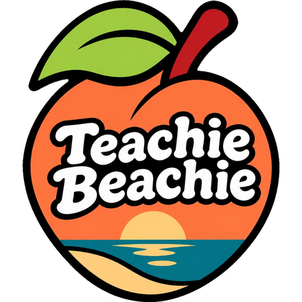
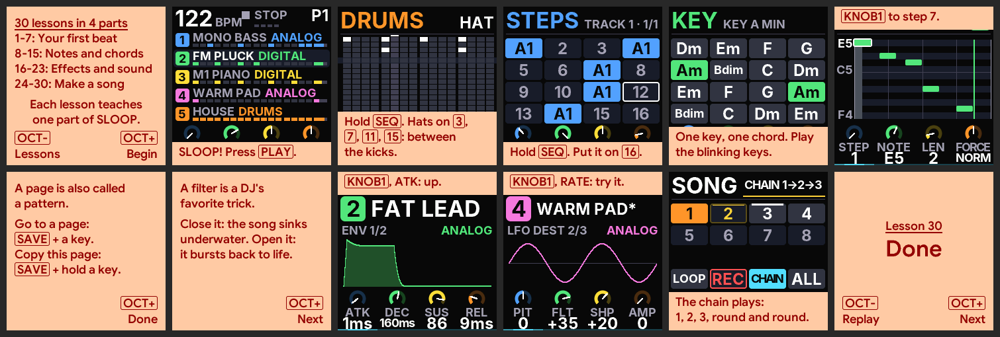

# Teachie Beachie



**Thirty lessons that teach the M-VAVE FM-1, on the FM-1 itself.** Built on
[SLOOP 3](https://github.com/isod89/sloop3-fm1), the free groovebox firmware for the FM-1.

Teachie Beachie teaches kids, and any beginner, to make music on the M-VAVE FM-1. You don't need to read music or
open a manual: every lesson shows you what to press, right on the FM-1's screen.

A lesson puts a short card on the screen, lights up the button or key to press, and waits while you try it. If you
get stuck it offers a hint, and it can even do the step for you. Each lesson takes a few minutes and builds on the
one before.

There are thirty lessons in four parts: Your first beat, Notes and chords, Effects and sound, Make a song. By lesson
7 you have made a beat of your own. By lesson 30, a whole song.

Teachie Beachie is free, and once it is installed no computer is needed. It is built on SLOOP 3, a complete
groovebox, which stays when the lessons are done.

I made Teachie Beachie for my kids, nieces and nephews, as part of a Christmas present. If you have kids who would
like to learn how to use a groovebox and the FM-1, I'd encourage you to give Teachie Beachie a try.

> **⚠ A beta, and unofficial.** Teachie Beachie runs SLOOP 3, which is a public beta, and adds new code of its own.
> It is not made, endorsed or supported by M-VAVE or by the SLOOP project. Installing third-party firmware is at
> your own risk. **Keep the backup the installer makes.**



**[Install it from your browser →](https://davydegravy.github.io/teachie-beachie-fm1/)** (Chrome or Edge, a USB data
cable, through m-bootloader)

## The lessons

Thirty lessons in four parts. Each lesson teaches one part of SLOOP and takes a few minutes.

| Part | Lessons |
|---|---|
| **1. Your first beat** | 1 Hello · 2 Sixteen boxes · 3 Kick, snare, hat · 4 The drum kit · 5 Meet the tracks · 6 Faster, slower, oops · 7 Your own beat |
| **2. Notes and chords** | 8 A bass line in boxes · 9 Pick your sound · 10 Record it live · 11 No wrong notes · 12 One-finger chords · 13 The piano roll · 14 Mix the tracks · 15 Your own loop |
| **3. Effects and sound** | 16 Eight pages · 17 Fills and rolls · 18 Play the effects · 19 Echo and space · 20 Color a track · 21 Shape a sound · 22 Wobble and arps · 23 Your own piece, live |
| **4. Make a song** | 24 Songs have parts · 25 Chain the pages · 26 Write it line by line · 27 Build-ups and drops · 28 Swing and feel · 29 Keep it and share it · 30 The final test |

## How a lesson works

- **The start card.** When the FM-1 starts, a card asks "Ready for a lesson?" <kbd>OCT+</kbd> starts one.
  <kbd>OCT-</kbd> goes straight to SLOOP 3, which is all there and works as always.
- **Cards and strips.** A peach card explains one idea. A strip across the top or bottom says what to do while
  SLOOP's own page stays live underneath. SLOOP's pages are dark, so you always know which is which.
- **Lights.** The button or key to press blinks.
- **It checks your work.** When you have done what the step asks, the lesson moves on by itself.
- **Hints.** If a step takes a while, a hint appears. If you are still stuck, the lesson offers to do the step for
  you.
- **One song.** Every lesson works on HOUSE ONE, a song written for the course, so each lesson adds to what you
  already know.
- **Any lesson, any time.** The first card of the course opens the list of all thirty.

The lessons run on the FM-1 alone. No computer is needed after the install.

## With an AI assistant

The lessons are plain text files, written to be read by people and by AI. Open this project on a computer, in an AI
assistant that works with files, and you have a tutor for the learner, a lesson writer for you, and a second pair of
hands on the FM-1. Teachie Beachie was built and tested this way.

- **Ask about any step.** The assistant knows every lesson: each step, its hints, and what usually goes wrong.
- **Control the FM-1.** With the FM-1 plugged in, the assistant can work it: load a lesson's song, press play, change
  the tempo, write notes, light up a button. It can show a move, or set up a practice round.
- **Change a lesson.** It rewrites a confusing card, checks that the words fit the FM-1's screen, tests the lesson
  on a simulated FM-1, and sends it to yours.
- **Write your own.** A new lesson is one more text file, tested the same way.

[tutorial/AI.md](tutorial/AI.md) says how to set it up and what to ask. [AGENTS.md](AGENTS.md) is what the assistant
reads first. Any assistant that can read files and run commands will do.

## Install

Teachie Beachie installs from one web page over USB MIDI, through
[m-bootloader](https://github.com/jvitkauskas/m-bootloader). m-bootloader is a small free program that sits under the
firmware: it checks every firmware before starting it, and if an install is interrupted the FM-1 opens a recovery menu
instead of getting stuck.

You need an FM-1, a USB data cable, and Chrome or Edge. The page walks you through six steps:

1. **Before you start:** what a beta means and what you need.
2. **The safety net: m-bootloader, once.** The page shows how to check whether it is there (hold PLAY at power-on)
   and how to set it up if it is not.
3. **Connect:** hold PLAY at power-on, choose MIDI MODE, plug it in. The page finds the FM-1 by itself.
4. **Back up:** the whole FM-1 (1 MB), saved as a file. Nothing is written.
5. **Install:** about a minute. The package is checked before anything is erased.
6. **Lessons:** the FM-1 restarts on Teachie Beachie, and one button sends the thirty lessons. They go into a sample
   slot that holds no samples; if all four of yours are full, the page asks which one to give up.

**Newer lessons, later:** in step 1 of the page, "send the lessons only" updates the lessons on an FM-1 that already
runs Teachie Beachie, without installing again.

**Going back:** restore the backup from step 4 with [M-Flasher](https://github.com/jvitkauskas/m-flasher), or install
SLOOP 3 from [its own page](https://isod89.github.io/sloop3-fm1/).

## What is SLOOP's and what is Teachie Beachie's

The instrument is SLOOP 3: the sound engines, the sequencer, the effects, every page and the web editor. Teachie
Beachie is built on SLOOP 3.3.7 and adds:

- the lessons, their player inside the firmware and the start card;
- the lights, cards and checks a lesson uses;
- the lessons step of the installer page, and the page's own look;
- the tools that write, measure, pack and test the lessons ([tutorial/](tutorial/)).

One thing is left out to make room: SLOOP 3 opens the project SLOOP 2.8 left at its first start, and Teachie Beachie
does not. Your SLOOP 2.8 presets, favorites, samples, kits and settings still come along.

For everything about the instrument itself, see SLOOP 3's [guide](docs/GUIDE.md), its
[repository](https://github.com/isod89/sloop3-fm1) and its
[web editor](https://isod89.github.io/sloop3-fm1/editor.html), which works with Teachie Beachie too.

## Good to know

- The FM-1 does not yet remember which lesson you reached when it is switched off. Pick your lesson from the list.
- The lessons are in English.
- Teachie Beachie is new and has been tried by few people. Please report what you find in the
  [issues](../../issues), with the lesson and the step. Problems with the instrument itself, with no lesson running,
  are more likely SLOOP 3's.

## Building

### On a PC: the tests, the simulated FM-1

Any C11 compiler (gcc or clang) on Linux or macOS, Python 3 with NumPy and Pillow for the tools, Node.js for the
page tests.

```sh
make test                      # SLOOP 3's tests: the sound, the sequencer, the saves, MIDI, the screens
make twin                      # after fw/build.sh: the whole firmware on a simulated FM-1
python3 tutorial/check.py      # every lesson read, and its words measured against the FM-1's screen
python3 tutorial/device.py     # all thirty lessons played through on simulated FM-1s that lead themselves
```

### The firmware and the installer page

You need the [pi32v2 LLVM toolchain](https://github.com/jvitkauskas/pi32v2-llvm), release `pi32v2-23.1.5-2`. Nothing
from JieLi is needed. On Linux x86-64:

```sh
curl -fLo toolchain.tar.xz https://github.com/jvitkauskas/pi32v2-llvm/releases/download/pi32v2-23.1.5-2/pi32v2-llvm-23.1.5-2-linux-x64.tar.xz
echo 'cb896562418a2be93edb9bac26af4bc81a106a32974002a78e6b9fc203c93990  toolchain.tar.xz' | sha256sum -c
mkdir toolchain && tar -xJf toolchain.tar.xz -C toolchain --strip-components=1
fw/build.sh                                            # or: fw/build.sh /path/to/toolchain/bin
```

This writes `build/fw/installer-fm1.html`: the installer page, one file, with the firmware and the thirty lessons
inside. The build checks the page against a simulated m-bootloader (`tests/install_sim.js`), and its lessons step
against a fake FM-1 and the simulated one (`tests/lessons_sim.js`).

### Writing lessons

A lesson is one Markdown file in [tutorial/lessons/](tutorial/lessons/); its
[README](tutorial/lessons/README.md) says how one is written. [tutorial/PLAN.md](tutorial/PLAN.md) is the plan of
the course, and [tutorial/NOTES.md](tutorial/NOTES.md) is the day-by-day record of what was tried.

## Source

| Path | What |
|---|---|
| `tutorial/` | Teachie Beachie: the plan, the thirty lessons, their song, and the programs that run and test them |
| `fw/course.inc`, `app/tp_course.h` | the lessons' player inside the firmware |
| `tools/mkcourse.py`, `tools/teachie_page.py`, `web/teachie_lessons.js` | the lessons packed for the FM-1, and the installer page under Teachie Beachie's name with its lessons step |
| `engine/`, `seq/`, `app/`, `fw/`, `hal/fm1/`, `core/` | SLOOP 3: the sound, the sequencer, the interface, the firmware's entry and the FM-1's hardware layer |
| `host/` | the simulated FM-1 (SLOOP 3's PC twin) and its scenarios |
| `web/`, `tools/`, `tests/`, `assets/` | SLOOP 3's installer page and web editor, its tools, its tests, the factory samples and the fonts |

## Credits and licenses

- **Teachie Beachie** is free software under the GPL-3.0 (see [LICENSE](LICENSE)), as SLOOP 3 is.
- **SLOOP 3** is by the SLOOP project ([github.com/isod89/sloop3-fm1](https://github.com/isod89/sloop3-fm1),
  GPL-3.0). The values of its factory sounds, kits and presets are SLOOP 2.8.5's
  ([github.com/isod89/sloop-fm1](https://github.com/isod89/sloop-fm1), GPL-3.0), whose earlier versions were based on
  Felucca by Leo Kuroshita (Hügelton Instruments). The SLOOP project does not make or support Teachie Beachie.
- [m-bootloader](https://github.com/jvitkauskas/m-bootloader), [M-Flasher](https://github.com/jvitkauskas/m-flasher)
  and the [pi32v2 LLVM toolchain](https://github.com/jvitkauskas/pi32v2-llvm) are by Julius Vitkauskas (MIT). None of
  their code is included: the installer page speaks m-bootloader's MIDI MODE protocol as its specification describes.
- The factory samples: CC0 recordings from VCSL and VSCO-2 Community Edition (Versilian Studios / Sam Gossner) and the
  Sonic Pi sample set ([assets/CREDITS-SAMPLES.txt](assets/CREDITS-SAMPLES.txt)).
- SLOOP 3's screen fonts are rendered from [Inter](https://github.com/rsms/inter), SIL Open Font License 1.1
  ([assets/fonts/OFL-Inter.txt](assets/fonts/OFL-Inter.txt)).
- The lessons' cards and the installer page use Google Sans, © 2025 The Google Sans Project Authors, SIL Open Font
  License 1.1 ([assets/fonts/google-sans/OFL.txt](assets/fonts/google-sans/OFL.txt)). "Google Sans" is a trademark of
  Google LLC.
- M-VAVE and FM-1 are names of their owner, used here only to say what this runs on.
