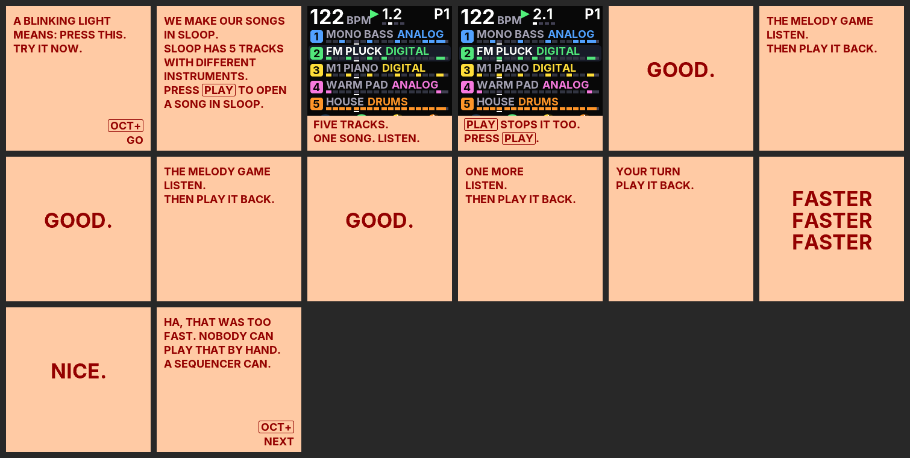

# Lesson 1: Hello

- **Part:** 1, your first beat
- **The idea:** a blinking light means "press this". SLOOP has five tracks.
- **The learner does:** starts and stops a song with PLAY, plays the melody game, and meets a run nobody can play by hand.
- **Got it when:** they start and stop the song without help.
- **Song:** HOUSE ONE, section C (the whole band).
- **Phrase RUN:** A3 C4 E4 A4 C5 E5 C5 A4 E4 C4 A3 C4 E4 A4 C5 E5 C5 A4 E4 C4 A3 E4 A4 E5

## Steps

1. **Setup:** song HOUSE ONE section C; track lead
2. **Card:** A BLINKING LIGHT MEANS: PRESS THIS. / TRY IT NOW.
   - **OCT+:** GO
3. **Card:** WE MAKE OUR SONGS IN SLOOP. / SLOOP HAS 5 TRACKS WITH DIFFERENT INSTRUMENTS. / PRESS [PLAY] TO OPEN A SONG IN SLOOP.
   - **Do:** press PLAY
   - **Until:** playing
4. **Strip:** FIVE TRACKS. / ONE SONG. LISTEN.
   - **Wait:** 4 bars
5. **Strip:** [PLAY] STOPS IT TOO. / PRESS [PLAY].
   - **Do:** press PLAY
   - **Until:** stopped
6. **Reply:** GOOD.
7. **Card:** THE MELODY GAME / LISTEN. / THEN PLAY IT BACK.
   - **Play:** A4 C5 E5
   - **Echo:** A4 C5 E5
8. **Reply:** GOOD.
9. **Card:** THE MELODY GAME / LISTEN. / THEN PLAY IT BACK.
   - **Play:** A4 B4 C5 D5 E5
   - **Echo:** A4 B4 C5 D5 E5
10. **Reply:** GOOD.
11. **Card:** ONE MORE / LISTEN. / THEN PLAY IT BACK.
    - **Play:** RUN fast
12. **Card:** YOUR TURN / PLAY IT BACK.
    - **Echo:** A3 C4
13. **Big:** FASTER / FASTER / FASTER
    - **Keys:** silent
    - **Do:** tap E4 or any key
14. **Play:** RUN fast
    - **Keys:** silent
15. **Reply:** NICE.
16. **Card:** HA, THAT WAS TOO FAST. NOBODY CAN PLAY THAT BY HAND. / A SEQUENCER CAN.
    - **OCT+:** NEXT

## Screens

The lesson's cards and strips in order, from the robot's run on the simulated FM-1.

## Notes for Claude

- The first two keys of the fast run are real: the learner plays them and hears them. From FASTER on, the keys are
  silent and any key sets the run off, so it sounds as if the learner played it.
- If the learner laughs or looks puzzled at the fast run, that is the point. Don't explain the joke before step 16.
- Lesson 22 pays this off: the arpeggiator plays the same run.

## Tester notes

