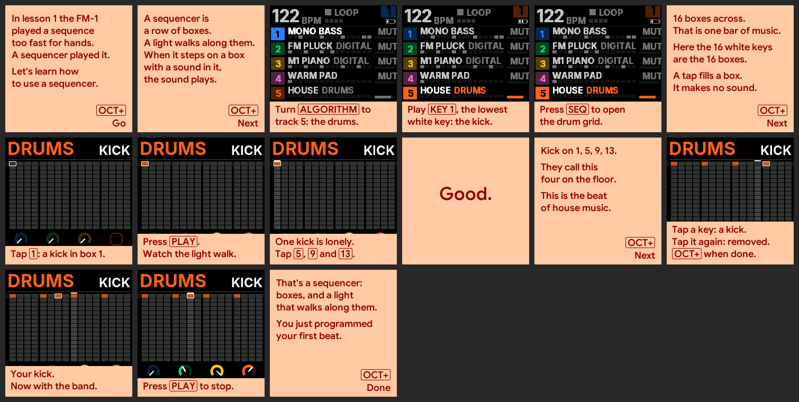

# Lesson 2: Sixteen boxes

- **Part:** 1, your first beat
- **The idea:** a sequencer is a row of boxes and a walking light.
- **The learner does:** picks the drum track, plays the kick, opens the drum grid, and puts a kick in boxes 1, 5, 9 and 13.
- **Got it when:** the four kicks are in, and they can say what the walking light does.
- **Song:** HOUSE ONE, section C, its first bar. The drums start empty and the band is muted until the end.
- **Style in the end:** house (this is the lesson the house beat belongs to)
- **Tied to the song:** boxes 1, 5, 9 and 13. Any style with a kick on every beat works.

## Steps

1. **Setup:** song HOUSE ONE section C, 1 bar; drums empty; mute bass lead chords pad; track bass; page TRACKS
2. **Card:** In lesson 1 the FM-1 / played a sequence / too fast for hands. / A sequencer played it. // Let's learn how / to use a sequencer. *(beginners only)*
   - **OCT+:** Go
3. **Card:** A sequencer is / a row of boxes. / A light walks along them. / When it steps on a box / with a sound in it, / the sound plays. *(beginners only)*
   - **OCT+:** Next
4. **Strip:** Turn [ALGORITHM] to track 5: the drums.
   - **Do:** turn ALGORITHM right 4
   - **Until:** track is drums
   - **Hint:** Keep turning until / track 5 is lit.
5. **Strip:** Play [KEY 1], the lowest / white key: the kick.
   - **Do:** tap box 1
   - **Page:** TRACKS
6. **Strip:** Press [SEQ] to open / the drum grid.
   - **Do:** press SEQ
   - **Until:** page is STEPS
7. **Card:** 16 boxes across. / That is one bar of music. // Here the 16 white keys / are the 16 boxes. // A tap fills a box. / It makes no sound.
   - **OCT+:** Next
8. **Strip:** Tap [1]: a kick in box 1.
   - **Do:** tap box 1
   - **Until:** drums has KICK on box 1
   - **Hint:** Tap the blinking key.
   - **Page:** STEPS
9. **Strip:** Press [PLAY]. / Watch the light walk.
   - **Do:** press PLAY
   - **Until:** playing
   - **Wait:** 2 bars
10. **Strip:** One kick is lonely. / Tap [5], [9] and [13].
    - **Do:** tap box 5 9 13
    - **Until:** drums has KICK on boxes 1 5 9 13
    - **Hint:** Tap each blinking key.
11. **Reply:** Good.
12. **Card:** Kick on 1, 5, 9, 13. // They call this / four on the floor. // This is the beat / of house music.
    - **OCT+:** Next
13. **Strip:** Tap a key: a kick. / Tap it again: removed. / [OCT+] when done.
    - **OCT+:** Done
    - **Robot:** tap box 7
14. **Setup:** unmute; play
15. **Strip:** Your kick. / Now with the band.
    - **Wait:** 4 bars
16. **Strip:** Press [PLAY] to stop.
    - **Do:** press PLAY
    - **Until:** stopped
17. **Card:** That's a sequencer: / boxes, and a light / that walks along them. // You just programmed / your first beat.
    - **OCT+:** Done

## Screens

The lesson's cards and strips in order, from the robot's run on the simulated FM-1.

## Notes for the AI assistant

- The picture to keep using: a step is a "box", and the light "walks". Don't switch to "step" or "playhead" yet.
- The white keys mean two things, and this is the first place it shows. On the tracks page they play the drums
  (step 5). On the drum grid, the page [SEQ] opens, they are the 16 boxes: a tap fills a box or empties it, and makes
  no sound; no button is held (SLOOP 3.4.2). If the learner taps and hears nothing, that is right: the kick sounds
  when the light reaches its box.
- A black key on the grid picks another drum (the top of the screen names the one picked). If that happens here, the
  lesson says `Another drum is picked. / Tap the blinking key.` and blinks the kick's black key, `[BLACK 1]`. Lesson 3
  teaches picking a drum; don't teach it here.
- In step 13 anything goes. If the kick ends up in odd places, let it. Lesson 3 starts from a clean four.

## Tester notes

2026-11-20, the round from the notes ("go back and make adjustment based on all of the notes").

- Keys have framed names now (`[KEY 1]`, then `[5], [9] AND [13]`); "box" is only the square on the screen.
- The free step says what can be done: `ADD KICKS, OR TAP A FULL BOX: IT EMPTIES.`

2026-11-25, the move to SLOOP 3.4.2. On its drum grid a white key is a box by itself, with no [SEQ] held, and makes no
sound; playing a drum's key there no longer plays it. Five changes, each shown as Today / Suggested:

- **The kick is played before the grid opens** ("Yes, move it"): `Play [KEY 1], the lowest / white key: the kick.` was
  step 7, on the grid, where that key now writes a box in silence. The same words are step 5 now, on the tracks page,
  where a white key still plays its drum: heard first, then written.
- **Step 7, the card** ("Yes, use it"): `16 boxes across. / That is one bar of music. // Here the 16 white keys / are
  the 16 boxes. // A tap fills a box. / It makes no sound.` (was `... // Hold [SEQ], and the / 16 white keys are / the
  16 boxes.`). The last two lines are the one place the course says a tap on the grid writes and is silent.
- **Step 8** ("Yes, use it"): `Tap [1]: a kick in box 1.` (was `Now hold [SEQ] and tap [1].`); its hint `Tap the
  blinking key.` One line each.
- **Step 10** ("yes use it"): `One kick is lonely. / Tap [5], [9] and [13].` (was `... / Hold [SEQ] and tap / [5], [9]
  and [13].`); its hint `Tap each blinking key.`
- **Step 13, the free step:** `Tap a key: a kick. / Tap it again: removed. / [OCT+] when done.` (was `Hold [SEQ] and
  tap a box / to add or remove a kick. / [OCT+] when done.`). Suggested with `gone`; the course's author's own word:
  "does: Tap a key: a kick. / Tap it again: removed. / [OCT+] when done. fit?" It does: 141, 185 and 163 px of 220.
- Still 17 steps: old steps 5 and 6 are 6 and 7, old step 7 is step 5.
