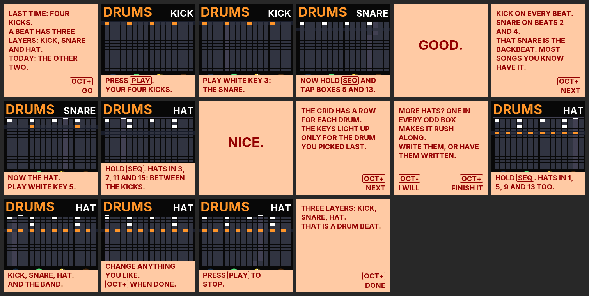

# Lesson 3: Kick, snare, hat

- **Part:** 1, your first beat
- **The idea:** a beat is three simple layers.
- **The learner does:** adds the snare on boxes 5 and 13 and the hats between the kicks, picking each drum by
  playing its key first.
- **Got it when:** they can name the three layers and pick a drum without being told which key.
- **Song:** HOUSE ONE, section C, its first bar. The drums start with only the four kicks from lesson 2.
- **Style in the end:** house, then hip-hop from lesson 4 on
- **Tied to the song:** the boxes named for the snare and the hats.

## Steps

1. **Setup:** song HOUSE ONE section C, 1 bar; drums empty; drums KICK on 1 5 9 13; mute bass lead chords pad; track drums; page STEPS
2. **Card:** LAST TIME: FOUR KICKS. / A BEAT HAS THREE LAYERS: KICK, SNARE AND HAT. / TODAY: THE OTHER TWO.
   - **OCT+:** GO
3. **Strip:** PRESS [PLAY]. / YOUR FOUR KICKS.
   - **Do:** press PLAY
   - **Until:** playing
4. **Strip:** PLAY WHITE KEY 3: THE SNARE.
   - **Do:** tap box 3
   - **Page:** STEPS
5. **Strip:** NOW HOLD [SEQ] AND TAP BOXES 5 AND 13.
   - **Do:** hold SEQ, tap box 5 13
   - **Until:** drums has SNARE on boxes 5 13
   - **Hint:** IF THE TOP SAYS KICK, PLAY WHITE KEY 3 FIRST.
6. **Reply:** GOOD.
7. **Card:** KICK ON EVERY BEAT. / SNARE ON BEATS 2 AND 4. / THAT SNARE IS THE BACKBEAT. MOST SONGS YOU KNOW HAVE IT. *(beginners only)*
   - **OCT+:** NEXT
8. **Strip:** NOW THE HAT. / PLAY WHITE KEY 5.
   - **Do:** tap box 5
   - **Page:** STEPS
9. **Strip:** HOLD [SEQ]. HATS IN 3, 7, 11 AND 15: BETWEEN THE KICKS.
   - **Do:** hold SEQ, tap box 3 7 11 15
   - **Until:** drums has HAT on boxes 3 7 11 15
   - **Hint:** IF THE TOP DOES NOT SAY HAT, PLAY WHITE KEY 5 FIRST.
10. **Reply:** NICE.
11. **Card:** THE GRID HAS A ROW FOR EACH DRUM. / THE KEYS LIGHT UP ONLY FOR THE DRUM YOU PICKED LAST.
    - **OCT+:** NEXT
12. **Card:** MORE HATS? ONE IN EVERY ODD BOX MAKES IT RUSH ALONG. / WRITE THEM, OR HAVE THEM WRITTEN.
    - **OCT-:** I WILL
    - **OCT+:** FINISH IT → drums HAT on 1 5 9 13
13. **Strip:** HOLD [SEQ]. HATS IN 1, 5, 9 AND 13 TOO.
    - **Do:** hold SEQ, tap box 1 5 9 13
    - **Until:** drums has HAT on boxes 1 3 5 7 9 11 13 15
    - **Hint:** IF THE TOP DOES NOT SAY HAT, PLAY WHITE KEY 5 FIRST.
    - **Robot:** tap box 5, hold SEQ, tap box 1 5 9 13
14. **Setup:** unmute
15. **Strip:** KICK, SNARE, HAT. / AND THE BAND.
    - **Wait:** 4 bars
16. **Strip:** CHANGE ANYTHING YOU LIKE. / [OCT+] WHEN DONE.
    - **OCT+:** DONE
17. **Strip:** PRESS [PLAY] TO STOP.
    - **Do:** press PLAY
    - **Until:** stopped
18. **Card:** THREE LAYERS: KICK, SNARE, HAT. / THAT IS A DRUM BEAT.
    - **OCT+:** DONE

## Screens

The lesson's cards and strips in order, from the robot's run on the simulated FM-1.

## Notes for Claude

- The one trap: the drum that boxes write is the drum played last. If the learner plays the kick key and then taps
  box 5 with SEQ held, the kick in box 5 is removed. The hints say how to get back; if kicks have gone missing,
  say so and help put them back (white key 1, then SEQ and the box).
- "Backbeat" is the only new music word. Use it again in later lessons.
- If they choose I WILL in step 12 and then struggle, FINISH IT is still there next time round.

## Tester notes

