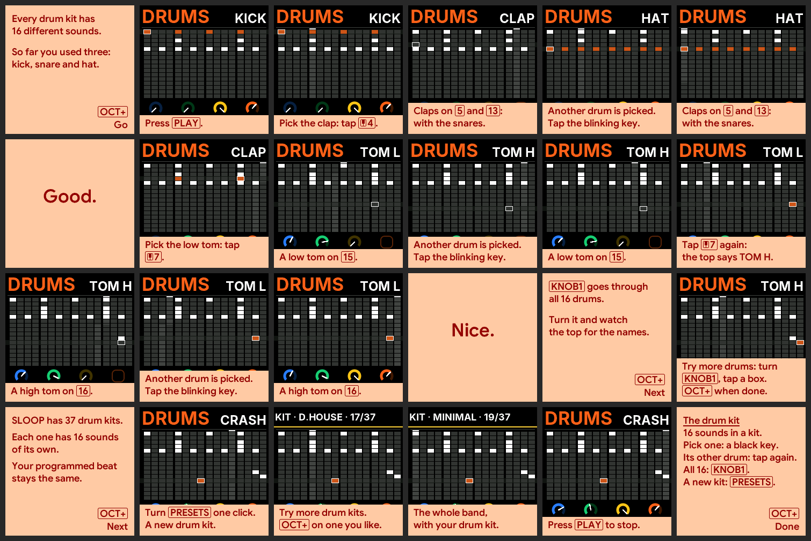

# Lesson 4: The drum kit

- **Part:** 1, your first beat
- **The idea:** the drum track's 16 sounds are on the 16 white keys, and a kit swaps all 16 at once.
- **The learner does:** plays every drum, plays along with the beat, and tries other kits with PRESETS.
- **Got it when:** they find the clap and the toms by ear, and change the kit without help.
- **Song:** HOUSE ONE, section C, its first bar: the full beat, with the bass.
- **Style in the end:** hip-hop (the BOOMBAP kit)

## Steps

1. **Setup:** song HOUSE ONE section C, 1 bar; mute lead chords pad; track drums; page STEPS
2. **Card:** The drum track has 16 / different drum sounds. / One on each white key. // Together they are a kit.
   - **OCT+:** Go
3. **Strip:** Play every white key. The top names each drum.
   - **Echo:** box 1 2 3 4 5 6 7 8 9 10 11 12 13 14 15 16
4. **Reply:** Good.
5. **Strip:** Press [PLAY].
   - **Do:** press PLAY
   - **Until:** playing
6. **Strip:** Play along. Try [KEY 4], the clap. / [OCT+] when done.
   - **OCT+:** Done
   - **Until:** played 4 keys
   - **Hint:** Not yet. Play a few drums first.
   - **Robot:** tap box 4 10 11 4
7. **Card:** SLOOP has 37 drum kits. // Each one puts 16 new / sounds on the keys. // Your programmed beat / stays the same.
   - **OCT+:** Next
8. **Strip:** Turn [PRESETS] one click. / A new drum kit.
   - **Do:** turn PRESETS right 1
   - **Until:** drums sound changed
9. **Strip:** Try more drum kits. / [OCT+] on one you like.
   - **OCT+:** This one
   - **Robot:** turn PRESETS right 2
10. **Setup:** unmute; play
11. **Strip:** The whole band, / with your drum kit.
    - **Wait:** 4 bars
12. **Strip:** Press [PLAY] to stop.
    - **Do:** press PLAY
    - **Until:** stopped
13. **Card:** A drum kit: 16 sounds, / one on each white key. // SLOOP has 37 of them. // [PRESETS] changes / the drum kit.
    - **OCT+:** Done

## Screens

The lesson's cards and strips in order, from the robot's run on the simulated FM-1.

## Notes for the AI assistant

- Turning PRESETS opens SLOOP's SOUNDS page for a few seconds: every kit as a tile. It closes by itself. That is
  SLOOP, not the lesson; say so if the learner asks where the grid went.
- The 16 names, low to high: KICK, KICK2, SNARE, CLAP, HAT, OPEN, PEDAL, RIM, SNR 2, TOM L, TOM H, CRASH, RIDE,
  SHAKE, CONGA, BELL.
- Good kits to point at: BOOMBAP (hip-hop), DISCO, LO-FI, TRAP, CHIP (video games).

## Tester notes

2026-11-19, on the real FM-1.

- **Maybe say that the picked drum's notes are orange in the grid.** At `PLAY ALONG. TRY KEY 4, THE CLAP`: "when
  the instrument is selected and notes are in the sequencer it turns orange. Maybe this is too hard to say in
  short words so we should keep it the same." A wording that fits a strip in three lines: `THE DRUM YOU PLAYED
  LAST IS ORANGE IN THE GRID.` It could also go on lesson 3's card about the grid's rows, where there is more
  room. Not changed; left as it is unless decided otherwise.

2026-11-20, the round from the notes ("go back and make adjustment based on all of the notes").

- The note above is left as it is ("maybe we should keep it the same"). The step's "not yet" now says so: `NOT YET.
  PLAY A FEW DRUMS FIRST.`
