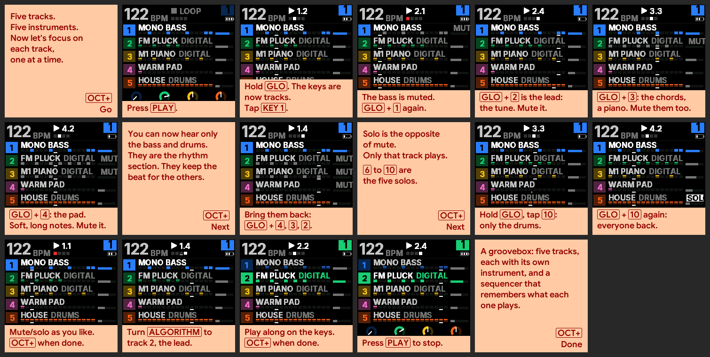

# Lesson 5: Meet the tracks

- **Part:** 1, your first beat
- **The idea:** each track plays its own instrument, and you can silence any of them.
- **The learner does:** mutes each track in turn to hear what it adds, solos the drums, then plays along on the
  lead track.
- **Got it when:** they can say what each of the five tracks does in the song.
- **Song:** HOUSE ONE, section C, all four bars.
- **Style in the end:** hip-hop

## Steps

1. **Setup:** song HOUSE ONE section C; track bass; page TRACKS
2. **Card:** Five tracks. / Five instruments. / Now let's focus on / each track, / one at a time.
   - **OCT+:** Go
3. **Strip:** Press [PLAY].
   - **Do:** press PLAY
   - **Until:** playing
4. **Strip:** Hold [GLO]. The keys are now tracks. / Tap [KEY 1].
   - **Do:** hold GLO, tap box 1
   - **Until:** bass is muted
   - **Hint:** Keep holding [GLO]. / Tap the blinking key.
5. **Strip:** The bass is muted. / [GLO] + [1] again.
   - **Do:** hold GLO, tap box 1
   - **Until:** bass is not muted
6. **Strip:** [GLO] + [2] is the lead: / the tune. Mute it.
   - **Do:** hold GLO, tap box 2
   - **Until:** lead is muted
7. **Strip:** [GLO] + [3]: the chords, / a piano. Mute them too.
   - **Do:** hold GLO, tap box 3
   - **Until:** chords is muted
8. **Strip:** [GLO] + [4]: the pad. / Soft, long notes. Mute it.
   - **Do:** hold GLO, tap box 4
   - **Until:** pad is muted
9. **Card:** You can now hear only / the bass and drums. / They are the rhythm / section. They keep the / beat for the others.
   - **OCT+:** Next
10. **Strip:** Bring them back: / [GLO] + [4], [3], [2].
    - **Do:** hold GLO, tap box 4 3 2
    - **Until:** nothing muted
11. **Card:** Solo is the opposite / of mute. / Only that track plays. // [6] to [10] are / the five solos.
    - **OCT+:** Next
    - **Lights:** box 6 7 8 9 10
12. **Strip:** Hold [GLO], tap [10]: / only the drums.
    - **Do:** hold GLO, tap box 10
    - **Until:** drums is solo
13. **Strip:** [GLO] + [10] again: / everyone back.
    - **Do:** hold GLO, tap box 10
    - **Until:** nothing solo
14. **Strip:** Mute/solo as you like. / [OCT+] when done.
    - **OCT+:** Done
    - **Until:** nothing muted and nothing solo
    - **Hint:** Not yet. Bring every track back first.
15. **Strip:** Turn [ALGORITHM] to track 2, the lead.
    - **Do:** turn ALGORITHM right 1
    - **Until:** track is lead
16. **Strip:** Play along on the keys. / [OCT+] when done.
    - **OCT+:** Done
17. **Strip:** Press [PLAY] to stop.
    - **Do:** press PLAY
    - **Until:** stopped
18. **Card:** A groovebox: five tracks, each with its own instrument, and a sequencer that remembers what each one plays.
    - **OCT+:** Done

## Screens

The lesson's cards and strips in order, from the robot's run on the simulated FM-1.

## Notes for the AI assistant

- While GLO is held, SLOOP shows its MIX page: tiles 1 to 5 for the mutes, S1 to S5 for the solos. The learner
  can read the state there.
- Track numbers and colors on the screen: 1 bass (blue), 2 lead (green), 3 chords (yellow), 4 pad (pink),
  5 drums (orange).
- If asked which track matters most: none. Ask them which one they missed most when it was gone.

## Tester notes

2026-11-20, the round from the notes ("go back and make adjustment based on all of the notes").

- Framed key names (`TAP [KEY 1]`, `[GLO] AND [4], [3], [2]`), and `NOT YET. BRING EVERY TRACK BACK FIRST.`

2026-11-26, the move to SLOOP 3.4.2: nothing changed. [GLO] held still shows SLOOP's MIX page (`1-5 MUTE`, `6-10 SOLO`),
and the mutes and solos work as before; the lesson plays through both ways as it was.

2026-11-27, on the real FM-1 (the trial on SLOOP 3.4.2).

- **Every strip that needs the hold names [GLO]** ("when we are muting the tracks it just tells you the number like 2,
  3, 4. These should be [Glo]+ 2, [Glo]+ 3, [Glo]+ 4"; "for the solos when the you are turning the solo off it says
  [10] it needs to be [Glo]+ [10]"). Steps 6, 7, 8 and 13 now begin `[GLO] + [2]`, `[GLO] + [3]`, `[GLO] + [4]`,
  `[GLO] + [10] again`; steps 5 and 10 said `[GLO] and` and say `[GLO] +` too ("Yes, all of it").
- **The drums drowned the band here** ("the drum dominates and I can barely hear the bass"; "I can't hear the keys at
  all"): SLOOP 3.4.2's kits are about 12 dB louder against its other sounds. The song's drums went from level 104 to
  31 (`tutorial/songs/house-one.json`; `tutorial/NOTES.md`, 2026-11-27, item 5).
