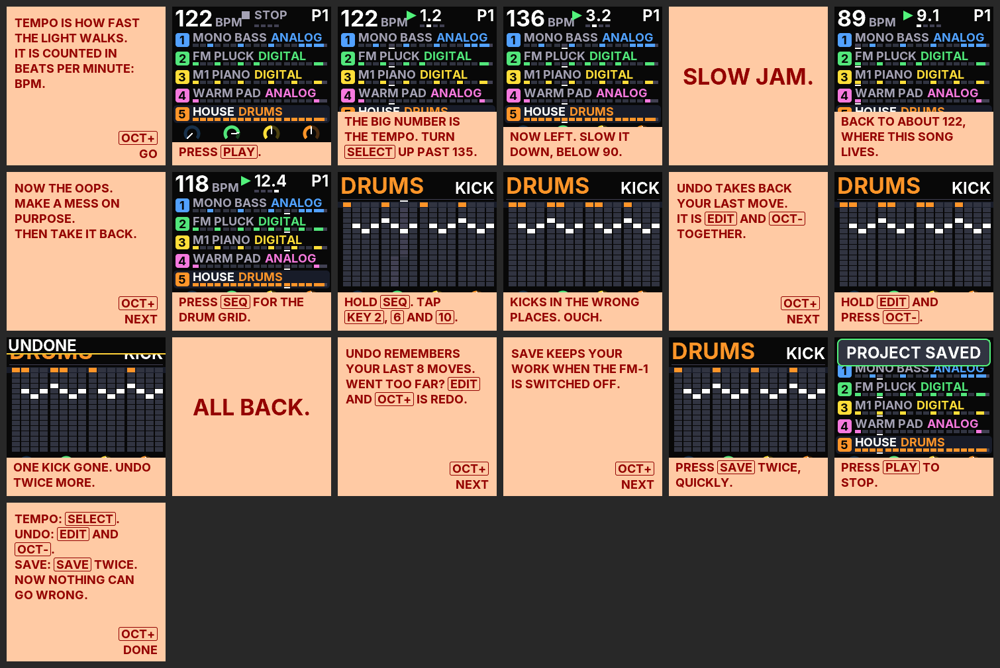

# Lesson 6: Faster, slower, oops

- **Part:** 1, your first beat
- **The idea:** tempo is how fast the light walks. Undo takes a mistake back. Save keeps your work.
- **The learner does:** changes the tempo with SELECT, makes a mess on purpose, undoes it, and saves.
- **Got it when:** they undo and save without being shown.
- **Song:** HOUSE ONE, section C, all four bars.
- **Style in the end:** hip-hop
- **Tied to the song:** the tempo it comes back to (122), and the three wrong boxes (2, 6 and 10 hold no kick).

## Steps

1. **Setup:** song HOUSE ONE section C; track drums; pick KICK; page TRACKS
2. **Card:** Tempo is the speed / of the song. It's / how fast the light / walks in the sequencer. / It is counted in beats / per minute: BPM. / A beat is 4 boxes.
   - **OCT+:** Go
3. **Strip:** Press [PLAY].
   - **Do:** press PLAY
   - **Until:** playing
4. **Strip:** The big number is the tempo. Turn [SELECT] up past 135.
   - **Do:** turn SELECT right 3
   - **Until:** tempo above 135
   - **Hint:** Keep turning, past 135.
5. **Strip:** Now left. Slow it down, below 90.
   - **Do:** turn SELECT left 3
   - **Until:** tempo below 90
6. **Reply:** Slow jam.
7. **Strip:** Back to about 122, where this song lives.
   - **Do:** turn SELECT right 3
   - **Until:** tempo above 117 and tempo below 127
8. **Card:** Now the oops. // We will make a mess / on purpose. / Then take it back.
   - **OCT+:** Next
9. **Strip:** Press [SEQ] for the drum grid.
   - **Do:** press SEQ
   - **Until:** page is STEPS
10. **Strip:** Tap [KEY 2], [6] and [10].
    - **Do:** tap box 2 6 10
    - **Until:** drums has KICK on boxes 2 6 10
11. **Strip:** Kicks in the wrong places. Ouch.
    - **Wait:** 2 bars
12. **Card:** Undo takes back / your last move. // To undo, hold [EDIT] / and press [OCT-].
    - **OCT+:** Next
13. **Strip:** Hold [EDIT] and press [OCT-].
    - **Do:** hold EDIT, press OCT-
    - **Until:** says UNDONE
14. **Strip:** One kick gone. Undo twice more.
    - **Do:** hold EDIT, press OCT-, press OCT-
    - **Until:** drums has no KICK on boxes 2 6 10
    - **Hint:** Hold [EDIT], press [OCT-]. Once for each kick.
15. **Reply:** All back.
16. **Card:** Undo will remember / your last 3 moves. / Went too far? / To redo hold [EDIT] / and press [OCT+].
    - **OCT+:** Next
17. **Card:** Save keeps your work / when the FM-1 is / switched off. // SLOOP also saves by / itself when the music / is stopped.
    - **OCT+:** Next
18. **Strip top:** Press [SAVE] twice: / the PROJECT page.
    - **Do:** press SAVE twice
    - **Until:** page is PROJECT
    - **Hint:** Press [SAVE] until the / bottom corner says / PROJECT.
19. **Strip top:** Turn [KNOB1]: SAVE.
    - **Do:** turn KNOB 1 right 1
    - **Until:** says only PROJECT SAVED
    - **Hint:** One click to the right.
20. **Setup:** page TRACKS
21. **Strip:** Press [PLAY] to stop.
    - **Do:** press PLAY
    - **Until:** stopped
22. **Card:** Tempo: [SELECT]. / Undo: [EDIT] + [OCT-]. / Redo: [EDIT] + [OCT+]. / Save: [SAVE] twice, / then [KNOB1]. // Now nothing can / go wrong.
    - **OCT+:** Done

## Screens

The lesson's cards and strips in order, from the robot's run on the simulated FM-1.

## Notes for the AI assistant

- The point of the mess is safety: the learner should leave knowing that nothing they do is permanent. If they
  seem nervous about pressing things, come back to this.
- SELECT changes the tempo only on the TRACKS page and the drum grid. On other pages it turns the page. If the
  number is not moving, press HOME first.
- Saving on SLOOP 3.4.2: from the tracks page or a drum page, [SAVE] opens SONG 2/3 and [SAVE] again opens PROJECT
  3/3 (SLOOP writes the page's name small in the bottom right corner). There [KNOB1] is SAVE: one click to the right
  saves, and a green SAVED shows at the top. A third [SAVE] goes back to SONG. [KNOB2] is NEW and [KNOB3] LOAD: leave
  them alone here (lesson 29). The lesson goes back to the tracks page by itself afterwards.
- SLOOP also saves by itself, a moment after the music is stopped and nothing is touched. Step 17's card says so.
- From a synth track's pages [SAVE] opens other pages (PRESETS, USER, PATTERNS, TOOLS). To save from there, a short
  tap of [HOME] first (the tracks page); [HOME] held longer opens SLOOP's menu.
- Undo keeps the last 3 moves on 3.4.2 (it kept 8). The lesson asks for exactly three.

## Tester notes

2026-11-19, on the real FM-1.

- **Give the first tempo step a target.** "When turning the tempo up maybe we should give them a target like
  135." (Said of "lesson 5"; the step is here, in lesson 6.) The step already ends at 135, but only its hint says
  so, and the hint comes after 25 seconds. A wording that fits the strip in three lines: `THE BIG NUMBER IS THE
  TEMPO. TURN [SELECT] UP PAST 135.` Not changed yet.

2026-11-20, the hidden-screen pass ("Yes, fix them").

- Undo (old step 12) and save (old step 16) are each a card with an answer and then a strip, so `UNDONE` and
  `PROJECT SAVED` show when they happen. 21 steps: from old step 13 on, add one; from old step 16 on, two.
- The three tempo strips stay at the bottom: the number they point at is at the top of the screen. The wording
  note above is still open.

2026-11-20, the round from the notes ("go back and make adjustment based on all of the notes").

- Applied: `THE BIG NUMBER IS THE TEMPO. TURN [SELECT] UP PAST 135.`

2026-11-26, the move to SLOOP 3.4.2. The lesson stopped at the save both ways: "Press [SAVE] twice" no longer saves.
The whole lesson was shown at once ("Yes, all of it").

- **Step 10:** `Tap [KEY 2], [6] and [10].` (was `Hold [SEQ]. Tap [KEY 2], [6] and [10].`): a box is tapped by itself.
- **Step 16:** `Undo will remember / your last 3 moves. ...` (was 8).
- **Step 17:** the save card gains `// SLOOP also saves by / itself when the music / is stopped.` (decision 6).
- **Saving, two strips along the top** (decision 6: [SAVE], [SAVE], [KNOB1], the first way in SLOOP's guide, every
  step named on the screen): step 18 `Press [SAVE] twice: / the PROJECT page.`, until the page is PROJECT, with the
  hint `Press [SAVE] until the / bottom corner says / PROJECT.`; step 19 `Turn [KNOB1]: SAVE.`, until PROJECT SAVED,
  with the hint `One click to the right.` First shown as `Press [SAVE] twice: the / corner says PROJECT.` and the
  second strip along the bottom, which sat on the very corner it named: "can you tell me about: corner says PROJECT.
  I don't see that in the screenshot". With both strips at the top the page shows its big SAVE and `PROJECT 3/3` in
  the corner.
- **The cheat sheet:** `Save: [SAVE] twice, / then [KNOB1].` (was `Save: [SAVE] twice.`).
- 22 steps: from old step 19 on, add one.

2026-11-26, a check line, no words ("Yes, both", with lesson 29).

- **The save step waits for exactly PROJECT SAVED:** `Until: says only PROJECT SAVED` (was `says PROJECT SAVED`). The
  FM-1 saves by itself when the music is stopped and untouched for about two and a half seconds, and then says
  `PROJECT SAVED (AUTO)`; the step took that for the learner's own save and ended without [KNOB1] being turned.
  The music plays during this lesson's save, so it could only happen if the learner stopped it.
