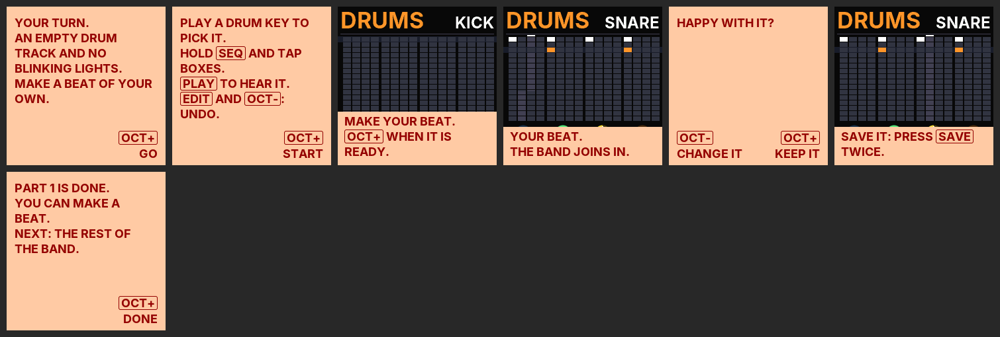

# Lesson 7: Your own beat

- **Part:** 1, your first beat (the piece of the learner's own)
- **The idea:** everything from part 1, with no blinking lights.
- **The learner does:** makes a beat on an empty drum track. The band joins in.
- **Got it when:** there is a beat they made alone, and they saved it.
- **Song:** HOUSE ONE, section C, its first bar. The drums are empty and the band is muted until the beat is ready.
- **Style in the end:** the learner picks

## Steps

1. **Setup:** song HOUSE ONE section C, 1 bar; drums empty; mute bass lead chords pad; track drums; page STEPS
2. **Card:** YOUR TURN. / AN EMPTY DRUM TRACK AND NO BLINKING LIGHTS. / MAKE A BEAT OF YOUR OWN.
   - **OCT+:** GO
3. **Card:** PLAY A DRUM KEY TO PICK IT. / HOLD [SEQ] AND TAP BOXES. / [PLAY] TO HEAR IT. / [EDIT] AND [OCT-]: UNDO.
   - **OCT+:** START
4. **Strip:** MAKE YOUR BEAT. / [OCT+] WHEN IT IS READY.
   - **OCT+:** READY
   - **Until:** drums has 6 notes or more
   - **Hint:** A BEAT NEEDS AT LEAST 6 HITS. KEEP GOING.
   - **Page:** STEPS
   - **Robot:** tap box 1, hold SEQ, tap box 1 5 9 13, let go, tap box 3, hold SEQ, tap box 5 13, let go
5. **Setup:** unmute; play
6. **Strip:** YOUR BEAT. / THE BAND JOINS IN.
   - **Wait:** 4 bars
7. **Card:** HAPPY WITH IT?
   - **OCT-:** CHANGE IT → go to 4
   - **OCT+:** KEEP IT
8. **Strip:** SAVE IT: PRESS [SAVE] TWICE.
   - **Do:** press SAVE twice
   - **Until:** says PROJECT SAVED
9. **Setup:** page TRACKS; stop
10. **Card:** PART 1 IS DONE. / YOU CAN MAKE A BEAT. / NEXT: THE REST OF THE BAND.
    - **OCT+:** DONE

## Screens

The lesson's cards and strips in order, from the robot's run on the simulated FM-1.

## Notes for Claude

- This is the first place the lesson waits for Claude: while the loop plays in step 6, say one true thing about
  the beat (where the kick sits, whether there is a backbeat, how busy the hats are). No grades.
- No lights on purpose. If the learner is stuck for long, remind them of the card in step 3 before offering more.
- If the beat is very sparse or very full, that is their choice. Ask what they would change, don't tell them.

## Tester notes

