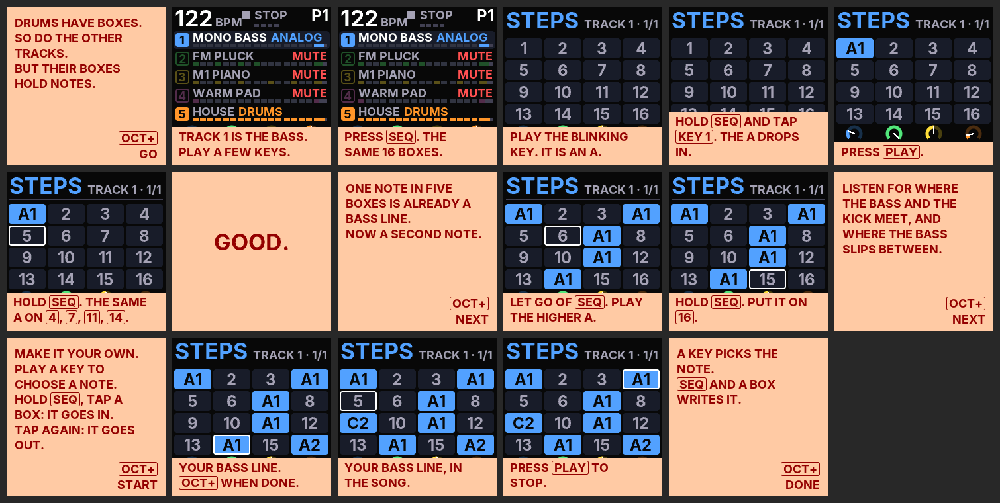

# Lesson 8: A bass line in boxes

- **Part:** 2, notes and chords
- **The idea:** the other tracks put notes in boxes too, and low notes are the bass.
- **The learner does:** on track 1, opens the piano roll, turns [KNOB1] to a step and plays a key: its note is written
  there.
- **Got it when:** they write a note at a step without help, and change which note it is.
- **Song:** HOUSE ONE, section C, its first bar. The bass starts empty; only the drums play.
- **Style in the end:** funk and disco
- **Tied to the song:** the note A and the steps 1, 4, 7, 11, 14 and 16.

## Steps

1. **Setup:** song HOUSE ONE section C, 1 bar; bass empty; mute lead chords pad; track bass; page TRACKS
2. **Card:** In the sequencer, / drums have boxes. / So do the other tracks. / But their boxes / hold notes.
   - **OCT+:** Go
3. **Strip:** Track 1 is the bass. Play a few keys.
   - **Do:** tap A3 C4 E4
   - **Until:** played 3 keys
4. **Strip:** Play the blinking key. It is an A.
   - **Do:** tap A3
   - **Page:** TRACKS
5. **Strip:** Press [SEQ]: / the piano roll.
   - **Do:** press SEQ
   - **Until:** page is NOTES
6. **Card:** _The piano roll / 16 steps across. / A step is a box. / Higher up: a higher note. // A key you play here / is written at the step / the STEP dial shows.
   - **OCT+:** Next
   - **Keys:** silent
7. **Strip top:** STEP says 1. Play [KEY 3].
   - **Do:** tap A3
   - **Until:** bass has notes on box 1
   - **Hint:** Play the blinking key.
   - **Page:** NOTES
8. **Strip top:** The A is in. STEP says 2.
   - **Wait:** 4 seconds
   - **Keys:** silent
9. **Strip top:** Press [PLAY].
   - **Do:** press PLAY
   - **Until:** playing
   - **Keys:** silent
10. **Strip top:** [KNOB1] to step 4: [3].
    - **Do:** turn KNOB 1 right 2, tap A3
    - **Until:** bass has notes on boxes 1 4
    - **Hint:** Turn [KNOB1] until STEP / says 4. Then play [KEY 3].
    - **Page:** NOTES
11. **Strip top:** The same on 7, 11 and 14.
    - **Do:** turn KNOB 1 right 2, tap A3, turn KNOB 1 right 3, tap A3, turn KNOB 1 right 2, tap A3
    - **Until:** bass has notes on boxes 1 4 7 11 14
    - **Hint:** [KNOB1] to the step, / then play [KEY 3].
    - **Page:** NOTES
12. **Reply:** Good.
13. **Card:** One note on five steps is / already a bass line. // Now a second note: / a higher A, on [KEY 10].
    - **OCT+:** Next
    - **Keys:** silent
14. **Strip top:** [KNOB1] to step 16: [10].
    - **Do:** turn KNOB 1 right 1, tap A4
    - **Until:** bass has notes on box 16
    - **Hint:** Turn [KNOB1] until STEP / says 16. Then [KEY 10].
    - **Page:** NOTES
15. **Card:** _Bass and kick / The kick is on / 1, 5, 9 and 13. / Your bass is on 1 too, / then lands in between. // That is what makes / it groove.
    - **OCT+:** Next
    - **Keys:** silent
16. **Card:** Make it your own. / [KNOB1]: go to a step. / Play a key: its note / is written there. / [EDIT]: the note there / is deleted.
    - **OCT+:** Start
    - **Keys:** silent
17. **Strip top:** [OCT+] when done.
    - **OCT+:** Done
    - **Page:** NOTES
    - **Robot:** turn KNOB 1 right 8, tap C4
18. **Setup:** page TRACKS; unmute; play
19. **Strip:** Your bass line, in the song.
    - **Wait:** 4 bars
20. **Strip:** Press [PLAY] to stop.
    - **Do:** press PLAY
    - **Until:** stopped
21. **Card:** _The piano roll / Open it: [SEQ]. / Go to a step: [KNOB1]. / Write a note: play a key. / Delete a note: [EDIT].
    - **OCT+:** Done

## Screens

The lesson's cards and strips in order, from the robot's run on the simulated FM-1.

## Notes for the AI assistant

- On SLOOP 3.4.2 a track that is not the drums has no boxes on the white keys. [SEQ] opens the piano roll (the top says
  NOTES 1-16): 16 steps across, higher notes higher up, and four dials at the bottom: STEP, NOTE, LEN, FORCE. The card
  in step 6 says "a step is a box": the same 16 places in the bar as the drum grid's boxes.
- **Every key played on the piano roll is written,** at the step the STEP dial shows, and takes the place of the note
  that was there. Then STEP moves on by one, by itself. [KNOB1] turns STEP. So the move is always: [KNOB1] until STEP
  says the step, then the key. If a note landed on the wrong step: [KNOB1] back to that step, then [EDIT] deletes it
  (the top says NOTE DELETED, or NO NOTE HERE).
- **The key to play blinks only while STEP is on a step that still needs its note.** If nothing blinks, the knob has
  not brought STEP there yet: the STEP dial is the truth. The knob itself has no light.
- While a card is up on the piano roll, and in steps 8 and 9, the keys play nothing, so that reading a card writes no
  stray note. The listening step at the end is on the tracks page, where a key played along is only heard.
- The lesson waits for a note on each step, any note: a wrong key is let through, and the learner hears it. The free
  step is where to put it right.
- [OCT-] and [OCT+] tapped on the piano roll move the keys an octave down or up (on a card or a strip that names
  [OCT+] they are the lesson's). If the notes land an octave off, that is why: both together put the octave back.
- The bass sounds an octave or two below the key that is pressed: [KEY 3] is written as A1. That is the sound's
  setting, not a mistake.
- Not taught here, and for lesson 13: [KNOB2] changes the note at the step, [KNOB3] its length. Held, [OCT+] opens the
  note's sheet (slide, nudge, fill, move, copy, delete); [PRESETS] is the zoom.

## Tester notes

2026-11-19, on the real FM-1.

- **`NOW CHANGE THE LINE. [OCT+] WHEN DONE.` does not say what to do.** "I'm not entirely sure what I am supposed
  to do as far as change the line." The strip was cut short to fit and lost its meaning: "the line" is the bass
  line, and changing it means choosing other notes or other boxes. An idea: a card before the strip, which fits
  in seven lines: `MAKE IT YOUR OWN. / PLAY A KEY TO CHOOSE A NOTE. / HOLD [SEQ], TAP A BOX: IT GOES IN. / TAP AGAIN: IT GOES OUT.` Then the strip only has to say `[OCT+] WHEN DONE`. The same goes for
  the other "change it" steps (lessons 2, 3, 7): check each says what can be changed and how. Not changed yet.

2026-11-20, the round from the notes ("go back and make adjustment based on all of the notes").

- Applied: a card before the free step (`MAKE IT YOUR OWN. / PLAY A KEY TO CHOOSE A NOTE. / HOLD [SEQ], TAP A BOX:
  IT GOES IN. / TAP AGAIN: IT GOES OUT.`), and the strip is `YOUR BASS LINE. / [OCT+] WHEN DONE.` 19 steps: from
  old step 14 on, add one.

2026-11-26, the move to SLOOP 3.4.2: the same bass line, written on the piano roll.

- **Why.** On 3.4.2 a synth track has no page of boxes: [SEQ] opens the piano roll (NOTES), where "the keys write the
  step" and [KNOB1] (STEP) picks it. Decided on 2026-11-24: "To me the knob and the keys sounds easier than doing a
  double press". The lesson is still the first time notes are written on a track that is not the drums; the song, the A
  and its steps (1, 4, 7, 11, 14, the higher A on 16) are the same. Shown whole, as Today / Suggested.
- **The A is played before [SEQ]** (step 4, same words: `Play the blinking key. It is an A.`), on the tracks page,
  where a key only plays. On the piano roll every key played is written.
- **Step 5:** `Press [SEQ]: / the piano roll.` (was `Press [SEQ]. The same 16 boxes.`).
- **Step 6, a new card:** `_The piano roll / 16 steps across. / A step is a box. / Higher up: a higher note. // A key
  you play here / is written at the step / the STEP dial shows.`
- **Step 7:** `STEP says 1. Play [KEY 3].` (was `Hold [SEQ] and tap [KEY 1]. The A drops in.`). **Step 8, new, four
  seconds:** `The A is in. STEP says 2.`
- **Step 10:** suggested `[KNOB1] to step 4: the A.`; the course's author: "for step 10 can we do: [KNOB1] to step 4:
  [Key 3]". That is 222 px and wraps (a line wraps at 212); then "what about [KNOB1] to step 4: [3]": 185 px, one line.
  Used: `[KNOB1] to step 4: [3].` The key's full name comes first (step 7), then the short one, as in lesson 2.
  **Step 11:** `The same on 7, 11 and 14.` (the two were one strip, `Hold [SEQ]. The same A on [4], [7], [11], [14].`).
- **Step 13, the card:** `One note on five steps is / already a bass line. // Now a second note: / a higher A, on
  [KEY 10].` **Step 14** matches step 10 ("Yes, match it"): `[KNOB1] to step 16: [10].` (were two strips, `Let go of
  [SEQ]. Play the / higher A: [KEY 10].` and `Hold [SEQ]. Put it on [16].`).
- **Step 16, the card of the free step:** `Make it your own. / [KNOB1]: go to a step. / Play a key: its note / is
  written there. / [EDIT]: the note there / is deleted.` **Step 17:** `[OCT+] when done.` **Step 21, the last card:**
  `_The piano roll / Open it: [SEQ]. / Go to a step: [KNOB1]. / Write a note: play a key. / Delete a note: [EDIT].`
- **Strips on the piano roll are at the top and one line long:** the dials at the bottom (STEP) have to show, and a
  strip of two lines hides the roll's top row, where the highest note sits.
- **The blinking key.** "the key will be blinking right?" It does, and it waits for the knob: "yes make the key wait
  until the knob is turned, hopefully we will put in the directional fill button later that will augment that" (the
  frames that answer the controls, step 6 of the plan). The lesson player was blinking the white keys of the empty
  "boxes", which on the piano roll would write other notes; now, on a track that is not the drums, it blinks the key
  the step names, and on the piano roll only while STEP is on a step that still needs its note. SHOW ME on the FM-1
  writes the note (`fw/course.inc`, `tutorial/tp/lesson.py`; the test is `tutorial/upgrade/rollcheck.py`).
- 21 steps (were 19).
