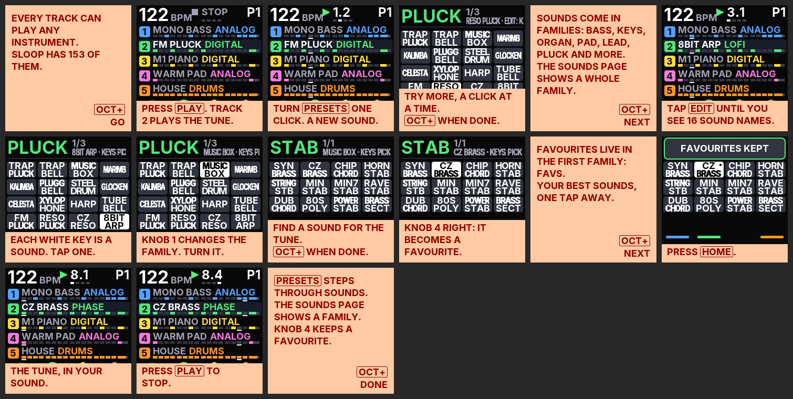

# Lesson 9: Pick your sound

- **Part:** 2, notes and chords
- **The idea:** each track can play any instrument.
- **The learner does:** steps through sounds with PRESETS, opens the SOUNDS page, picks by family, and keeps a
  favorite.
- **Got it when:** they change a track's sound on purpose and find it again as a favorite.
- **Song:** HOUSE ONE, section C, all four bars.
- **Style in the end:** lo-fi

## Steps

1. **Setup:** song HOUSE ONE section C; track lead; page TRACKS
2. **Card:** Every track can play / any instrument. // SLOOP has 153 / different instruments.
   - **OCT+:** Go
3. **Strip:** Press [PLAY]. Track 2 plays the tune.
   - **Do:** press PLAY
   - **Until:** playing
4. **Strip:** Turn [PRESETS] one click. A new sound.
   - **Do:** turn PRESETS right 1
   - **Until:** lead sound changed
5. **Strip:** Try more clicks. / [OCT+] when done.
   - **OCT+:** Done
   - **Robot:** turn PRESETS right 2
6. **Card:** Sounds come in families: bass, keys, organ, pad, lead, pluck and more. / The SOUNDS page shows a whole family.
   - **OCT+:** Next
7. **Setup:** page TRACKS
8. **Strip:** Tap [EDIT] until you see 16 sound names.
   - **Do:** press EDIT
   - **Until:** page is SOUNDS
   - **Hint:** It is the last of the edit pages. Keep tapping.
   - **Robot:** press EDIT, press EDIT, press EDIT, press EDIT, press EDIT, press EDIT
9. **Strip:** Each white key is a sound. Tap one.
   - **Do:** tap box 3
   - **Until:** lead sound changed
   - **Page:** SOUNDS
10. **Strip:** [KNOB1] changes the / family. Turn it.
    - **Do:** turn KNOB 1 right 1
    - **Page:** SOUNDS
11. **Strip:** Find your sound. / [OCT+] when done.
    - **OCT+:** This one
    - **Page:** SOUNDS
    - **Robot:** tap box 2
12. **Strip:** [KNOB4] right: / now a favorite.
    - **Do:** turn KNOB 4 right 1
    - **Until:** says FAV
    - **Page:** SOUNDS
13. **Card:** Favorites live in / the first family: FAVS. // Your best sounds are / just one tap away.
    - **OCT+:** Next
14. **Strip:** Press [HOME].
    - **Do:** press HOME
    - **Until:** page is TRACKS
15. **Strip:** The tune, in your sound.
    - **Wait:** 4 bars
16. **Strip:** Press [PLAY] to stop.
    - **Do:** press PLAY
    - **Until:** stopped
17. **Card:** [PRESETS] steps through / different sounds. / Tap [EDIT] several times / for the SOUNDS page. / It shows a whole family. / [KNOB4] keeps / a favorite.
    - **OCT+:** Done

## Screens

The lesson's cards and strips in order, from the robot's run on the simulated FM-1.

## Notes for the AI assistant

- Turning PRESETS opens the SOUNDS page by itself for four seconds, then it closes. Tapping EDIT up to SOUNDS
  keeps it open, and there the white keys choose.
- On the SOUNDS page: KNOB 1 the family, KNOB 2 or SELECT the page within it, KNOB 4 a favorite.
- The favorite is kept on the FM-1 for good, with the learner's other favorites (16 at most).
- If the learner picks something that sounds odd for a tune (a bass, an effect), let them hear it in the song
  before saying anything.

## Tester notes

2026-11-19, on the real FM-1. "Lesson 9 is great."

- **"Favourites: we want this in American English."** FAVOURITE is on three of this lesson's cards (steps 12, 13
  and 17) and should read FAVORITE. It is part of the switch to American spelling noted in `NOTES.md`. SLOOP's
  own messages on this page keep the British spelling (`FAVOURITES KEPT`, `ALREADY A FAVOURITE`, `FAVOURITE
  REMOVED`, `16 FAVOURITES: REMOVE ONE`). Decided the same day: SLOOP's own messages are left as they are. The
  lesson's cards are not changed yet.

2026-11-20, the hidden-screen pass ("Yes, fix them").

- Three strips were three lines high and sat on the fourth row of sound names (steps 5, 11 and 12). They are
  two lines now: `TRY MORE CLICKS.`, `FIND YOUR SOUND.`, `KNOB 4 RIGHT: / NOW A FAVORITE.`
- FAVORITE is applied on the lesson's three cards (steps 12, 13 and 17), since step 12 was being rewritten.
  SLOOP's own messages keep their spelling.
- Step 10 (KNOB 1, the family) stays at the bottom: the family's name is at the top left.
