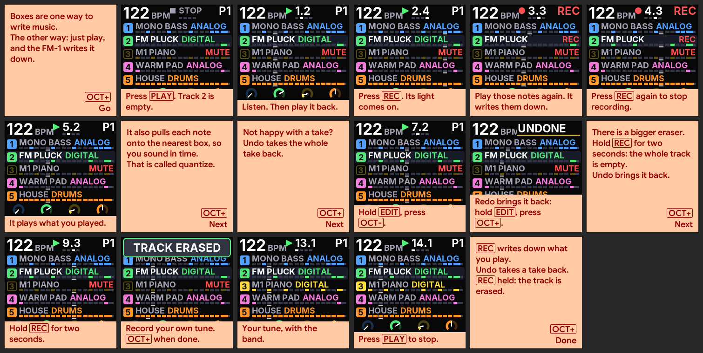

# Lesson 10: Record it live

- **Part:** 2, notes and chords
- **The idea:** REC writes down what you play.
- **The learner does:** presses REC and plays over the loop, undoes a take and brings it back, erases the track,
  and records again.
- **Got it when:** they record a take, throw it away and record another, without help.
- **Song:** HOUSE ONE, section C, its first bar. The lead starts empty and the piano is muted.
- **Style in the end:** funk and disco

## Steps

1. **Setup:** song HOUSE ONE section C, 1 bar; lead empty; mute chords; track lead; page TRACKS
2. **Card:** Boxes are one way to / write music. // The other way is to / just play, and the FM-1 / writes it down.
   - **OCT+:** Go
3. **Strip:** Press [PLAY]. Track 2 is empty.
   - **Do:** press PLAY
   - **Until:** playing
4. **Strip:** Listen. Then play it back.
   - **Play:** A4 C5 E5
   - **Echo:** A4 C5 E5
5. **Strip:** Press [REC]. Its light comes on.
   - **Do:** press REC
   - **Until:** recording
6. **Strip:** Play those notes again. It writes them down.
   - **Do:** tap A4 C5 E5
   - **Until:** lead has 3 notes or more
   - **Robot:** tap A4, wait 0.3, tap C5, wait 0.3, tap E5
7. **Strip:** Press [REC] again to stop recording.
   - **Do:** press REC
   - **Until:** not recording
8. **Strip:** It plays what you played.
   - **Wait:** 2 bars
9. **Card:** It also pulls each note / onto the nearest box, so / you sound in time. // That is called quantize. *(beginners only)*
   - **OCT+:** Next
10. **Card:** Not happy with a take? // One undo removes / the whole take.
    - **OCT+:** Next
11. **Strip:** Hold [EDIT], press [OCT-].
    - **Do:** hold EDIT, press OCT-
    - **Until:** lead is empty
12. **Strip:** Redo brings it back: / hold [EDIT], press [OCT+].
    - **Do:** hold EDIT, press OCT+
    - **Until:** lead has 3 notes or more
13. **Card:** There is a bigger eraser. // Hold [REC] for 2 seconds: / the whole track is empty. // Undo brings it back.
    - **OCT+:** Next
14. **Strip:** Hold [REC] for two seconds.
    - **Do:** hold REC, wait 2.5
    - **Until:** lead is empty
    - **Hint:** Keep holding [REC] until the top says TRACK ERASED.
15. **Card:** While [REC] is on, / the bar keeps looping. / Each time round, what / you play is added on top. // That's how you build up / a tune, bit by bit.
    - **OCT+:** Next
16. **Strip:** Record your own tune. / [OCT+] when done.
    - **OCT+:** Done
    - **Until:** lead has 3 notes or more and not recording
    - **Hint:** Not yet. Record 3 notes or more, then stop [REC].
    - **Robot:** press REC, tap A4, wait 0.3, tap C5, wait 0.3, tap E5, wait 0.3, press REC, wait 0.3
17. **Setup:** unmute; play
18. **Strip:** Your tune, with the band.
    - **Wait:** 4 bars
19. **Strip:** Press [PLAY] to stop.
    - **Do:** press PLAY
    - **Until:** stopped
20. **Card:** Record: [REC], then play. / Undo: [EDIT] + [OCT-]. / Redo: [EDIT] + [OCT+]. / Erase track: hold [REC] / for 2 seconds.
    - **OCT+:** Done

## Screens

The lesson's cards and strips in order, from the robot's run on the simulated FM-1.

## Notes for Claude

- REC pressed while the song plays records at once. Pressed while stopped, it waits (REC READY) and the first
  note starts everything. If the learner ends up there, PLAY or a note gets them going.
- Holding REC for two seconds erases the whole track, on the page that is up. It says so first (HOLD REC: ERASE
  THE TRACK); let go before the two seconds and it says ERASE CANCELLED. Undo brings the track back. The lesson
  teaches it at step 14, after undo and redo, so it is a tool before the final test.
- A second take adds to the first. To start clean, undo or erase first.

## Tester notes

2026-11-20, the round from the notes ("go back and make adjustment based on all of the notes").

- Erasing a track is taught here now, after undo (asked in the final test: "how do I delete a whole track?"): redo
  brings the take back (`REDO BRINGS IT BACK: / HOLD [EDIT], PRESS [OCT+].`), a card (`THERE IS A BIGGER ERASER.
  ...`), then `HOLD [REC] FOR TWO SECONDS.` The track is empty again for the learner's own tune. 19 steps: old step
  12 is 15.
