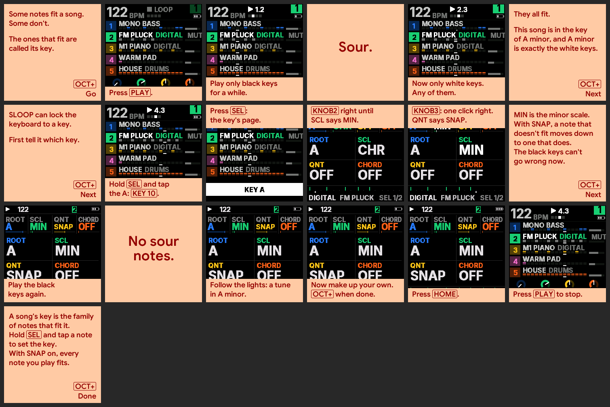

# Lesson 11: No wrong notes

- **Part:** 2, notes and chords
- **The idea:** a key is a family of notes that sound good together.
- **The learner does:** hears notes that clash and notes that fit, tells SLOOP the song's key, and plays a tune
  that cannot go wrong.
- **Got it when:** they can say what a key is in their own words, and set one.
- **Song:** HOUSE ONE, section C, all four bars, with the lead muted so the learner is the lead.
- **Style in the end:** pop
- **Tied to the song:** the key, A minor.

## Steps

1. **Setup:** song HOUSE ONE section C; mute lead; track lead; page TRACKS
2. **Card:** Some notes fit a song. / Some don't. // The ones that fit are / called its key.
   - **OCT+:** Go
3. **Strip:** Press [PLAY].
   - **Do:** press PLAY
   - **Until:** playing
4. **Strip:** Play only black keys / for a while.
   - **Until:** played 4 keys
   - **Robot:** tap F#3 G#3 A#3 C#4
5. **Reply:** Sour.
6. **Strip:** Now only white keys. Any of them.
   - **Until:** played 4 keys
   - **Robot:** tap A4 C5 D5 E5
7. **Card:** They all fit. // This song is in the key / of A minor, and A minor / is exactly the white keys.
   - **OCT+:** Next
8. **Card:** SLOOP can lock the / keyboard to a key. // First tell it which key.
   - **OCT+:** Next
9. **Strip:** Hold [SEL] and tap / the A: [KEY 10].
   - **Do:** hold SEL, tap A4
   - **Until:** says KEY A
10. **Strip top:** Press [SEL]: / the key's page.
    - **Do:** press SEL
    - **Until:** page is KEY
    - **Hint:** Press [SEL] until the / bottom corner says / SEL 1/2.
11. **Strip top:** [KNOB2] right until / SCL says MIN.
    - **Do:** turn KNOB 2 right 2
    - **Page:** KEY
    - **Hint:** Two clicks right. / SCL is [KNOB2]'s name.
12. **Strip top:** [KNOB3]: one click right. / QNT says SNAP.
    - **Do:** turn KNOB 3 right 1
    - **Page:** KEY
13. **Card:** MIN is the minor scale. / With SNAP, a note that / doesn't fit moves down / to one that does. / The black keys can't / go wrong now.
    - **OCT+:** Next
14. **Strip:** Play the black / keys again.
    - **Until:** played 4 keys
    - **Robot:** tap F#3 G#3 A#3 C#4
15. **Reply:** No sour notes.
16. **Strip:** Follow the lights: a tune in A minor.
    - **Echo:** A4 C5 D5 E5 E5 D5 C5 A4
17. **Strip:** Now make up your own. / [OCT+] when done.
    - **OCT+:** Done
18. **Strip:** Press [HOME].
    - **Do:** press HOME
    - **Until:** page is TRACKS
19. **Strip:** Press [PLAY] to stop.
    - **Do:** press PLAY
    - **Until:** stopped
20. **Card:** A song's key is the family / of notes that fit it. / Hold [SEL] and tap a note / to set the key. / With SNAP on, every / note you play fits.
    - **OCT+:** Done

## Screens

The lesson's cards and strips in order, from the robot's run on the simulated FM-1.

## Notes for the AI assistant

- [SEL] tapped opens SLOOP 3.4.2's SEL page (the bottom corner says SEL 1/2). Its four values are ROOT, SCL (the scale),
  QNT and CHORD, on [KNOB1] to [KNOB4]: each is there twice, small in a row at the top and big below. The lesson's
  strips for the knobs are at the top: they cover the small row only, and the big letters show the change.
- QNT is what locks the keyboard: OFF, SNAP, WHITE, on [KNOB3]. With SNAP, a black key plays the scale note just
  below it, so two neighboring keys can play the same note. That is expected. [KNOB4] is CHORD (lesson 12): if chords
  sound where single notes should, CHORD has been turned on; turn [KNOB4] back to OFF.
- The lesson cannot read the scale or QNT from the FM-1 yet, so steps 11 and 12 only count clicks. If SCL does not
  say MIN afterwards, help the learner turn [KNOB2] until it does, and [KNOB3] until QNT says SNAP.
- [SEL] held shows another page, called KEY, with the notes on tiles: there a key sets the key (step 9), and the top
  says KEY A.
- Other scales worth a try on [KNOB2] afterwards: MPEN (five notes that always sound good) and BLUES.

## Tester notes

2026-11-19, on the real FM-1.

- **The KNOB 4 step should say which way to turn.** "For the knob 4 direction I think it should say one click
  right." (Said of "lesson 10"; the step is here.) The strip says `KNOB 4: ONE CLICK. SNAP.` and the step before
  it, for KNOB 2, does say RIGHT. `KNOB 4: ONE CLICK RIGHT. SNAP.` fits in two lines. Not changed yet.

2026-11-20, the hidden-screen pass ("Yes, fix them").

- Old step 8 is a card with an answer and then a strip (`HOLD [SEL] AND TAP AN A.`), so `KEY A` shows when it
  lands. The KNOB 2 step is a strip at the top and reads the dial: `KNOB 2 RIGHT UNTIL / SCALE SAYS MIN.`
  The lesson has 20 steps: from old step 9 on, add one to the numbers above. The KNOB 4 wording is still open.

2026-11-20, the round from the notes ("go back and make adjustment based on all of the notes").

- Applied: `KNOB 4: ONE CLICK RIGHT. SNAP.`

2026-11-26, the move to SLOOP 3.4.2. The lesson is for the same thing; [SEL]'s page changed. Its values are named
ROOT, SCL, QNT and CHORD, small in a row at the top and big below, and the page's name (SEL 1/2) is small in the bottom
corner. SNAP is on [KNOB3] now (QNT); [KNOB4] is CHORD, so the old step 12 turned one-finger chords on (the lesson
still played through: that step counts clicks). Three strips, shown as Today / Suggested:

- **Step 10, at the top now:** `Press [SEL]: / the key's page.` (was `Press [SEL]: / the KEY page.`, at the bottom),
  with a hint: `Press [SEL] until the / bottom corner says / SEL 1/2.`
- **Step 11:** `[KNOB2] right until / SCL says MIN.` (was `... / SCALE says MIN.`); its hint `Two clicks right. / SCL
  is [KNOB2]'s name.`
- **Step 12:** `[KNOB3]: one click right. / QNT says SNAP.` (was `[KNOB4]: one click right. SNAP.`).
- **Where the two knob strips sit.** Suggested at the bottom, as decided for these pages on 2026-11-24. The course's
  author: "I think Strip 12 should move to the top". Tried on the simulated FM-1: at the bottom the strip cut the big
  QNT and CHORD in half; at the top it covers only the small row, which the big letters repeat, and SEL 1/2 in the
  corner shows too. So step 11 as well ("Yes, both at the top"), which is where both strips were before the move.
