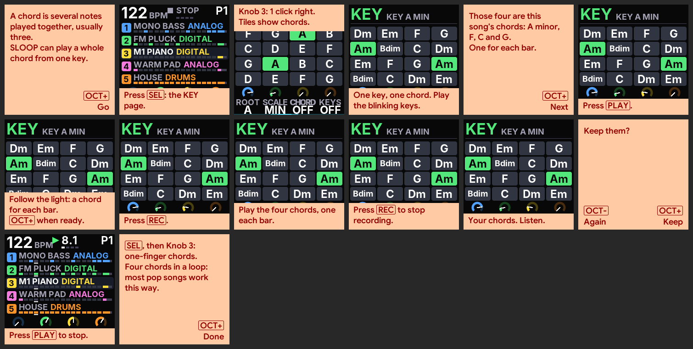

# Lesson 12: One-finger chords

- **Part:** 2, add the band
- **The idea:** a chord is several notes at once, and four chords in a loop carry a whole song.
- **The learner does:** turns chords on, plays the song's four chords with one finger each, and records them.
- **Got it when:** they can play the four chords in time, one for each bar.
- **Song:** HOUSE ONE, section C, all four bars. The chord track starts empty. The key is already set to A minor.
- **Style in the end:** pop
- **Tied to the song:** its four chords (A minor, F, C, G) and the keys that play them (C4, A4, E4, B4).

## Steps

1. **Setup:** song HOUSE ONE section C; chords empty; key A minor; track chords; page TRACKS
2. **Card:** A chord is several notes played together, usually three. / SLOOP can play a whole chord from one key.
   - **OCT+:** Go
3. **Strip:** Press [SEL]: the KEY page.
   - **Do:** press SEL
   - **Until:** page is KEY
4. **Strip top:** Knob 3: 1 click right. / Tiles show chords.
   - **Do:** turn KNOB 3 right 1
   - **Page:** KEY
5. **Strip:** One key, one chord. Play the blinking keys.
   - **Echo:** C4 A4 E4 B4
6. **Card:** Those four are this song's chords: A minor, F, C and G. / One for each bar.
   - **OCT+:** Next
7. **Strip:** Press [PLAY].
   - **Do:** press PLAY
   - **Until:** playing
8. **Strip:** Follow the light: a chord for each bar. / [OCT+] when ready.
   - **Follow:** C4 A4 E4 B4
   - **OCT+:** Ready
9. **Strip:** Press [REC].
   - **Do:** press REC
   - **Until:** recording
10. **Strip:** Play the four chords, one each bar.
    - **Follow:** C4 A4 E4 B4
    - **Until:** chords has 12 notes or more
    - **Robot:** tap C4, wait 1.5, tap A4, wait 1.5, tap E4, wait 1.5, tap B4
11. **Strip:** Press [REC] to stop recording.
    - **Do:** press REC
    - **Until:** not recording
12. **Strip:** Your chords. Listen.
    - **Wait:** 4 bars
13. **Card:** Keep them?
    - **OCT-:** Again → chords empty; go to 9
    - **OCT+:** Keep
14. **Setup:** page TRACKS
15. **Strip:** Press [PLAY] to stop.
    - **Do:** press PLAY
    - **Until:** stopped
16. **Card:** [SEL], then Knob 3: one-finger chords. / Four chords in a loop: most pop songs work this way.
    - **OCT+:** Done

## Screens

The lesson's cards and strips in order, from the robot's run on the simulated FM-1.

## Notes for Claude

- The lesson cannot read the CHORD setting from the FM-1 yet. After step 4 the tiles should show chord names
  (Am, F, C, G ...) and the CHORD dial says TRIAD. The strip is at the top so that dial is in view. If they show single notes, KNOB 3 has to go one more click.
- The light changes at the start of each bar, which is slightly late for a first-time player. Tell them to look
  ahead: Am, F, C, G, round and round.
- Chords recorded a little early or late are pulled onto the nearest box when they play back.
- The black keys change a chord while they are held (major to minor, a seventh, and so on). Leave that for the
  deeper series unless the learner finds it.

## Tester notes

