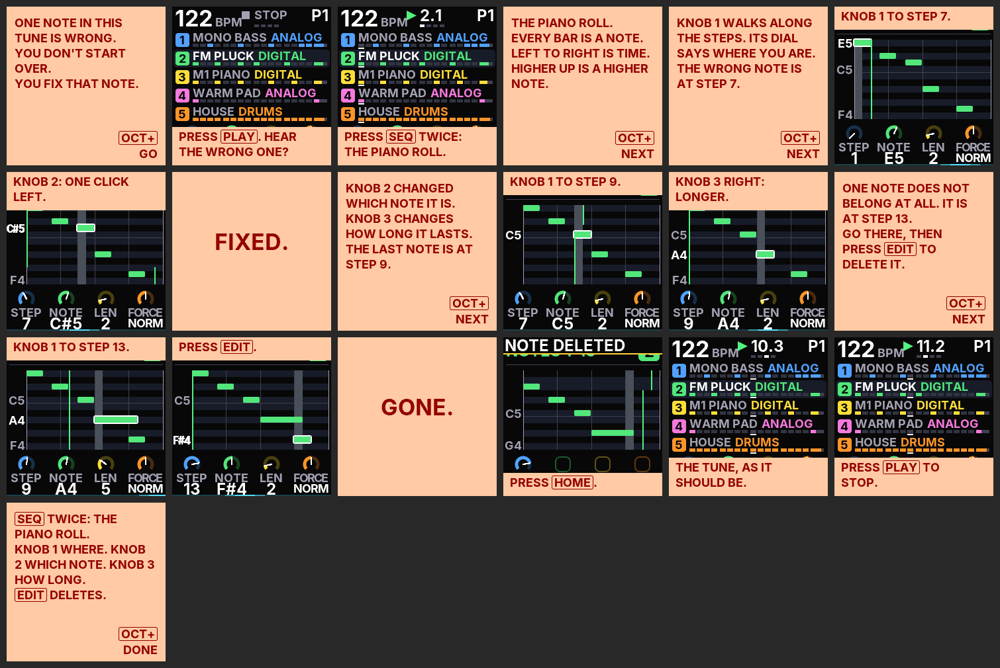

# Lesson 13: The piano roll

- **Part:** 2, notes and chords
- **The idea:** a note can be moved, stretched or removed after it is written.
- **The learner does:** opens the piano roll, fixes a wrong note, makes one longer and deletes one.
- **Got it when:** they find a note with KNOB 1 and change it, without being told which knob.
- **Song:** HOUSE ONE, section C, its first bar. The tune has been changed for the lesson: one wrong note, and
  one note that does not belong.
- **Style in the end:** lo-fi
- **Tied to the song:** the tune's notes and the steps they sit on (the wrong note at step 7, the stray at 13).

## Steps

1. **Setup:** song HOUSE ONE section C, 1 bar; lead empty; lead E5 on 1; lead D5 on 4; lead C#5 on 7; lead A4 on 9; lead F#4 on 13; track lead; page TRACKS
2. **Card:** This tune has / one wrong note. // No need to start over. / Just fix that note.
   - **OCT+:** Go
3. **Strip:** Press [PLAY]. / Hear the wrong one?
   - **Do:** press PLAY
   - **Until:** playing
   - **Wait:** 2 bars
4. **Strip:** Press [SEQ]: / the piano roll.
   - **Do:** press SEQ
   - **Until:** page is NOTES
5. **Card:** _The piano roll / It shows your notes / as green lines. / Left to right is time. / Higher up: a higher note. / The longer the line, / the longer the note.
   - **OCT+:** Next
   - **Keys:** silent
6. **Card:** [KNOB1] walks left and / right along the steps. / Its dial says which / step you are on. // The wrong note is / at step 7.
   - **OCT+:** Next
   - **Keys:** silent
7. **Strip top:** [KNOB1] to step 7.
   - **Do:** turn KNOB 1 right 6
   - **Page:** NOTES
   - **Keys:** silent
8. **Strip top:** [KNOB2]: one click left.
   - **Do:** turn KNOB 2 left 1
   - **Until:** lead has C5 on box 7
   - **Page:** NOTES
   - **Hint:** Step 7 must say C5.
   - **Keys:** silent
9. **Reply:** Fixed.
10. **Card:** [KNOB2] is NOTE: / higher or lower. / [KNOB3] is LEN: / how long a note lasts. // Let's make the last note / longer. It's at step 9.
    - **OCT+:** Next
    - **Keys:** silent
11. **Strip top:** [KNOB1] to step 9.
    - **Do:** turn KNOB 1 right 2
    - **Page:** NOTES
    - **Keys:** silent
12. **Strip top:** [KNOB3] until LEN says 5.
    - **Do:** turn KNOB 3 right 3
    - **Until:** lead longest note above 4.5
    - **Page:** NOTES
    - **Keys:** silent
13. **Card:** One note sounds wrong, / it doesn't belong. // It is at step 13. // Go there, then press / [EDIT] to delete it.
    - **OCT+:** Next
    - **Keys:** silent
14. **Strip top:** [KNOB1] to step 13.
    - **Do:** turn KNOB 1 right 4
    - **Page:** NOTES
    - **Keys:** silent
15. **Strip top:** Press [EDIT].
    - **Do:** press EDIT
    - **Until:** lead has nothing on box 13
    - **Page:** NOTES
    - **Hint:** Step 13, then [EDIT].
    - **Keys:** silent
16. **Reply:** Gone.
17. **Strip:** Press [HOME].
    - **Do:** press HOME
    - **Until:** page is TRACKS
18. **Strip:** The tune, as it should be.
    - **Wait:** 2 bars
19. **Strip:** Press [PLAY] to stop.
    - **Do:** press PLAY
    - **Until:** stopped
20. **Card:** Piano roll: [SEQ]. / STEP: [KNOB1]. / NOTE: [KNOB2]. / LEN: [KNOB3]. / Delete: [EDIT].
    - **OCT+:** Done

## Screens

The lesson's cards and strips in order, from the robot's run on the simulated FM-1.

## Notes for the AI assistant

- The learner met the piano roll in lesson 8: [SEQ] opens it, [KNOB1] is STEP, a key played is written at that step.
  This lesson adds the other dials: [KNOB2] NOTE (a semitone a click, and the note is heard), [KNOB3] LEN (a step a
  click), and [EDIT], which deletes the note under STEP (the top says NOTE DELETED).
- The strips are at the top and one line long here, so the four dials at the bottom stay in view (STEP, NOTE, LEN,
  FORCE) and the roll's top row, where the highest note sits, is not covered. The learner needs both.
- Steps 7, 11 and 14 count clicks of [KNOB1], which works when the learner starts from step 1 and does not wander.
  If they are lost, the STEP dial is the truth.
- While the piano roll is open in this lesson (steps 5 to 15) the keys play nothing: no step needs one, and a key
  played on the roll writes over the note under STEP. After [HOME] they play again.
- [KNOB2] turned on a step with no note writes one there (the note played last). If a note appears where there was
  none, that is how: [EDIT] takes it out.
- Left out on purpose, for the learner who asks: [OCT+] held opens the note's sheet ([KNOB1] the row: slide, nudge,
  fill, move, copy, delete; [KNOB2] its value; [OCT-] closes it), and [PRESETS] is the zoom (8, 16, 32 or 64 steps
  across). [KNOB4], FORCE, is how hard the note is played: GHOST, SOFT, NORM, HARD, ACC.

## Tester notes

2026-11-26, the move to SLOOP 3.4.2. The lesson is for the same thing: a note fixed after it is written. It stopped
because "[SEQ] twice" lands on the PATTERN page: on 3.4.2 the piano roll is [SEQ]'s first page, and lesson 8 teaches it
first now. Shown as Today / Suggested ("Yes, all of it"):

- **Step 4:** `Press [SEQ]: / the piano roll.` (was `Press [SEQ] twice: / ...`).
- **Step 5, the card's heading:** `The piano roll` (was `The Piano Roll`), as lesson 8's cards have it.
- **Step 12, one line:** `[KNOB3] until LEN says 5.` (was `Turn [KNOB3] right / until LEN says 5.`): a strip of two
  lines hides the roll's top row, where the tune's first note sits. 212 px, the most a line may have.
- **Step 20, the last card:** `Piano roll: [SEQ]. / STEP: [KNOB1]. / NOTE: [KNOB2]. / LEN: [KNOB3]. / Delete: [EDIT].`
  (was `Piano roll page: / [SEQ] twice. / ...`).
- **The keys play nothing while the roll is open** (steps 5 to 15, `Keys: silent`).
- **The note's sheet and the zoom are left out.** On 2026-11-24 this lesson was to go on to them. Tried: the sheet
  ([OCT+] held) is a held button with its own meanings for the knobs, on top of the three fixes the lesson has; the
  zoom changes nothing useful on a bar of 16 steps. Both are in the notes for the AI assistant. If the sheet is wanted
  later, its natural exercise is a note one step late, moved back: about four more steps, not built.
