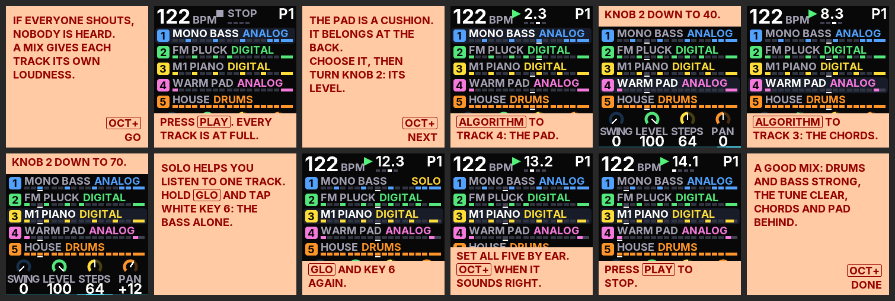

# Lesson 14: Mix the tracks

- **Part:** 2, add the band
- **The idea:** if everyone shouts, nobody is heard.
- **The learner does:** sets the levels of the tracks, and uses solo to listen to one.
- **Got it when:** they can make one track quieter on purpose, and say why.
- **Song:** HOUSE ONE, section C, all four bars, with every track turned up to full.
- **Style in the end:** lo-fi

## Steps

1. **Setup:** song HOUSE ONE section C; bass level 100; lead level 100; chords level 100; pad level 100; drums level 100; track bass; page TRACKS
2. **Card:** IF EVERYONE SHOUTS, NOBODY IS HEARD. / A MIX GIVES EACH TRACK ITS OWN LOUDNESS.
   - **OCT+:** GO
3. **Strip:** PRESS [PLAY]. EVERY TRACK IS AT FULL.
   - **Do:** press PLAY
   - **Until:** playing
   - **Wait:** 2 bars
4. **Card:** THE PAD IS A CUSHION. IT BELONGS AT THE BACK. / CHOOSE IT, THEN TURN KNOB 2: ITS LEVEL.
   - **OCT+:** NEXT
5. **Strip:** [ALGORITHM] TO TRACK 4: THE PAD.
   - **Do:** turn ALGORITHM right 3
   - **Until:** track is pad
6. **Strip top:** KNOB 2 DOWN TO 40.
   - **Do:** turn KNOB 2 left 5
   - **Until:** pad level below 46
   - **Page:** TRACKS
7. **Strip:** [ALGORITHM] TO TRACK 3: THE CHORDS.
   - **Do:** turn ALGORITHM left 1
   - **Until:** track is chords
8. **Strip top:** KNOB 2 DOWN TO 70.
   - **Do:** turn KNOB 2 left 5
   - **Until:** chords level below 76
   - **Page:** TRACKS
9. **Card:** SOLO HELPS YOU LISTEN TO ONE TRACK. / HOLD [GLO] AND TAP WHITE KEY 6: THE BASS ALONE.
   - **Do:** hold GLO, tap box 6
   - **Until:** bass is solo
10. **Strip:** [GLO] AND KEY 6 AGAIN.
    - **Do:** hold GLO, tap box 6
    - **Until:** nothing solo
11. **Strip:** SET ALL FIVE BY EAR. / [OCT+] WHEN IT SOUNDS RIGHT.
    - **OCT+:** DONE
    - **Robot:** turn KNOB 2 left 3
12. **Strip:** PRESS [PLAY] TO STOP.
    - **Do:** press PLAY
    - **Until:** stopped
13. **Card:** A GOOD MIX: DRUMS AND BASS STRONG, THE TUNE CLEAR, CHORDS AND PAD BEHIND.
    - **OCT+:** DONE

## Screens

The lesson's cards and strips in order, from the robot's run on the simulated FM-1.

## Notes for Claude

- On the TRACKS page KNOB 2 is the level of the track that is chosen. Holding GLO shows SLOOP's MIX page, where
  KNOB 1 is the level and KNOBS 2 to 4 are pan, delay and reverb, for the same track.
- There is no single right mix. If the learner's mix hides the tune, ask whether they can still hum it.
- The FM-1's own speaker cannot play low notes, so the bass and kick seem quiet on it. On headphones they are not.

## Tester notes

