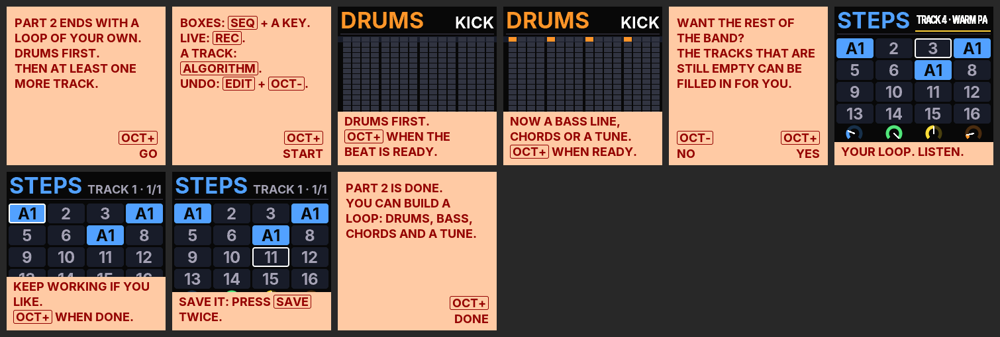

# Lesson 15: Your own loop

- **Part:** 2, notes and chords (the piece of the learner's own)
- **The idea:** everything from parts 1 and 2, with no blinking lights.
- **The learner does:** makes a loop: drums and at least one more track of their own. The rest of the band can be
  filled in for them.
- **Got it when:** there is a loop with two parts or more that they wrote, and they saved it.
- **Song:** HOUSE ONE's sounds and tempo, with all five tracks empty. One bar long.
- **Style in the end:** the learner picks

## Steps

1. **Setup:** song HOUSE ONE section C, 1 bar; bass empty; lead empty; chords empty; pad empty; drums empty; track drums; page STEPS
2. **Card:** Part 2 ends with a loop / of your own. // Drums first, then / at least one more track.
   - **OCT+:** Go
3. **Card:** Boxes: [SEQ] + a key. / Live: [REC]. / A track: [ALGORITHM]. / Undo: [EDIT] + [OCT-].
   - **OCT+:** Start
4. **Strip:** Drums first. / [OCT+] when ready.
   - **OCT+:** Ready
   - **Until:** drums has 4 notes or more
   - **Hint:** Not yet. The beat needs 4 hits or more.
   - **Robot:** tap box 1, hold SEQ, tap box 1 5 9 13, let go
5. **Strip:** Now add another track. / [OCT+] when ready.
   - **OCT+:** Ready
   - **Until:** 2 tracks or more
   - **Hint:** Not yet. Write something on a second track first.
   - **Robot:** turn ALGORITHM right 1, tap A3, hold SEQ, tap box 1 4 7, let go
6. **Card:** Want the rest / of the band? // Empty tracks can be / filled in for you.
   - **OCT-:** No
   - **OCT+:** Yes → fill empty tracks
7. **Setup:** play
8. **Strip:** Your loop. Listen.
   - **Wait:** 4 bars
9. **Strip:** Keep working if you like. / [OCT+] when done.
   - **OCT+:** Done
10. **Strip:** Save it: / press [SAVE] twice.
    - **Do:** press SAVE twice
    - **Until:** says PROJECT SAVED
11. **Setup:** page TRACKS; stop
12. **Card:** Part 2 is done. // Now you can build / a whole loop: / drums, bass, chords / and a tune. // Next: effects and sound.
    - **OCT+:** Done

## Screens

The lesson's cards and strips in order, from the robot's run on the simulated FM-1.

## Notes for the AI assistant

- A moment for the assistant: when the loop plays in step 8, say one true thing about how the parts fit (does the
  bass meet the kick, does the tune leave room). Read the patterns from the FM-1 if it is plugged in, or ask.
- No lights on purpose. The card in step 3 is the only reminder.
- BRING THEM fills only tracks with nothing on them, from the song as written. It never touches what the learner
  wrote.
- With every track empty, REC pressed while stopped starts SLOOP's free take (REC READY · PLAY FREELY), which
  sets the tempo from what is played. If the learner lands there by accident, PLAY cancels it.

## Tester notes

2026-11-20, the round from the notes ("go back and make adjustment based on all of the notes").

- The two "not yet" hints begin with `NOT YET.`
