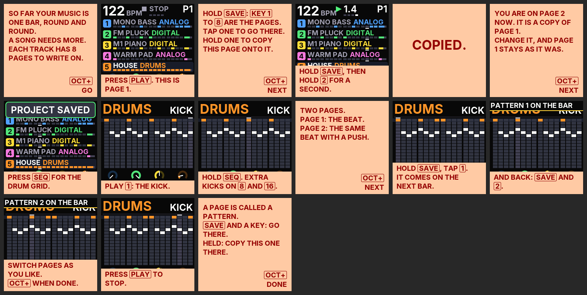

# Lesson 16: Eight pages

- **Part:** 3, make it move
- **The idea:** a pattern is a page, and each track has eight.
- **The learner does:** copies page 1 onto page 2, changes page 2, and switches between the two while the song
  plays.
- **Got it when:** they can go to a page, and copy a page, and know which is which.
- **Song:** HOUSE ONE, section C, its first bar, on page 1.
- **Style in the end:** dance music (a verse beat and a chorus beat)
- **Tied to the song:** the two extra kicks (boxes 8 and 16 hold no kick in this beat).

## Steps

1. **Setup:** song HOUSE ONE section C, 1 bar; track drums; page TRACKS
2. **Card:** SO FAR YOUR MUSIC IS ONE BAR, ROUND AND ROUND. / A SONG NEEDS MORE. / EACH TRACK HAS 8 PAGES TO WRITE ON.
   - **OCT+:** GO
3. **Strip:** PRESS [PLAY]. THIS IS PAGE 1.
   - **Do:** press PLAY
   - **Until:** playing
4. **Card:** HOLD [SAVE]: [KEY 1] TO [8] ARE THE PAGES. / TAP ONE TO GO THERE. / HOLD ONE TO COPY THIS PAGE ONTO IT.
   - **OCT+:** NEXT
5. **Strip:** HOLD [SAVE], THEN HOLD [2] FOR A SECOND.
   - **Do:** hold SAVE, long box 2
   - **Until:** drums pattern 2 has notes and drums on pattern 2
   - **Hint:** KEEP HOLDING BOTH UNTIL THE TOP SAYS COPY.
6. **Reply:** COPIED.
7. **Card:** YOU ARE ON PAGE 2 NOW. IT IS A COPY OF PAGE 1. / CHANGE IT, AND PAGE 1 STAYS AS IT WAS.
   - **OCT+:** NEXT
8. **Strip:** PRESS [SEQ] FOR THE DRUM GRID.
   - **Do:** press SEQ
   - **Until:** page is STEPS
9. **Strip:** PLAY [1]: THE KICK.
   - **Do:** tap box 1
   - **Page:** STEPS
10. **Strip:** HOLD [SEQ]. EXTRA KICKS ON [8] AND [16].
    - **Do:** hold SEQ, tap box 8 16
    - **Until:** drums has KICK on boxes 8 16
    - **Hint:** IF THE TOP DOES NOT SAY KICK, PLAY [1].
11. **Card:** TWO PAGES. / PAGE 1: THE BEAT. / PAGE 2: THE SAME BEAT WITH A PUSH.
    - **OCT+:** NEXT
12. **Strip:** HOLD [SAVE], TAP [1]. IT COMES ON THE NEXT BAR.
    - **Do:** hold SAVE, tap box 1
    - **Until:** drums on pattern 1
13. **Strip:** AND BACK: [SAVE] AND [2].
    - **Do:** hold SAVE, tap box 2
    - **Until:** drums on pattern 2
14. **Strip:** SWITCH PAGES AS YOU LIKE. / [OCT+] WHEN DONE.
    - **OCT+:** DONE
15. **Strip:** PRESS [PLAY] TO STOP.
    - **Do:** press PLAY
    - **Until:** stopped
16. **Card:** A PAGE IS CALLED A PATTERN. / [SAVE] AND A KEY: GO THERE. / HELD: COPY THIS ONE THERE.
    - **OCT+:** DONE

## Screens

The lesson's cards and strips in order, from the robot's run on the simulated FM-1.

## Notes for Claude

- "Page" is our word and "pattern" is SLOOP's. The screen says PATTERN 2: COPY OF 1. From here on, use both.
- A page change waits for the end of the bar, so nothing ever jumps out of time.
- All five tracks change page together. One track can change alone (SAVE held, white key 16); leave that for
  later.
- Copying also saves the project. The FM-1 is busy for a moment afterwards and may miss a press.

## Tester notes

2026-11-20, the round from the notes ("go back and make adjustment based on all of the notes").

- Framed key names: `[KEY 1] TO [8] ARE THE PAGES`, `HOLD [SAVE], THEN HOLD [2] FOR A SECOND.`
