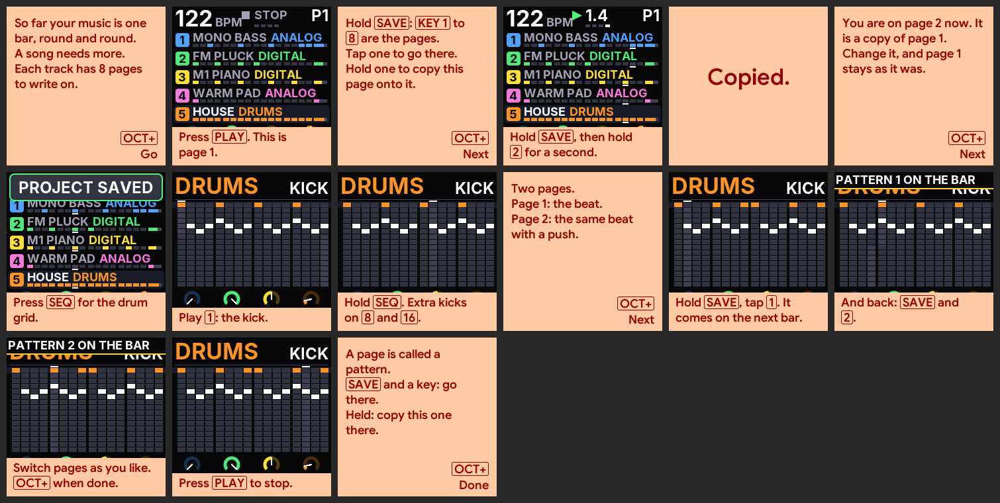

# Lesson 16: Eight patterns

- **Part:** 3, effects and sound
- **The idea:** a song is made of patterns, and there are eight. A pattern keeps what is saved into it.
- **The learner does:** adds two kicks to the beat, saves that into pattern 2, and switches between the two patterns
  while the song plays.
- **Got it when:** they can go to a pattern, and save into one, and know which is which.
- **Song:** HOUSE ONE, section C, its first bar, on pattern 1.
- **Style in the end:** dance music (a verse beat and a chorus beat)
- **Tied to the song:** the two extra kicks (boxes 8 and 16 hold no kick in this beat).

## Steps

1. **Setup:** song HOUSE ONE section C, 1 bar; track drums; pick KICK; page TRACKS
2. **Card:** So far your music is / one bar, on a loop. / A song needs more. // You have 8 patterns. / Each pattern holds / all five tracks.
   - **OCT+:** Go
3. **Strip:** Press [PLAY]. This is / pattern 1: the 1, top right.
   - **Do:** press PLAY
   - **Until:** playing
4. **Card:** _Patterns: hold [SAVE] / Keys [1] to [8] / are the 8 patterns. // Tap a key: go there. / Hold a key: save what / plays into it.
   - **OCT+:** Next
5. **Card:** _A second pattern / Change the beat a little. / Then save it into / pattern 2. // Pattern 1 stays / as it was saved.
   - **OCT+:** Next
6. **Strip:** Press [SEQ] for / the drum grid.
   - **Do:** press SEQ
   - **Until:** page is STEPS
7. **Strip:** Extra kicks: [8] and [16].
   - **Do:** tap box 8 16
   - **Until:** drums has KICK on boxes 8 16
   - **Hint:** Tap the blinking keys.
   - **Page:** STEPS
8. **Strip:** Hold [SAVE] + [2] until / the top says SAVED.
   - **Do:** hold SAVE, long box 2
   - **Until:** drums pattern 2 has notes and drums on pattern 1 and drums has 20 notes or more
   - **Hint:** No sound? Hold [SAVE], / tap [1]: the beat is back. / Then the kicks, and save.
   - **Hint:** Keep holding both until / the top says SAVED.
   - **Robot:** hold SAVE, hold box 2, wait 2.2, let go
9. **Reply:** Saved.
10. **Card:** _Two patterns / Pattern 2: the beat with / the two extra kicks. // Pattern 1: the beat as it / was. Its new kicks were / not saved into it.
    - **OCT+:** Next
11. **Strip:** Hold [SAVE], tap [1]. / It waits for the bar's end.
    - **Do:** hold SAVE, tap box 1
    - **Until:** drums has no KICK on boxes 8 16
12. **Strip:** And to pattern 2: / [SAVE] + [2].
    - **Do:** hold SAVE, tap box 2
    - **Until:** drums on pattern 2
13. **Strip:** Switch as you like. / [OCT+] when done.
    - **OCT+:** Done
14. **Strip:** Press [PLAY] to stop.
    - **Do:** press PLAY
    - **Until:** stopped
15. **Card:** _Patterns / Go to one: / [SAVE] + its key. / Save into one: / [SAVE] + hold its key. // A change not saved is / gone when you switch.
    - **OCT+:** Done

## Screens

The lesson's cards and strips in order, from the robot's run on the simulated FM-1.

## Notes for the AI assistant

- The word is "pattern", SLOOP's own, from here on. "Page" is kept for what the screen shows (the tracks page, the
  drum grid). Holding [SAVE] shows the SONG page: eight tiles, one for each pattern, and `TAP: PATTERN · HOLD: SAVE`.
- Two moves, and they are easy to mix up (SLOOP 3.4.2):
  - **[SAVE] + a key held** for a second and a half saves what is playing into that pattern. The tile fills, the top
    says `PATTERN 2 FROM 1 · SAVING`, then a big green SAVED. The learner stays on the pattern they were on.
  - **[SAVE] + a key tapped** goes to that pattern as it was saved, at the end of the bar (`PATTERN 2 ON THE BAR`).
    Tapping the pattern that is playing brings it back as saved (`PATTERN 1 · AS SAVED`).
- Nothing is copied. A pattern changes only when something is saved into it, so a change that was not saved is gone
  when the learner leaves the pattern. Step 11 shows this: the two kicks were saved into pattern 2, never into
  pattern 1, and [SAVE] + [1] takes them away. That is the lesson working, not a mistake.
- If the key is let go too early in step 8, SLOOP goes to pattern 2, which is empty: the music stops and the kicks
  are lost. The first hint says the way back: [SAVE] + [1] for the beat, the two kicks again on the drum grid, then
  the save. The step waits until pattern 2 holds the beat with the kicks.
- A pattern already used asks once more before it is saved over: `AGAIN: SAVE INTO 2`. Hold the key a second time.
- A pattern change waits for the end of the bar, so nothing ever jumps out of time.
- All five tracks change pattern together. One track can change alone ([SAVE] held, key 15), and keys tapped one
  after another without letting go of [SAVE] make a chain; leave both for later.
- Saving into a pattern also saves the project. The FM-1 is busy for a moment afterwards and may miss a press.

## Tester notes

2026-11-20, the round from the notes ("go back and make adjustment based on all of the notes").

- Framed key names: `[KEY 1] TO [8] ARE THE PAGES`, `HOLD [SAVE], THEN HOLD [2] FOR A SECOND.`

2026-11-26, the move to SLOOP 3.4.2. The lesson stopped at its copy step both ways: 3.4.2 has no "copy this page".
[SAVE] + a key held saves what plays into that pattern and stays where it is; a pattern gone to comes back as it was
saved. The goal is the same, a second version of the beat and switching between the two, so the lesson is reworked
in a new order and named "Eight patterns" (was "Eight pages"; the file is renamed with it). Shown whole ("Yes, all of
it").

- **The order turns round.** Was: copy page 1 onto page 2, then change the copy. Now: add the two kicks, save that
  into pattern 2, then [SAVE] + [1] brings pattern 1 back as it was saved and the kicks go away. The step shows the
  new rule where a card would only tell it.
- **"Page" is "pattern" throughout:** `You have 8 patterns. / Each pattern holds / all five tracks.`; `Press [PLAY].
  This is / pattern 1: the 1, top right.` (was `page 1: P1, top right.`).
- **Step 4, the card:** `_Patterns: hold [SAVE] / Keys [1] to [8] / are the 8 patterns. // Tap a key: go there. / Hold
  a key: save what / plays into it.` (was `... Hold a key: copy / this page onto it.`).
- **Step 5, the card:** `_A second pattern / Change the beat a little. / Then save it into / pattern 2. // Pattern 1
  stays / as it was saved.` (was `_Why copy a page? ...`).
- **Step 7:** `Extra kicks: [8] and [16].` (was `Hold [SEQ]. Extra kicks on [8] and [16].`). `Play [1]: the kick.` is
  gone: the setup picks the kick.
- **Step 8, the save:** `Hold [SAVE] + [2] until / the top says SAVED.` (was `... says COPY.`), then `Saved.` Its first
  hint is the way back from a key let go too early: `No sound? Hold [SAVE], / tap [1]: the beat is back. / Then the
  kicks, and save.` Tried on the simulated FM-1 on both paths.
- **Step 10, one card for two:** `_Two patterns / Pattern 2: the beat with / the two extra kicks. // Pattern 1: the
  beat as it / was. Its new kicks were / not saved into it.`
- **Steps 12 and 13:** `And to pattern 2: / [SAVE] + [2].` and `Switch as you like. / [OCT+] when done.`
- **The last card:** `_Patterns / Go to one: / [SAVE] + its key. / Save into one: / [SAVE] + hold its key. // A change
  not saved is / gone when you switch.`
- 15 steps (were 17).
