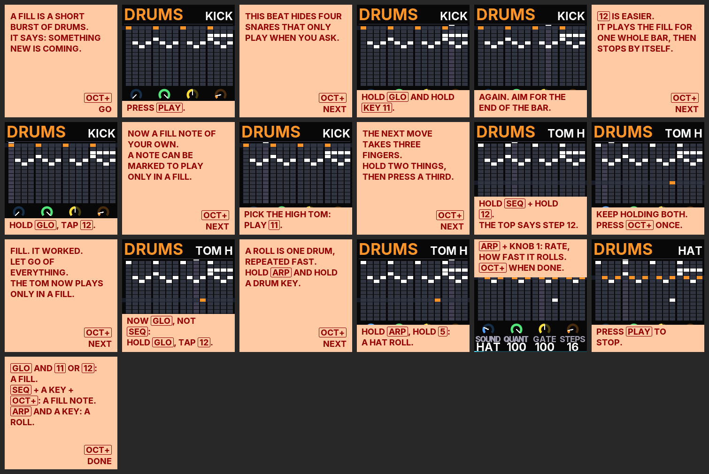

# Lesson 17: Fills and rolls

- **Part:** 3, effects and sound
- **The idea:** a fill says "something new is coming".
- **The learner does:** plays a fill by hand, marks a note so it only plays in a fill, and plays a drum roll.
- **Got it when:** they drop a fill in at the end of a bar, on purpose.
- **Song:** HOUSE ONE, section C, its first bar. Four snares have been added that only play in a fill.
- **Style in the end:** trap (hat rolls and fills)
- **Tied to the song:** the fill snares in boxes 13 to 16, and box 12 for the learner's own.

## Steps

1. **Setup:** song HOUSE ONE section C, 1 bar; drums fill SNARE on 13 14 15 16; track drums; page STEPS
2. **Card:** A fill is a short / burst of drums. // It says: something / new is coming.
   - **OCT+:** Go
3. **Strip:** Press [PLAY].
   - **Do:** press PLAY
   - **Until:** playing
4. **Card:** This beat hides / four snares. // They only play / when you ask.
   - **OCT+:** Next
5. **Strip:** Hold [GLO] and hold [11].
   - **Do:** hold GLO, long box 11
   - **Until:** fill on
6. **Strip:** Again. Aim for / the end of the bar.
   - **Do:** hold GLO, long box 11
   - **Until:** fill on
7. **Card:** [12] is easier. // It plays the fill for / one whole bar, then / stops by itself.
   - **OCT+:** Next
8. **Strip:** Hold [GLO], tap [12].
   - **Do:** hold GLO, tap box 12
   - **Wait:** 2 bars
9. **Card:** Now a fill note / of your own. // A note can be marked / to play only in a fill.
   - **OCT+:** Next
10. **Strip:** Pick the high tom: / play [11].
    - **Do:** tap box 11
    - **Page:** STEPS
11. **Card:** The next move takes / three fingers. // Hold two things, / then press a third.
    - **OCT+:** Next
12. **Strip:** Hold [SEQ] + hold [12]. / The top says STEP 12.
    - **Do:** hold SEQ, hold box 12
    - **Until:** drums has TOM H on box 12
    - **Hint:** Hear a crash? [SEQ] was not held. Hold [SEQ] first.
13. **Strip:** Keep holding both. / Press [OCT+] once.
    - **Do:** hold SEQ, hold box 12, press OCT+
    - **Until:** drums has 5 fill notes or more
    - **Hint:** Hold [SEQ] + [12], then [OCT+] once. The top says FILL.
    - **Hint:** Top says NO FILL? [OCT-] puts it back. Then [OCT+] once.
14. **Card:** FILL. It worked. / Let go of everything. // The tom now plays / only in a fill.
    - **OCT+:** Next
15. **Strip:** Now [GLO], not [SEQ]: / hold [GLO], tap [12].
    - **Do:** hold GLO, tap box 12
    - **Wait:** 2 bars
16. **Card:** A roll is one drum, / repeated fast. // Hold [ARP] and hold / a drum key.
    - **OCT+:** Next
17. **Strip:** Hold [ARP], hold [5]: / a hat roll.
    - **Do:** hold ARP, long box 5
18. **Strip top:** [ARP] + [KNOB1]: RATE, / how fast it rolls. / [OCT+] when done.
    - **OCT+:** Done
    - **Robot:** hold ARP, turn KNOB 1 right 1, long box 5, let go
19. **Strip:** Press [PLAY] to stop.
    - **Do:** press PLAY
    - **Until:** stopped
20. **Card:** Fill: [GLO] + [11] or [12]. / Fill note: / [SEQ] + a key + [OCT+]. / Roll: [ARP] + a key.
    - **OCT+:** Done

## Screens

The lesson's cards and strips in order, from the robot's run on the simulated FM-1.

## Notes for the AI assistant

- A fill does nothing unless some notes are marked FILL. That is why the lesson hides four snares in the beat
  first.
- With SEQ and a box held, each press of OCT+ moves the box's rule on: ALWAYS, FILL, NO FILL, then others (1 OF 2,
  chances). If the learner presses twice they get NO FILL: the note plays except in a fill. OCT- puts the box
  back to ALWAYS.
- The fill note is taught in stages (steps 11 to 14): a card says the move takes three fingers; SEQ and key 12
  held puts the tom in and the top says STEP 12; OCT+ once makes it FILL; a card then says to let go. A crash
  heard on the way means SEQ was not down when the key was pressed.
- Marking a box marks every drum in it: the hat on box 12 becomes a fill note with the tom. That is SLOOP's rule.
- A step that waits for a fill or an effect does not go by on one still held from the step before: the learner
  has to let go and do it again.
- The lesson cannot see key 12's one-bar fill, only that the key was pressed.
- The roll is live: it is heard, and it is written down only if REC is on.

## Tester notes

2026-11-19, on the real FM-1.

- **Step 10, the fill note, was not understood.** "Keep SEQ and the box down. The top says FILL. Can you explain
  this, I am stuck." The step ran 134 seconds: the hint, STUCK? twice (TRY AGAIN, then SHOW ME). What went wrong
  with the hands is not in the log. Three things make it hard:
  - It is three holds at once and in order (SEQ, then the box, then OCT+), the only step so far that asks that.
    Letting the box go before OCT+ does nothing, and nothing on the screen says why.
  - The hint reads as a statement ("THE TOP SAYS FILL") when it means "when it works, the top of the screen
    shows FILL". It does not say what to do differently.
  - A second press of OCT+ goes past FILL to NO FILL, and the step then never ends.
  Ideas, none applied: split it in two steps (HOLD [SEQ] AND HOLD BOX 12, then KEEP BOTH DOWN, PRESS [OCT+] ONCE);
  hint `PRESS [OCT+] ONCE WHILE / BOTH ARE HELD. THE TOP / OF THE SCREEN SHOWS FILL.`; let the step also end,
  with a message, when the box says NO FILL.
- **Marking the box marks every drum in it.** After the step, box 12 held the high tom and the hat that was
  already there, both FILL: the hat on box 12 no longer plays outside a fill. That is SLOOP's rule (the mark is
  the box's). An empty box would avoid it; in this beat every box holds something, so the lesson could clear
  box 12 in its setup.
- **Second play, the same day: step 10 again, 154 seconds.** The hint, STUCK? twice (TRY AGAIN both times), then
  done by hand after the step was explained in chat. "What does the box down mean?" The words that failed are
  THE BOX (the two steps before call the same key KEY 12) and DOWN (for "still held").
- **His wording:** "Hold Glo + key2 + Oct+", then "hold Glo+ Hold key12 + press OCT+". Read here as the form he
  wants for this step, with SEQ meant ("yes I meant seq"): each thing with its own verb, joined by +, and KEY 12
  where the strip says BOX 12. A strip in that form:
  `HOLD [SEQ] + / HOLD KEY 12 + / PRESS [OCT+] ONCE.` Not applied, not measured yet.
  He wrote GLO both times. If GLO is what the hand goes to, that is a finding too: steps 5, 7 and 11 are all
  [GLO] and key 12, and this one is [SEQ] and the same key, so the step could say "THIS TIME [SEQ], NOT [GLO]".
- **After the step ended the note went on to NO FILL.** At the lesson's end boxes 11 and 12 (open hat, high tom,
  hat) all said NO FILL: OCT+ was pressed again after the step had ended, with key 11 held too at some point.
  The step ends the instant FILL is reached, while the fingers are still down, and nothing says to stop.
- **To revisit: "it is still a bit confusing", the most confusing lesson so far.** His idea: "introduce the idea
  of holding multiple buttons, and that sometimes you might need to hold in two buttons and then press a
  third." This is the first move in the course that takes three fingers; everything before is one hold and
  one tap. A sketch, nothing applied:
  - a card before the step: `SOME MOVES TAKE THREE FINGERS. / HOLD TWO THINGS DOWN, / THEN PRESS A THIRD.`
  - the move in two steps: first `HOLD [SEQ] + HOLD KEY 12.` (the tom goes in), then
    `KEEP BOTH DOWN. / PRESS [OCT+] ONCE.` To check: whether the lesson can see that the key is still held.
  - when FILL is reached: `FILL. LET GO NOW.`, so that no further press moves it on to NO FILL.
  - worth saying once, early in the course, as a rule of the FM-1 (hold one thing, press another), and here
    as its bigger form. Lessons 23 and 27 come back to the same move and take the same wording.

2026-11-20, the hidden-screen pass ("Yes, fix them"). Only the two steps that hid the screen; the rework of the
fill note above is still open.

- Old step 4 is a card with an answer and then the strip `HOLD [GLO] AND HOLD WHITE KEY 11.` With GLO held the
  screen is the MIX page, and its FILL tile lights while the fill is on: that was under the card.
- The roll's speed (old step 14) is a strip at the top: `[ARP] + KNOB 1: RATE, / HOW FAST IT ROLLS.` With ARP
  held the screen is the ROLL page, with one dial, RATE (1/16, 1/32 ...), at the bottom left.
- 17 steps: from old step 5 on, add one to the numbers above (the fill note is step 11 now).

2026-11-20, third play on the real FM-1 (the steps as renumbered: the fill note is step 11).

- **Stuck at the fill note again, more than four minutes:** the hint, then STUCK? three times, TRY AGAIN each time.
  "It is asking me to put a fill on 12 but when I press 12 it turns to crash, no longer fill."
  - What the FM-1 held at that moment: box 12 with its hat only, nothing written. So SEQ was not down when key
    12 went down: the key then plays its drum, the crash, and the drum's name at the top right changes to
    CRASH.
  - He was reading the top of the screen for FILL, as the hint says (`THE TOP SAYS FILL`), and saw CRASH there.
    The hint never says that hearing a drum means SEQ is not held.
  - The steps before use the same key with GLO for a fill ("fill on 12"); here the word FILL is on the screen
    only after OCT+, and nothing says what the screen shows on the way (with SEQ and the key down, the top
    says `STEP 12` and `ALWAYS`).
  - For the rework: say what each stage looks like. `HOLD [SEQ] + HOLD KEY 12.` (the top says STEP 12, no drum
    sounds), then `KEEP BOTH DOWN. / PRESS [OCT+] ONCE.` (the top says FILL), and a hint for the wrong turn:
    `HEAR A CRASH? [SEQ] WAS NOT DOWN. HOLD [SEQ] FIRST.`
- **The same play, what the log shows.** The first time through, the fill note took 292 seconds and was ended by
  SHOW ME. He played the lesson again at once (AGAIN on the DONE card):
  - The fill note was done by hand in 40 seconds, after the order was spelled out in chat (SEQ first and kept
    down, then the key, then OCT+ once).
  - He did not know it had worked: "I'm still having issues with the step when I am supposed to hold seq hold
    key 12 and then press Oct+." The step ended the instant FILL was reached, with no word, and the next strip,
    `HEAR IT: [GLO] AND KEY 12.`, looks like the same move. That step then took 96 seconds and was ended by
    SHOW ME.
  - He went on doing the move: box 13 was marked too (its kick, clap and snare all FILL), so the beat lost a
    kick outside the fill.
  - So the rework needs a plain stop after the mark (`FILL. LET GO NOW.` as a reply, or a card with an answer),
    and the next step has to say that the hand changes: `NOW [GLO], NOT [SEQ]: / HOLD [GLO], TAP KEY 12.`
  "I know there was a problem with this before, did we fix it?" No: only the two steps that hid the screen.

2026-11-20, the round from the notes ("go back and make adjustment based on all of the notes").

- The fill note is rebuilt from the sketch above (steps 10 to 15): `PICK THE HIGH TOM: / PLAY [11].`; a card `THE
  NEXT MOVE TAKES THREE FINGERS. / HOLD TWO THINGS DOWN, / THEN PRESS A THIRD.`; `HOLD [SEQ] + HOLD [12]. / THE TOP
  SAYS STEP 12.` (it ends when the tom is in the box; hint `HEAR A CRASH? [SEQ] WAS NOT DOWN. HOLD [SEQ] FIRST.`);
  `KEEP BOTH DOWN. / PRESS [OCT+] ONCE.` (hints: `[SEQ] + [12] DOWN, THEN [OCT+] ONCE. THE TOP SAYS FILL.` and `TOP
  SAYS NO FILL? [OCT-] PUTS IT BACK. THEN [OCT+] ONCE.`); a card with an answer, `FILL. IT WORKED. / LET GO OF
  EVERYTHING. / THE TOM NOW PLAYS ONLY IN A FILL.`, which takes OCT+ so a press too many does nothing; then `NOW
  [GLO], NOT [SEQ]: / HOLD [GLO], TAP [12].`
- The two fills in a row (steps 5 and 6) can no longer be ended by one long hold: a step that waits for a fill does
  not go by on one still held.
- Still as it was: marking box 12 also marks the hat in it. 20 steps.
