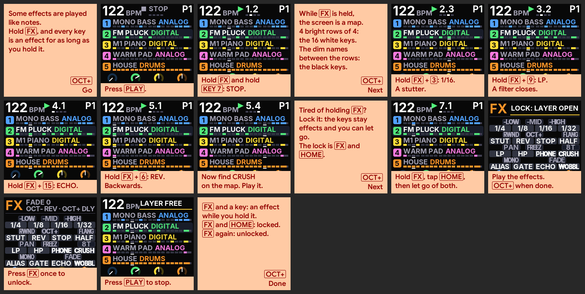

# Lesson 18: Play the effects

- **Part:** 3, make it move
- **The idea:** some effects are played like notes.
- **The learner does:** holds FX and plays the punch-in effects on the keys, then locks them on so both hands are
  free.
- **Got it when:** they play effects in time with the song, and can let them go again.
- **Song:** HOUSE ONE, section C, all four bars.
- **Style in the end:** dance music

## Steps

1. **Setup:** song HOUSE ONE section C; track lead; page TRACKS
2. **Card:** Some effects are played like notes. / Hold [FX], and every key is an effect for as long as you hold it.
   - **OCT+:** Go
3. **Strip:** Press [PLAY].
   - **Do:** press PLAY
   - **Until:** playing
4. **Strip:** Hold [FX] and hold [KEY 7]: STOP.
   - **Do:** hold FX, long box 7
   - **Until:** punch on
   - **Hint:** Keep holding [FX], then hold the blinking key.
5. **Card:** While [FX] is held, / the screen is a map. / 4 bright rows of 4: / the 16 white keys. / The dim names / between the rows: / the black keys.
   - **OCT+:** Next
6. **Strip:** Hold [FX] + [3]: 1/16. / A stutter.
   - **Do:** hold FX, long box 3
   - **Until:** punch on
7. **Strip:** Hold [FX] + [9]: LP. / A filter closes.
   - **Do:** hold FX, long box 9
   - **Until:** punch on
8. **Strip:** Hold [FX] + [15]: ECHO.
   - **Do:** hold FX, long box 15
   - **Until:** punch on
9. **Strip:** Hold [FX] + [6]: REV. / Backwards.
   - **Do:** hold FX, long box 6
   - **Until:** punch on
10. **Strip:** Now find CRUSH / on the map. Play it.
    - **Until:** punch on
    - **Hint:** CRUSH is in row 3, the last one: hold [FX] + [12].
    - **Robot:** hold FX, long box 12
11. **Card:** Tired of holding [FX]? / Lock it: the keys stay effects and you can let go. / The lock is [FX] and [HOME].
    - **OCT+:** Next
12. **Strip:** Hold [FX], tap [HOME], / then let go of both.
    - **Do:** hold FX, press HOME
    - **Until:** says LOCK
13. **Strip:** Play the effects. / [OCT+] when done.
    - **OCT+:** Done
    - **Robot:** long box 4, long box 14
14. **Strip:** Press [FX] once to unlock.
    - **Do:** press FX
    - **Until:** pressed FX
15. **Strip:** Press [PLAY] to stop.
    - **Do:** press PLAY
    - **Until:** stopped
16. **Card:** [FX] and a key: an effect while you hold it. / [FX] and [HOME]: locked. / [FX] again: unlocked.
    - **OCT+:** Done

## Screens

The lesson's cards and strips in order, from the robot's run on the simulated FM-1.

## Notes for Claude

- While FX is held the screen shows all 27 effects by name, in the keys' order. The white keys, low to high: 1/4,
  1/8, 1/16, 1/32 (repeats), STUT, REV, STOP, HALF, LP, HP, PHONE, CRUSH, ALIAS, GATE, ECHO, WOBBL. The black keys
  hold eleven more.
- Effects work on the whole song, not one track, and only while it plays.
- They sound best started on a beat and let go on a beat. If the learner's timing is loose, suggest the last beat
  of a bar.
- While the effects are locked on, the keys play no notes. Any button other than PLAY, REC and the OCT pair
  frees them.

## Tester notes

2026-11-19, on the real FM-1.

- **Step 11, `PRESS [FX] TO LET THEM GO.`, could not be ended** ("press [FX] to let them go"): STUCK? after 45
  seconds, TRY AGAIN, still there. The step waits for SLOOP to say LAYER FREE, and SLOOP only says it when a
  layer is locked. It very likely was not:
  - step 9 (the lock) ran 55 seconds and ended by SHOW ME, and the log says `shown hold FX, press HOME (and the
    lesson still does not see: says LOCK)`. So SHOW ME's own move did not lock either. To check: whether a HOME
    pressed by the computer counts FX as held (the lock looks at the buttons really held down).
  - or the lock was let go during step 10: any button but PLAY, REC and the OCTs frees it, and after five steps
    of "hold [FX] and a key" the hand goes to FX by habit.
  Either way the lesson then asks for something that cannot happen. Ideas, none applied: step 11 also ends when
  FX is pressed with nothing locked; step 10 checks that the lock is still on and puts it back; step 9 must
  not be ended by SHOW ME without the lock really on.
- **Step 9 itself took 55 seconds.** What the hands did is not known. The wording to look at: `HOLD [FX] AND
  PRESS [HOME]` on a card, where every move before was on a strip.

2026-11-20, the hidden-screen pass ("Yes, fix them"). The two faults above (the lock not seen, the step that
cannot end) are still open.

- The lock (old step 9) is a card with an answer and then the strip `HOLD [FX] AND PRESS [HOME].`, so SLOOP's
  `LOCK: LAYER OPEN` shows at the top when it works.
- The free play after it was three lines high and sat on the lowest row of effect names (ALIAS, GATE, ECHO,
  WOBBL). It is two lines: `PLAY THE EFFECTS. / [OCT+] WHEN DONE.` BOTH HANDS FREE moved onto the card.
- 14 steps: from old step 10 on, add one to the numbers above.

2026-11-20, second play on the real FM-1 (the steps as renumbered).

- **The lock's card was not understood** (a photo of it: "what does this mean, can we say this in a better way?").
  The card, written the same morning: `HOLDING [FX] TAKES A HAND. / [FX] AND [HOME] LOCK THE EFFECTS ONTO THE
  KEYS. / THEN BOTH HANDS ARE FREE.` "Takes a hand" and "lock the effects onto the keys" are the hard parts: it
  never says what the problem is (one hand is stuck on FX) nor what locking does (the keys stay effects after
  FX is let go). A wording that says both, seven lines with its answer:
  `TIRED OF HOLDING [FX]? / LOCK IT: THE KEYS STAY EFFECTS AND YOU CAN LET GO. / THE LOCK IS [FX] AND [HOME].`
  Then the move as `HOLD [FX], TAP [HOME], / THEN LET GO OF BOTH.` and the way out as `PRESS [FX] ONCE TO
  UNLOCK.` Applied the same day ("Yes, change it"), with the last card saying LOCKED and UNLOCKED to match.
- **Four effects went by unseen.** After `HOLD [FX] AND HOLD WHITE KEY 7: STOP.` (8.9 seconds) the strips for the
  stutter, the filter, the echo and backwards each ended within a hundredth of a second (`already: punch on`),
  because the first effect was still held when they began. Each of steps 5 to 8 only waits for "an effect is
  on", so one long hold ends all five. The learner goes from the first effect straight to the lock's card.
  To fix: each of these steps has to begin with no effect on (wait for the key to be let go first), or check
  for its own key. The same holds wherever two steps in a row wait for the same thing (lesson 17's two fills
  with `fill on`: the log there shows `already: fill on` too).

2026-11-20, the round from the notes ("go back and make adjustment based on all of the notes").

- The four effects can no longer go by unseen: a step that waits for an effect does not go by on one still held
  from the step before (both engines). Played on the simulated FM-1 by a robot that is slow to let go.
- The unlock step ends when FX is pressed, locked or not.
- SHOW ME's own presses do lock the layer (tried on the simulated FM-1); the log's remark was only SHOW ME not
  reading the message.
- The same evening: "Maybe we should put this in a lesson, how to see it and how to read it. Is it already in a
  lesson?" (the screen while FX is held: a map of the keys, with an effect's name on each). It was on the screen
  all through this lesson and no step said so. Added:
  - step 5, a card after the first effect: `WHILE [FX] IS DOWN, / THE SCREEN IS A MAP / OF THE KEYS. / BIG NAMES: WHITE
    / KEYS, 4 IN A ROW. / SMALL NAMES: BLACK / KEYS.`
  - the four effect strips name what the map says: `[FX] AND [3]: 1/16. / A STUTTER.`, `[FX] AND [9]: LP. / A FILTER
    CLOSES.`, `[FX] AND [15]: ECHO.`, `[FX] AND [6]: REV. / BACKWARDS.` Two lines each, so the map's lowest row stays
    in view. The tile of the effect that is held lights up on the map.
  - step 10, to do alone: `NOW FIND CRUSH / ON THE MAP. PLAY IT.`, no blinking key; the hint gives it away after a
    while (`CRUSH IS IN ROW 3, THE LAST ONE: [FX] AND [12].`). The lesson cannot tell which effect was played, so
    any effect ends the step.
  16 steps: the lock's card is step 11 now.
- Two more of his notes on the new steps, applied at once:
  - "I think it should say hold or held because that is the language we used before. If you press FX it cycles
    through the effects [pages]." The card says `WHILE [FX] IS HELD`, and the four strips say `HOLD [FX] + [3]: 1/16.`
    and so on. The same was done wherever a lesson said DOWN for holding (lessons 2, 5, 8, 10, 16, 17, 23, 28):
    `KEEP HOLDING [SEQ].`, `[SEQ] WAS NOT HELD.`, `KEEP HOLDING BOTH.` Lesson 1's card keeps `HOLD: KEEP IT DOWN.`,
    which is where the word is explained.
  - "Can you explain the big names small names, I don't see big names and small names." On the FM-1 the difference
    is not size: the white keys' names are bright, in four rows of four; the black keys' names are dim and sit
    between the rows. The card now reads `WHILE [FX] IS HELD, / THE SCREEN IS A MAP. / 4 BRIGHT ROWS OF 4: / THE 16
    WHITE KEYS. / THE DIM NAMES / BETWEEN THE ROWS: / THE BLACK KEYS.`

