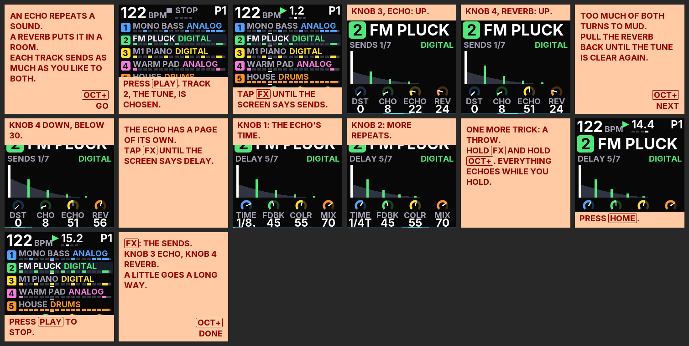

# Lesson 19: Echo and space

- **Part:** 3, effects and sound
- **The idea:** a delay repeats a sound, and a reverb puts it in a room.
- **The learner does:** sends the tune to the echo and the reverb, finds out what too much sounds like, and
  changes the echo itself.
- **Got it when:** they add a little echo or reverb to a track on purpose, and take it off again.
- **Song:** HOUSE ONE, section C, all four bars.
- **Style in the end:** dub

## Steps

1. **Setup:** song HOUSE ONE section C; track lead; page TRACKS
2. **Card:** Echo repeats a sound, / like a shout in a canyon. // Reverb puts it in a room, / like singing in a church. // You decide how much / each track sends.
   - **OCT+:** Go
3. **Strip:** Press [PLAY]. Track 2, the tune, is chosen.
   - **Do:** press PLAY
   - **Until:** playing
4. **Strip top:** Tap [FX] until the bottom / corner says FX 1/7.
   - **Do:** press FX
   - **Until:** page is SENDS
   - **Robot:** press FX, press FX, press FX, press FX, press FX, press FX, press FX
5. **Strip:** [KNOB3], DLY: echo. / Turn it up.
   - **Do:** turn KNOB 3 right 5
   - **Until:** lead delay above 50
   - **Page:** SENDS
6. **Strip:** [KNOB4], REV: reverb. / Turn it up.
   - **Do:** turn KNOB 4 right 5
   - **Until:** lead reverb above 55
   - **Page:** SENDS
7. **Card:** Too much of both / turns to mud. // Pull the reverb back / until the tune is clear.
   - **OCT+:** Next
8. **Strip:** [KNOB4] down past 30.
   - **Do:** turn KNOB 4 left 5
   - **Until:** lead reverb below 30
   - **Page:** SENDS
9. **Card:** The echo has a page / of its own. // It is called DLY.
   - **OCT+:** Next
10. **Strip top:** Tap [FX] until the bottom / corner says DLY 6/7.
    - **Do:** press FX
    - **Until:** page is DELAY
    - **Robot:** press FX, press FX, press FX, press FX
11. **Strip:** [KNOB1] is TIME: / the echo time.
    - **Do:** turn KNOB 1 left 1
    - **Page:** DELAY
12. **Strip:** [KNOB2] is FDBK: / more repeats.
    - **Do:** turn KNOB 2 right 5
    - **Page:** DELAY
13. **Card:** One more trick: a throw. // Hold [FX] and [OCT+]: / everything echoes / while you hold.
    - **OCT+:** Next
14. **Strip:** Hold [FX] + hold [OCT+].
    - **Do:** hold FX, press OCT+
15. **Strip:** Press [HOME].
    - **Do:** press HOME
    - **Until:** page is TRACKS
16. **Strip:** Press [PLAY] to stop.
    - **Do:** press PLAY
    - **Until:** stopped
17. **Card:** FX page: [FX]. / Echo: DLY, [KNOB3]. / Reverb: REV, [KNOB4]. // A little goes a long way.
    - **OCT+:** Done

## Screens

The lesson's cards and strips in order, from the robot's run on the simulated FM-1.

## Notes for the AI assistant

- The sends belong to the track that is chosen. ALGORITHM changes track without leaving the page, so the learner
  can go round all five.
- Reverb on the bass and the kick muddies a mix fastest. Reverb on a snare or a tune is the classic use.
- FX held with OCT- is the reverb throw, the partner of the echo throw in step 14.
- [FX] tapped goes round seven pages (SLOOP 3.4.2), and the page's name is in the bottom right corner of the screen:
  `FX 1/7` (the sends: DST, CHO, DLY, REV), `FILTER 2/7`, `SLICER 3/7`, `INSERT 4/7`, `INSERT 2 5/7`, `DLY 6/7` (the echo:
  TIME, FDBK, COLR, MIX), `REV/CHO 7/7`, then `FX 1/7` again. [FX] opens the FX page that was shown last, even after
  [HOME] and in the next lesson: on an FM-1 just switched on one tap reaches `FX 1/7`, otherwise it may take up to
  seven. That is why the strips say "until the bottom corner says". A learner who has tapped past a page keeps
  tapping; it comes round again.
- On `FX 1/7` and `DLY 6/7` the knobs' names and values are a small row along the top, with a picture of sliders under
  it. So the strips that turn a knob are at the bottom, and the two that look for a page (steps 4 and 10) are at
  the top, clear of the corner they point at.
- DLY is SLOOP's name for the echo and REV for the reverb; FDBK is how many times the echo repeats.

## Tester notes

2026-11-19, on the real FM-1.

- **Step 9 cannot be done by looking: the card hides the page it asks for.** "The echo has a page of its own, tap
  [FX] until the screen says DELAY. There is no button to advance at the bottom of the page; when I press OCT+
  nothing happens, if I press FX nothing happens." 119 seconds, STUCK? twice, ended by SHOW ME. FX was working:
  each tap went to the next effects page, behind a card that fills the screen. They could not see where they were,
  nor when to stop, and a card with nothing at its bottom looks broken.
  The step has to be a strip, so the page's name shows: `TAP [FX] UNTIL THE / SCREEN SAYS DELAY.` Not applied.

2026-11-20, the hidden-screen pass ("Yes, fix them").

- Applied. Old step 9 is a card with an answer (`... IT IS CALLED DELAY.`) and then the strip `TAP [FX] UNTIL THE
  SCREEN SAYS DELAY.`; the throw (old step 12) is a card with an answer and then `HOLD [FX] AND HOLD [OCT+].`
  With FX held the top of the screen says `OCT- REV · OCT+ DLY`, in view above the strip. 17 steps.

2026-11-26, the move to SLOOP 3.4.2. Its goal is the same. The lesson played through, but its words named pages that
3.4.2 calls otherwise (SENDS is `FX 1/7`, DELAY is `DLY 6/7`, the name in the bottom right corner), and its strips sat on
the wrong side: on these two pages the knobs' names and values are a small row along the top with sliders under it.
Shown whole.

- **The strips change sides.** The knob strips (steps 5, 6, 8, 11, 12) are at the bottom; the two that look for a page
  (steps 4 and 10) are at the top.
- **Steps 4 and 10:** `Tap [FX] until the bottom / corner says FX 1/7.` and `... / corner says DLY 6/7.` (were `Tap [FX]
  until / the screen says SENDS.` and `... says DELAY.`). Suggested first as `... until the corner / says FX 1/7.` The
  course's author: "For step 4 should the strip be on the bottom? where does it say FX 1/7". A picture of both
  placings, after one tap of [FX]: the name is in the bottom right corner and a strip at the bottom covers it. So the
  strip stays at the top, and the words say which corner ("Yes, use it"), as the hints of lessons 6, 7 and 11 do.
- **Steps 5 and 6 name the knob as the screen does:** `[KNOB3], DLY: echo. / Turn it up.` and `[KNOB4], REV: reverb. /
  Turn it up.` (were `[KNOB3], echo: up.` and `[KNOB4], reverb: up.`).
- **Steps 11 and 12:** `[KNOB1] is TIME: / the echo time.` and `[KNOB2] is FDBK: / more repeats.` (were `[KNOB1]: the echo
  time.` and `[KNOB2]: more repeats.`).
- **Step 9's card** ends `It is called DLY.` (was `DELAY`), and **the last card** reads `FX page: [FX]. / Echo: DLY,
  [KNOB3]. / Reverb: REV, [KNOB4]. // A little goes a long way.` (was `Sends page: [FX]. / Echo: [KNOB3]. / ...`).
- Still 17 steps.
