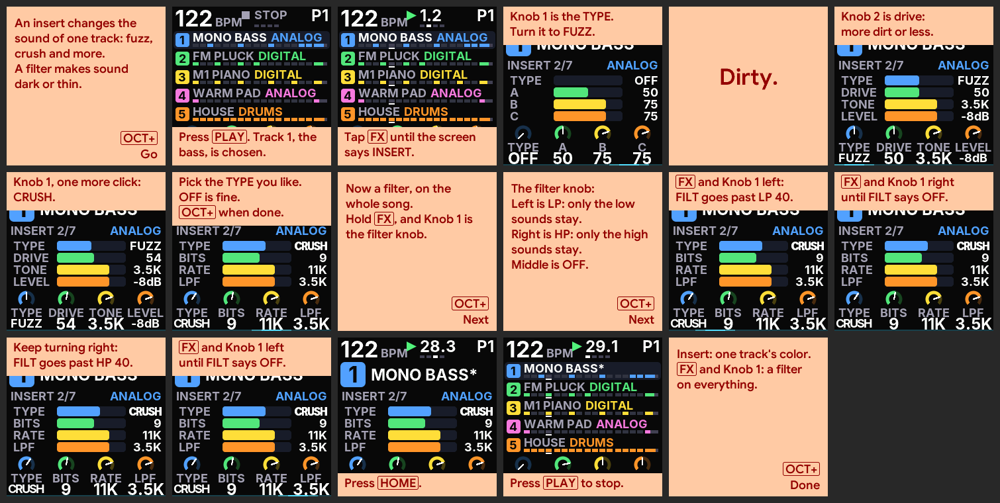

# Lesson 20: Color a track

- **Part:** 3, make it move
- **The idea:** an insert changes one track, and a filter makes sound dark or bright.
- **The learner does:** puts FUZZ and then CRUSH on the bass, and sweeps a filter over the whole song.
- **Got it when:** they can dirty one track on purpose, and open and close the filter in time.
- **Song:** HOUSE ONE, section C, all four bars.
- **Style in the end:** synthwave

## Steps

1. **Setup:** song HOUSE ONE section C; track bass; page TRACKS
2. **Card:** An insert changes the sound of one track: fuzz, crush and more. / A filter makes sound dark or thin.
   - **OCT+:** Go
3. **Strip:** Press [PLAY]. Track 1, the bass, is chosen.
   - **Do:** press PLAY
   - **Until:** playing
4. **Strip:** Tap [FX] until the screen says INSERT.
   - **Do:** press FX
   - **Until:** page is INSERT
   - **Robot:** press FX, press FX, press FX, press FX, press FX, press FX, press FX
5. **Strip top:** Knob 1 is the TYPE. / Turn it to FUZZ.
   - **Do:** turn KNOB 1 right 1
   - **Until:** bass insert is FUZZ
   - **Page:** INSERT
6. **Reply:** Dirty.
7. **Strip top:** Knob 2 is drive: / more dirt or less.
   - **Do:** turn KNOB 2 right 5
   - **Page:** INSERT
8. **Strip top:** Knob 1, one more click: CRUSH.
   - **Do:** turn KNOB 1 right 1
   - **Until:** bass insert is CRUSH
   - **Page:** INSERT
9. **Strip top:** Pick the TYPE you like. OFF is fine. / [OCT+] when done.
   - **OCT+:** Done
   - **Page:** INSERT
10. **Card:** Now a filter, on the whole song. / Hold [FX], and Knob 1 is the filter knob.
    - **OCT+:** Next
11. **Card:** The filter knob: / Left is LP: only the low sounds stay. / Right is HP: only the high sounds stay. / Middle is OFF.
    - **OCT+:** Next
12. **Strip top:** [FX] and Knob 1 left: / FILT goes past LP 40.
    - **Do:** hold FX, turn KNOB 1 left 5
    - **Until:** master filter below -40
    - **Hint:** Hold [FX]. FILT is the first dial below.
13. **Strip top:** [FX] and Knob 1 right / until FILT says OFF.
    - **Do:** hold FX, turn KNOB 1 right 3
    - **Until:** master filter is 0
14. **Strip top:** Keep turning right: / FILT goes past HP 40.
    - **Do:** hold FX, turn KNOB 1 right 5
    - **Until:** master filter above 40
15. **Strip top:** [FX] and Knob 1 left / until FILT says OFF.
    - **Do:** hold FX, turn KNOB 1 left 3
    - **Until:** master filter is 0
16. **Strip:** Press [HOME].
    - **Do:** press HOME
    - **Until:** page is TRACKS
17. **Strip:** Press [PLAY] to stop.
    - **Do:** press PLAY
    - **Until:** stopped
18. **Card:** Insert: one track's color. / [FX] and Knob 1: a filter on everything.
    - **OCT+:** Done

## Screens

The lesson's cards and strips in order, from the robot's run on the simulated FM-1.

## Notes for Claude

- The insert types in order on KNOB 1: OFF, SOFT, HARD, FOLD, FUZZ, CRUSH, PHASR, FLANG, CHOR. The other three
  knobs change meaning with the type; the screen names them.
- The filter knob stops at OFF in the middle, so it is easy to find again. Left of it is LP (dark), right is HP
  (thin).
- FX held with KNOB 4 is the same filter for the chosen track only.
- A slow filter opening over four or eight bars is the classic build-up. Lesson 27 uses it.

## Tester notes

2026-11-19, on the real FM-1.

- **Steps 11 and 12, the song's filter: the strip covers the dial that shows it.** "DARK. NOW [FX] AND KNOB 1 BACK
  TO OFF. I am not sure what I am supposed to be doing, perhaps something is being obscured?" It is: with FX
  held the four dials are along the bottom of the screen (FILT reads `LP 42`, `OFF`, `HP 30`), and these strips
  sit on the bottom. Step 11 took 84 seconds and step 12 57, each with STUCK? once. The step before (10) is a
  card and covers everything.
  To do: steps 10 to 13 as strips at the top, one line each, as lesson 19 does for its dials; and say what to
  look for: `[FX] + KNOB 1 RIGHT / UNTIL FILT SAYS OFF.` (SLOOP stops the knob at OFF on the way across, so
  "until it says OFF" is exact.) Not applied.

2026-11-20, the hidden-screen pass ("Yes, fix them").

- Applied. The filter is a card with an answer (`... LEFT IS DARK. RIGHT IS THIN.`) and then four strips at the
  top that say what to read: `FILT GOES PAST LP 40.`, `UNTIL FILT SAYS OFF.`, `FILT GOES PAST HP 40.`,
  `UNTIL FILT SAYS OFF.` The first has the hint `HOLD [FX]. FILT IS THE FIRST DIAL BELOW.`
- The insert steps (5, 7, 8, 9) are strips at the top too: the page's four values and its dials are all in
  view, and the page's name (`INSERT 2/7`) still shows under the strip.
- 17 steps: from old step 11 on, add one to the numbers above.

2026-11-20, second play on the real FM-1 (with the strips at the top).

- **The filter needs a card that shows the whole knob.** "I would like an extra card that explains that the knob
  goes from low pass 100 to off to high pass 100. We should brainstorm the simplest way to say that, but I can
  just imagine my kids having no idea what is happening in this step." The strips name a target (`FILT GOES PAST
  LP 40`) without ever saying what LP and HP are or that OFF is the middle of one long scale. The knob really
  runs LP 100 .. OFF .. HP 100 (`S.mfilt`, -100 to 100).
  Three cards drawn on the simulated FM-1 for him to choose from (`tutorial/lesson-20-filter-card-options.png`):
  - A, the knob as a line: `THE FILTER KNOB: / LP 100 < OFF > HP 100 / LEFT IS LP: DARK. / MIDDLE IS OFF. / RIGHT
    IS HP: THIN.`
  - B, three places: `ONE KNOB, THREE PLACES: / FAR LEFT: LP 100, DARK. / MIDDLE: OFF, NORMAL. / FAR RIGHT: HP 100,
    THIN.`
  - C, by what it sounds like: `LEFT IS LP: DARK, LIKE MUSIC NEXT DOOR. / RIGHT IS HP: THIN, LIKE A TINY SPEAKER. /
    IN THE MIDDLE IT IS OFF.`
  It would go after the card that says where the filter is (step 10) and before the first turn. Not applied.
- **He chose C, to be made better:** "I think C is the most useful but lets try to make it better. They know we
  are talking about the filter knob?" The card before it does say so, but C alone did not. Second round, drawn
  the same way:
  - the card before it ends on the knob's name and no longer says dark and thin (C says that now):
    `NOW A FILTER, ON THE WHOLE SONG. / HOLD [FX], AND KNOB 1 IS THE FILTER KNOB.`
  - C with a first line that names it: `THE FILTER KNOB: / LEFT IS LP: DARK, LIKE MUSIC NEXT DOOR. / RIGHT IS HP:
    THIN, LIKE A TINY SPEAKER. / MIDDLE IS OFF.`
  - the same with the numbers: `... / MIDDLE IS OFF. / 100 IS THE MOST.` (seven lines, the card is full)
  Other pictures for dark that fit: `LIKE UNDER WATER`. Not applied.
- **Applied the same day.** His choices: the card without the numbers, and for the dark side "LEFT IS LP: ONLY THE
  LOW SOUNDS STAY." The new card is step 11: `THE FILTER KNOB: / LEFT IS LP: ONLY THE LOW SOUNDS STAY. / RIGHT IS
  HP: THIN, LIKE A TINY SPEAKER. / MIDDLE IS OFF.` The card before it (step 10) ends `... KNOB 1 IS THE FILTER
  KNOB.` 18 steps; the four turns are steps 12 to 15. The HP line says the same thing the other way round
  (`RIGHT IS HP: ONLY THE HIGH SOUNDS STAY.`, "Yes, match it"), so that L and H explain themselves.

