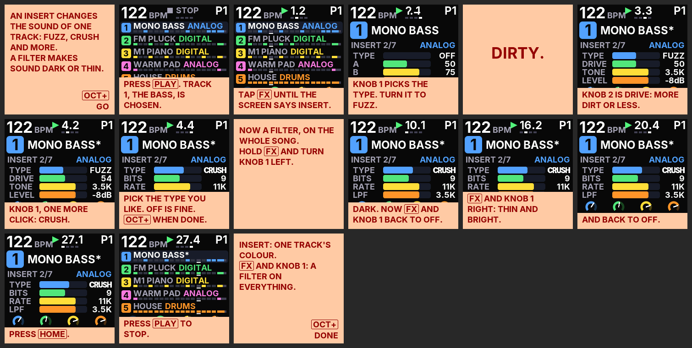

# Lesson 20: Colour a track

- **Part:** 3, make it move
- **The idea:** an insert changes one track, and a filter makes sound dark or bright.
- **The learner does:** puts FUZZ and then CRUSH on the bass, and sweeps a filter over the whole song.
- **Got it when:** they can dirty one track on purpose, and open and close the filter in time.
- **Song:** HOUSE ONE, section C, all four bars.
- **Style in the end:** synthwave

## Steps

1. **Setup:** song HOUSE ONE section C; track bass; page TRACKS
2. **Card:** AN INSERT CHANGES THE SOUND OF ONE TRACK: FUZZ, CRUSH AND MORE. / A FILTER MAKES SOUND DARK OR THIN.
   - **OCT+:** GO
3. **Strip:** PRESS [PLAY]. TRACK 1, THE BASS, IS CHOSEN.
   - **Do:** press PLAY
   - **Until:** playing
4. **Strip:** TAP [FX] UNTIL THE SCREEN SAYS INSERT.
   - **Do:** press FX
   - **Until:** page is INSERT
   - **Robot:** press FX, press FX, press FX, press FX, press FX, press FX, press FX
5. **Strip:** KNOB 1 PICKS THE TYPE. TURN IT TO FUZZ.
   - **Do:** turn KNOB 1 right 1
   - **Until:** bass insert is FUZZ
   - **Page:** INSERT
6. **Reply:** DIRTY.
7. **Strip:** KNOB 2 IS DRIVE: MORE DIRT OR LESS.
   - **Do:** turn KNOB 2 right 5
   - **Page:** INSERT
8. **Strip:** KNOB 1, ONE MORE CLICK: CRUSH.
   - **Do:** turn KNOB 1 right 1
   - **Until:** bass insert is CRUSH
   - **Page:** INSERT
9. **Strip:** PICK THE TYPE YOU LIKE. OFF IS FINE. / [OCT+] WHEN DONE.
   - **OCT+:** DONE
   - **Page:** INSERT
10. **Card:** NOW A FILTER, ON THE WHOLE SONG. / HOLD [FX] AND TURN KNOB 1 LEFT.
    - **Do:** hold FX, turn KNOB 1 left 5
    - **Until:** master filter below -40
11. **Strip:** DARK. NOW [FX] AND KNOB 1 BACK TO OFF.
    - **Do:** hold FX, turn KNOB 1 right 3
    - **Until:** master filter is 0
12. **Strip:** [FX] AND KNOB 1 RIGHT: THIN AND BRIGHT.
    - **Do:** hold FX, turn KNOB 1 right 5
    - **Until:** master filter above 40
13. **Strip:** AND BACK TO OFF.
    - **Do:** hold FX, turn KNOB 1 left 3
    - **Until:** master filter is 0
14. **Strip:** PRESS [HOME].
    - **Do:** press HOME
    - **Until:** page is TRACKS
15. **Strip:** PRESS [PLAY] TO STOP.
    - **Do:** press PLAY
    - **Until:** stopped
16. **Card:** INSERT: ONE TRACK'S COLOUR. / [FX] AND KNOB 1: A FILTER ON EVERYTHING.
    - **OCT+:** DONE

## Screens

The lesson's cards and strips in order, from the robot's run on the simulated FM-1.

## Notes for Claude

- The insert types in order on KNOB 1: OFF, SOFT, HARD, FOLD, FUZZ, CRUSH, PHASR, FLANG, CHOR. The other three
  knobs change meaning with the type; the screen names them.
- The filter knob stops at OFF in the middle, so it is easy to find again. Left of it is LP (dark), right is HP
  (thin).
- FX held with KNOB 4 is the same filter for the chosen track only.
- A slow filter opening over four or eight bars is the classic build-up. Lesson 27 uses it.

## Tester notes

