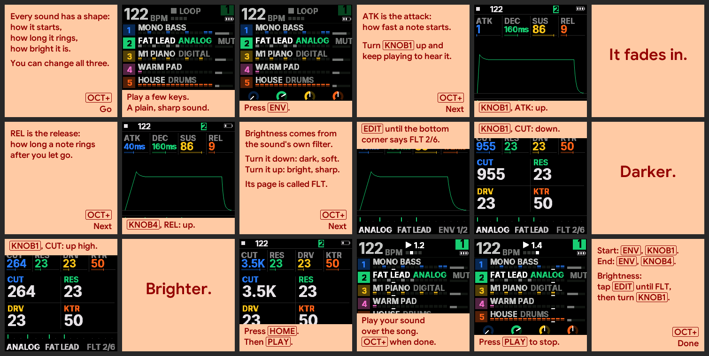

# Lesson 21: Shape a sound

- **Part:** 3, effects and sound
- **The idea:** a sound has a beginning and an end, and a brightness.
- **The learner does:** makes one sound start slowly, ring longer, and get darker and brighter.
- **Got it when:** they can say what ATK, REL and CUT do, by ear.
- **Song:** HOUSE ONE, section C, all four bars, with the lead muted. The lead track is given a plain, sharp
  sound (FAT LEAD) to shape.
- **Style in the end:** synthwave
- **Tied to the song:** nothing. Tied to the sound: FAT LEAD's starting values.

## Steps

1. **Setup:** song HOUSE ONE section C; lead sound FAT LEAD; mute lead; track lead; page TRACKS
2. **Card:** Every sound has a shape: / how it starts, / how long it rings, / how bright it is. // You can change all three.
   - **OCT+:** Go
3. **Strip:** Play a few keys. / A plain, sharp sound.
   - **Until:** played 3 keys
   - **Robot:** tap A4 C5 E5
4. **Strip:** Press [ENV].
   - **Do:** press ENV
   - **Until:** page is ENV
5. **Card:** ATK is the attack: / how fast a note starts. // Turn [KNOB1] up and / keep playing to hear it.
   - **OCT+:** Next
6. **Strip:** [KNOB1], ATK: up.
   - **Do:** turn KNOB 1 right 5
   - **Until:** lead ATK above 50
   - **Page:** ENV
7. **Reply:** It fades in.
8. **Card:** REL is the release: / how long a note rings / after you let go.
   - **OCT+:** Next
9. **Strip:** [KNOB4], REL: up.
   - **Do:** turn KNOB 4 right 5
   - **Until:** lead REL above 70
   - **Page:** ENV
10. **Card:** Brightness comes from / the sound's own filter. // Turn it down: dark, soft. / Turn it up: bright, sharp. // Its page is called FLT.
    - **OCT+:** Next
11. **Strip top:** [EDIT] until the bottom / corner says FLT 2/6.
    - **Do:** press EDIT
    - **Until:** page is FILTER
    - **Robot:** press EDIT, press EDIT, press EDIT, press EDIT, press EDIT, press EDIT
12. **Strip top:** [KNOB1], CUT: down.
    - **Do:** turn KNOB 1 left 5
    - **Until:** lead E4 below 45
    - **Page:** FILTER
13. **Reply:** Darker.
14. **Strip top:** [KNOB1], CUT: up high.
    - **Do:** turn KNOB 1 right 5
    - **Until:** lead E4 above 95
    - **Page:** FILTER
15. **Reply:** Brighter.
16. **Strip:** Press [HOME]. / Then [PLAY].
    - **Do:** press HOME, press PLAY
    - **Until:** page is TRACKS and playing
17. **Strip:** Play your sound / over the song. / [OCT+] when done.
    - **OCT+:** Done
18. **Strip:** Press [PLAY] to stop.
    - **Do:** press PLAY
    - **Until:** stopped
19. **Card:** Start: [ENV], [KNOB1]. / End: [ENV], [KNOB4]. // Brightness: / tap [EDIT] until FLT, / then turn [KNOB1].
    - **OCT+:** Done

## Screens

The lesson's cards and strips in order, from the robot's run on the simulated FM-1.

## Notes for the AI assistant

- The learner should keep playing keys while they turn: the change is only heard on a new note.
- [ENV] has two pages (SLOOP 3.4.2), named in the bottom right corner. `ENV 1/2` is a picture of the sound's shape,
  with ATK, DEC, SUS and REL in a small row along the top: the strips that turn a knob there are at the bottom. DEC
  is how fast the sound falls after the start, SUS the level it holds while a key is down. `ENV DEST 2/2`, [ENV]
  pressed again, shows where the envelope can also go: the filter, the pitch.
- [EDIT] goes round six pages: `OSC 1/6`, `FLT 2/6`, `FILTER 3/6`, `VOICE 4/6`, `VOICE 2 5/6`, and the list of sounds.
  Two of them are about the filter. The lesson uses `FLT 2/6`, where [KNOB1] is CUT (with RES, DRV, KTR on this kind
  of sound; other kinds name them differently). On `FILTER 3/6` [KNOB1] is TYPE and CUT is [KNOB2]: a learner who
  turns [KNOB1] and sees LP change to something else is one page too far. [EDIT] round again, or step 11 once more.
- The FLT page shows its four values big in the middle, so its strips are at the top.
- The sound made here lives only in this lesson's project. Keeping it as one of the learner's own sounds ([SAVE] on
  a sound's page, then USER) belongs to the deeper series on how a sound is made.

## Tester notes

2026-11-26, the move to SLOOP 3.4.2. Its goal is the same and it played through as it was; ATK, REL and CUT are
3.4.2's names too. Three strips change. Shown whole ("Yes, all of it").

- **Steps 6 and 9 are at the bottom now,** same words (`[KNOB1], ATK: up.`, `[KNOB4], REL: up.`): the [ENV] page is a
  picture of the sound's shape, and its names and values are a small row along the top, where the strips were.
- **Step 11:** `[EDIT] until the bottom / corner says FLT 2/6.` (was `Tap [EDIT] until FLT.`). [EDIT] goes round six
  pages on 3.4.2 and two sound alike, `FLT 2/6` and `FILTER 3/6`; the lesson wants the first, so the strip names the
  page as the corner does, as in lessons 19 and 20. `Tap [EDIT] until the bottom` is 225 px and wraps; the line starts
  with the button, as lesson 13's `[KNOB3] until LEN says 5.` does.
- The filter's strips (steps 12 and 14) stay at the top. Still 19 steps.
