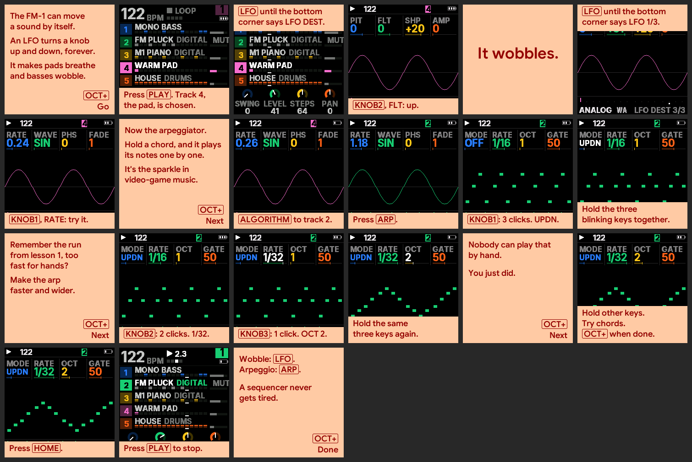

# Lesson 22: Wobble and arps

- **Part:** 3, effects and sound
- **The idea:** the FM-1 can move a sound by itself, and play a chord's notes one by one.
- **The learner does:** adds a wobble to the pad with the LFO, then holds a chord and lets the arpeggiator play
  it. The arpeggiator plays the run from lesson 1.
- **Got it when:** they can switch the arpeggiator on, and say what an LFO does.
- **Song:** HOUSE ONE, section C, all four bars, with the lead muted so the learner is the lead.
- **Style in the end:** synthwave, and video-game music for the arpeggios
- **Tied to the song:** the chord A, C, E (A minor), the same notes as lesson 1's run.

## Steps

1. **Setup:** song HOUSE ONE section C; mute lead; track pad; page TRACKS
2. **Card:** The FM-1 can move / a sound by itself. // An LFO turns a knob / up and down, forever. // It makes pads breathe / and basses wobble.
   - **OCT+:** Go
3. **Strip:** Press [PLAY]. Track 4, the pad, is chosen.
   - **Do:** press PLAY
   - **Until:** playing
4. **Strip top:** [LFO] until the bottom / corner says LFO DEST.
   - **Do:** press LFO
   - **Until:** page is LFO 2
   - **Robot:** press LFO, press LFO, press LFO
5. **Strip:** [KNOB2], FLT: up.
   - **Do:** turn KNOB 2 right 5
   - **Until:** pad LFLT above 30
   - **Page:** LFO 2
6. **Reply:** It wobbles.
7. **Strip top:** [LFO] until the bottom / corner says LFO 1/3.
   - **Do:** press LFO
   - **Until:** page is LFO
   - **Robot:** press LFO, press LFO, press LFO
8. **Strip:** [KNOB1], RATE: try it.
   - **Do:** turn KNOB 1 right 5
   - **Until:** pad LRATE changed
   - **Page:** LFO
9. **Card:** Now the arpeggiator. // Hold a chord, and it plays / its notes one by one. // It's the sparkle in / video-game music.
   - **OCT+:** Next
10. **Strip:** [ALGORITHM] to track 2.
    - **Do:** turn ALGORITHM left 2
    - **Until:** track is lead
11. **Strip:** Press [ARP].
    - **Do:** press ARP
    - **Until:** page is ARP
12. **Strip:** [KNOB1]: 3 clicks. UPDN.
    - **Do:** turn KNOB 1 right 3
    - **Page:** ARP
13. **Strip:** Hold the three / blinking keys together.
    - **Do:** hold A3, hold C4, hold E4
    - **Until:** played 3 keys
    - **Page:** ARP
14. **Card:** Remember the run / from lesson 1, too / fast for hands? // Make the arp / faster and wider.
    - **OCT+:** Next
15. **Strip:** [KNOB2]: 2 clicks. 1/32.
    - **Do:** turn KNOB 2 right 2
    - **Page:** ARP
16. **Strip:** [KNOB3]: 1 click. OCT 2.
    - **Do:** turn KNOB 3 right 1
    - **Page:** ARP
17. **Strip:** Hold the same / three keys again.
    - **Do:** hold A3, hold C4, hold E4
    - **Until:** played 3 keys
    - **Page:** ARP
18. **Card:** Nobody can play that / by hand. // You just did.
    - **OCT+:** Next
19. **Strip:** Hold other keys. / Try chords. / [OCT+] when done.
    - **OCT+:** Done
20. **Strip:** Press [HOME].
    - **Do:** press HOME
    - **Until:** page is TRACKS
21. **Strip:** Press [PLAY] to stop.
    - **Do:** press PLAY
    - **Until:** stopped
22. **Card:** Wobble: [LFO]. / Arpeggio: [ARP]. // A sequencer never / gets tired.
    - **OCT+:** Done

## Screens

The lesson's cards and strips in order, from the robot's run on the simulated FM-1.

## Notes for the AI assistant

- This is the payoff of lesson 1's joke. If the learner remembers the impossible run, let them enjoy step 18. If
  they don't, play it up a little.
- [LFO] goes round three pages (SLOOP 3.4.2), named in the bottom right corner: `LFO 1/3` (RATE, WAVE, PHS, FADE),
  `LFO 2 2/3` (SYNC, TRIG, POL) and `LFO DEST 3/3`. It opens the one that was shown last, so the number of taps is not
  fixed; the learner taps until the corner says the name.
- LFO DEST's four knobs say where the wave goes: PIT (pitch, a vibrato), FLT (the filter, a wobble), SHP, AMP
  (loudness, a tremolo).
- `LFO 1/3`, `LFO DEST 3/3` and `ARP 1/2` are pictures (the wave, the arpeggio's notes) with the knobs' names and values
  in a small row along the top. So the strips that turn a knob are at the bottom, and the two that look for a page
  (steps 4 and 7) are at the top, clear of the corner.
- The lesson cannot read the arpeggiator's settings yet, so steps 12, 15 and 16 only count clicks. The row along
  the top should read MODE UPDN, RATE 1/32, OCT 2.
- [ARP] pressed again shows its second page, `ARP 2 2/2`. HOLD there keeps the arpeggio going after the keys are let
  go, which frees both hands.

## Tester notes

2026-11-20, on the real FM-1.

- **"It uses the words for ever, shouldn't that be forever?"** Yes, one word in American English. Step 2's card
  now ends `UP AND DOWN, FOREVER.` It was the only one in the lessons. Changed the same day.
- **"At one point it says OCT+ HA, I think it should just say next."** Step 18's card (`NOBODY CAN PLAY THAT BY
  HAND. / YOU JUST DID.`) had HA as its answer, the only joke label in the course. It says NEXT now. The rule
  it gives: a button's word says what the press does (NEXT, DONE, GO), never a reply to the card.

2026-11-26, the move to SLOOP 3.4.2. Its goal is the same and it played through as it was; LFO DEST, LFO 1/3, FLT, RATE
and UPDN are 3.4.2's names too. The strips change sides. Shown whole ("Yes, all of it").

- **The knob strips are at the bottom now,** same words (steps 5, 8, 12, 15, 16): the pages are pictures, a wave or
  the arpeggio's notes, and the knobs' names and values are a small row along the top, where the strips were.
- **Steps 4 and 7 are at the top and say where to look:** `[LFO] until the bottom / corner says LFO DEST.` and `...
  / corner says LFO 1/3.` (were, at the bottom, `Tap [LFO] until / it says LFO DEST.` and `... it says LFO 1/3.`). `Tap
  [LFO] until the bottom` is 222 px and wraps, so the line starts with the button, as in lesson 21. The corner says
  `LFO DEST 3/3` in full; with the `3/3` the line is 219 px and wraps, and no other page has DEST in its name.
- Still 22 steps.
