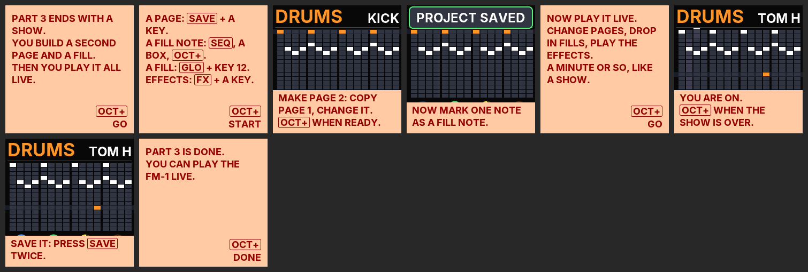

# Lesson 23: Your own piece, live

- **Part:** 3, make it move (the piece of the learner's own)
- **The idea:** everything from part 3, with no blinking lights, played as a performance.
- **The learner does:** builds a second page and a fill, then plays live: page changes, fills and effects.
- **Got it when:** they play for a minute without stopping, and change something on purpose at least three times.
- **Song:** HOUSE ONE, section C, its first bar, on page 1.
- **Style in the end:** the learner picks

## Steps

1. **Setup:** song HOUSE ONE section C, 1 bar; track drums; page STEPS
2. **Card:** PART 3 ENDS WITH A SHOW. / YOU BUILD A SECOND PAGE AND A FILL. / THEN YOU PLAY IT ALL LIVE.
   - **OCT+:** GO
3. **Card:** A PAGE: [SAVE] + A KEY. / A FILL NOTE: [SEQ], A BOX, [OCT+]. / A FILL: [GLO] + KEY 12. / EFFECTS: [FX] + A KEY.
   - **OCT+:** START
4. **Strip:** MAKE PAGE 2: COPY PAGE 1, CHANGE IT. / [OCT+] WHEN READY.
   - **OCT+:** READY
   - **Until:** 2 patterns or more
   - **Hint:** HOLD [SAVE] AND HOLD KEY 2 TO COPY.
   - **Robot:** hold SAVE, long box 2, let go, wait 1.5
5. **Strip:** NOW MARK ONE NOTE AS A FILL NOTE.
   - **Until:** drums has 1 fill notes or more
   - **Hint:** HOLD [SEQ], HOLD A BOX, PRESS [OCT+].
   - **Robot:** tap box 11, hold SEQ, hold box 12, press OCT+, let go
6. **Card:** NOW PLAY IT LIVE. / CHANGE PAGES, DROP IN FILLS, PLAY THE EFFECTS. / A MINUTE OR SO, LIKE A SHOW.
   - **OCT+:** GO
7. **Setup:** play
8. **Strip:** YOU ARE ON. / [OCT+] WHEN THE SHOW IS OVER.
   - **OCT+:** THE END
9. **Setup:** stop
10. **Strip:** SAVE IT: PRESS [SAVE] TWICE.
    - **Do:** press SAVE twice
    - **Until:** says PROJECT SAVED
11. **Setup:** page TRACKS
12. **Card:** PART 3 IS DONE. / YOU CAN PLAY THE FM-1 LIVE.
    - **OCT+:** DONE

## Screens

The lesson's cards and strips in order, from the robot's run on the simulated FM-1.

## Notes for Claude

- The third place the lesson waits for Claude: after the show, say one true thing about what they did (when the
  page changed, where the fill landed, which effect they leaned on).
- OCT+ ends the show, so the echo throw (FX held with OCT+) is not there in step 8. Everything else is.
- Step 5 moves on by itself as soon as one note is a fill note, because OCT+ is needed there to mark it.
- No lights on purpose. The card in step 3 is the only reminder.

## Tester notes

