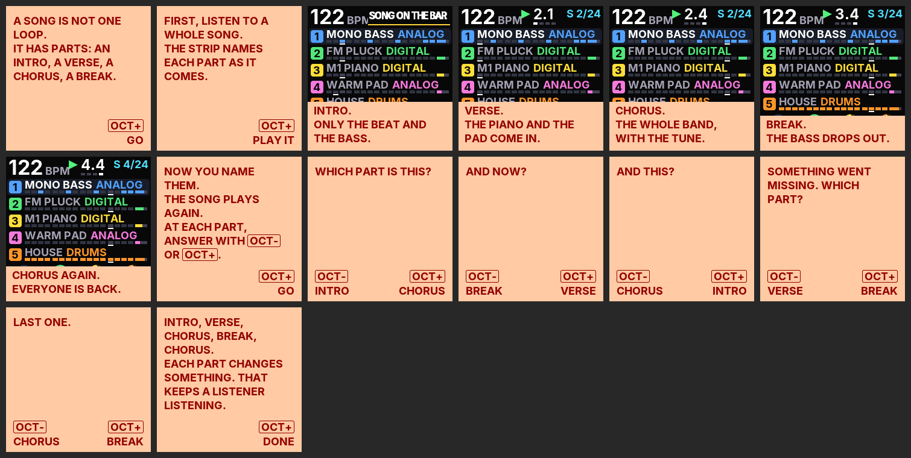

# Lesson 24: Songs have parts

- **Part:** 4, make a song
- **The idea:** a song has parts: an intro, a verse, a chorus, a break.
- **The learner does:** listens to a whole song while the strip names each part, then names the parts themselves
  with the OCT buttons.
- **Got it when:** they name four of the five parts by ear.
- **Song:** HOUSE ONE, the whole song: sections A, B, C, C, D, C, four bars each. A is on page 1, B on 2, C on 3
  and D on 4.
- **Style in the end:** dance music
- **Tied to the song:** its order of parts, and what each part adds or takes away.

## Steps

1. **Setup:** song HOUSE ONE section A; patterns A B C D; song lines 1 2 3 3 4 3; track bass; page TRACKS
2. **Card:** A SONG IS NOT ONE LOOP. / IT HAS PARTS: AN INTRO, A VERSE, A CHORUS, A BREAK.
   - **OCT+:** GO
3. **Card:** FIRST, LISTEN TO A WHOLE SONG. / THE STRIP NAMES EACH PART AS IT COMES.
   - **OCT+:** PLAY IT
4. **Setup:** song mode on; play
5. **Strip:** INTRO. / ONLY THE BEAT AND THE BASS.
   - **Wait:** until bar 5
6. **Strip:** VERSE. / THE PIANO AND THE PAD COME IN.
   - **Wait:** until bar 9
7. **Strip:** CHORUS. / THE WHOLE BAND, WITH THE TUNE.
   - **Wait:** until bar 17
8. **Strip:** BREAK. / THE BASS DROPS OUT.
   - **Wait:** until bar 21
9. **Strip:** CHORUS AGAIN. / EVERYONE IS BACK.
   - **Wait:** until bar 25
10. **Setup:** stop
11. **Card:** NOW YOU NAME THEM. / THE SONG PLAYS AGAIN. / AT EACH PART, ANSWER WITH [OCT-] OR [OCT+].
    - **OCT+:** GO
12. **Setup:** play
13. **Card:** WHICH PART IS THIS?
    - **OCT-:** INTRO → right
    - **OCT+:** CHORUS → wrong
    - **Right:** YES.
    - **Wrong:** NO. ONLY BEAT AND BASS: THAT IS THE INTRO.
    - **Robot:** answer left
14. **Wait:** until bar 6
15. **Card:** AND NOW?
    - **OCT-:** BREAK → wrong
    - **OCT+:** VERSE → right
    - **Right:** YES.
    - **Wrong:** NO. THE PIANO CAME IN: THE VERSE.
16. **Wait:** until bar 10
17. **Card:** AND THIS?
    - **OCT-:** CHORUS → right
    - **OCT+:** INTRO → wrong
    - **Right:** YES.
    - **Wrong:** NO. THE WHOLE BAND AND THE TUNE: THE CHORUS.
    - **Robot:** answer left
18. **Wait:** until bar 18
19. **Card:** SOMETHING WENT MISSING. WHICH PART?
    - **OCT-:** VERSE → wrong
    - **OCT+:** BREAK → right
    - **Right:** YES.
    - **Wrong:** NO. THE BASS LEFT: THAT IS THE BREAK.
20. **Wait:** until bar 22
21. **Card:** LAST ONE.
    - **OCT-:** CHORUS → right
    - **OCT+:** BREAK → wrong
    - **Right:** YES.
    - **Wrong:** NO. EVERYONE IS BACK: THE CHORUS.
    - **Robot:** answer left
22. **Setup:** stop; song mode off
23. **Card:** INTRO, VERSE, CHORUS, BREAK, CHORUS. / EACH PART CHANGES SOMETHING. THAT KEEPS A LISTENER LISTENING.
    - **OCT+:** DONE

## Screens

The lesson's cards and strips in order, from the robot's run on the simulated FM-1.

## Notes for Claude

- The questions are timed to the song. If the learner takes long over one, the next can arrive late in its part
  or just after it. Nothing breaks; say which part they were hearing.
- After the lesson, ask about a song the learner likes: where is its chorus, and what changes there? The idea
  should leave the FM-1.
- There is no score. A wrong answer gets the reason, and the song goes on.

## Tester notes

