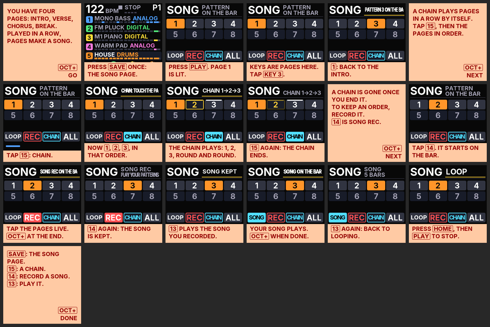

# Lesson 25: Chain the pages

- **Part:** 4, make a song
- **The idea:** pages played in a row make a song.
- **The learner does:** switches pages from the SONG page, plays a chain of pages, then records a song live and
  plays it back.
- **Got it when:** they record a song of three parts or more and play it back.
- **Song:** HOUSE ONE's four sections on pages 1 to 4 (intro, verse, chorus, break), four bars each.
- **Style in the end:** dance music

## Steps

1. **Setup:** song HOUSE ONE section A; patterns A B C D; track drums; page TRACKS
2. **Card:** YOU HAVE FOUR PAGES: INTRO, VERSE, CHORUS, BREAK. / PLAYED IN A ROW, PAGES MAKE A SONG.
   - **OCT+:** GO
3. **Strip:** PRESS [SAVE] ONCE: THE SONG PAGE.
   - **Do:** press SAVE
   - **Until:** page is SONG
   - **Hint:** ONE TAP ONLY. TWO QUICK TAPS SAVE INSTEAD.
4. **Strip:** PRESS [PLAY]. PAGE 1 IS LIT.
   - **Do:** press PLAY
   - **Until:** playing
5. **Strip:** KEYS ARE PAGES HERE. / TAP [KEY 3].
   - **Do:** tap box 3
   - **Until:** drums on pattern 3
   - **Page:** SONG
6. **Strip:** [1]: BACK TO THE INTRO.
   - **Do:** tap box 1
   - **Until:** drums on pattern 1
   - **Page:** SONG
7. **Card:** A CHAIN PLAYS PAGES IN A ROW BY ITSELF. / TAP [15], THEN THE PAGES IN ORDER.
   - **OCT+:** NEXT
8. **Strip:** TAP [15]: CHAIN.
   - **Do:** tap box 15
   - **Until:** says CHAIN
   - **Page:** SONG
9. **Strip:** NOW [1], [2], [3], IN THAT ORDER.
   - **Do:** tap box 1, tap box 2, tap box 3
   - **Page:** SONG
10. **Strip:** THE CHAIN PLAYS: 1, 2, 3, ROUND AND ROUND.
    - **Wait:** 8 bars
11. **Strip:** [15] AGAIN: THE CHAIN ENDS.
    - **Do:** tap box 15
    - **Until:** says CHAIN DONE
    - **Page:** SONG
12. **Card:** A CHAIN IS GONE ONCE YOU END IT. / TO KEEP AN ORDER, RECORD IT. / [14] IS SONG REC.
    - **OCT+:** NEXT
13. **Strip:** TAP [14]. IT STARTS ON THE BAR.
    - **Do:** tap box 14
    - **Until:** song recording
    - **Page:** SONG
14. **Strip:** TAP THE PAGES LIVE. / [OCT+] AT THE END.
    - **OCT+:** THE END
    - **Page:** SONG
    - **Robot:** wait 2.2, tap box 2, wait 2.2, tap box 3, wait 2.2
15. **Strip:** [14] AGAIN: THE SONG IS KEPT.
    - **Do:** tap box 14
    - **Until:** says SONG
    - **Page:** SONG
16. **Strip:** [13] PLAYS THE SONG YOU RECORDED.
    - **Do:** tap box 13
    - **Until:** song playing
    - **Page:** SONG
17. **Strip:** YOUR SONG PLAYS. / [OCT+] WHEN DONE.
    - **OCT+:** DONE
18. **Strip:** [13] AGAIN: BACK TO LOOPING.
    - **Do:** tap box 13
    - **Until:** says LOOP
    - **Page:** SONG
19. **Strip:** PRESS [HOME], THEN [PLAY] TO STOP.
    - **Do:** press HOME, press PLAY
    - **Until:** page is TRACKS and stopped
20. **Card:** [SAVE]: THE SONG PAGE. / [15]: A CHAIN. / [14]: RECORD A SONG. / [13]: PLAY IT.
    - **OCT+:** DONE

## Screens

The lesson's cards and strips in order, from the robot's run on the simulated FM-1.

## Notes for Claude

- On the SONG page the keys work with no button held. The same keys work anywhere while SAVE is held.
- A page change always waits for the bar. With four-bar pages the learner has time; tell them to tap during a
  part, not at its last moment.
- If the learner records nothing, the screen says EMPTY SONG. Record again from step 13.
- On the SONG page a tap of SAVE saves the project. That is fine at any time.

## Tester notes

2026-11-20, the round from the notes ("go back and make adjustment based on all of the notes").

- Framed key names (`TAP [KEY 3]`, `[15]: A CHAIN.`, `[14]: RECORD A SONG.`, `[13]: PLAY IT.`).
