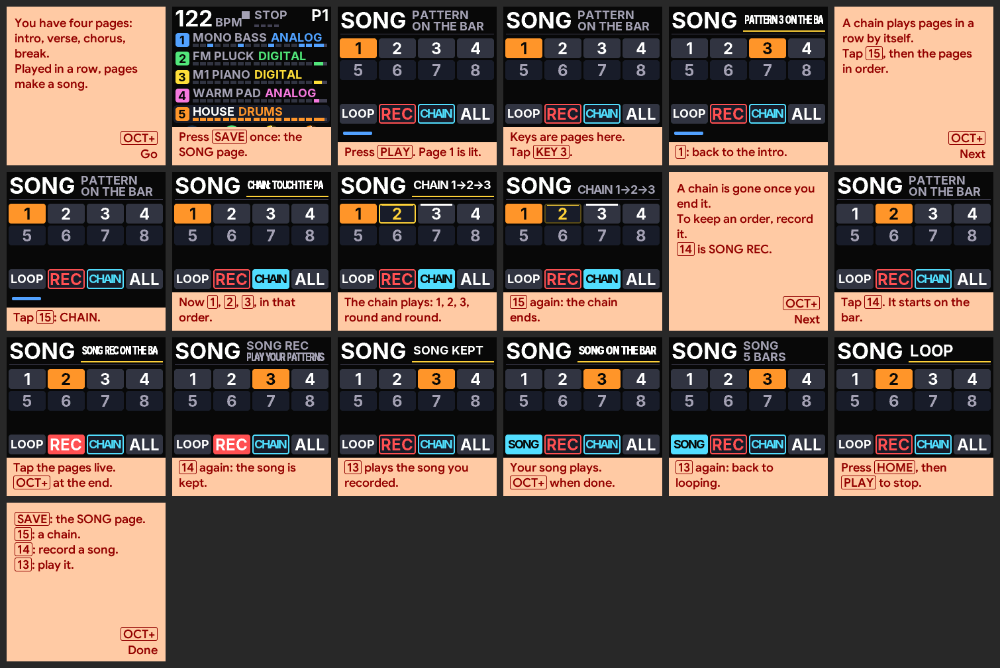

# Lesson 25: Chain the patterns

- **Part:** 4, make a song
- **The idea:** patterns played in a row make a song.
- **The learner does:** switches patterns with [SAVE] held, plays a chain of patterns, then records a song live
  and plays it back.
- **Got it when:** they record a song of three parts or more and play it back.
- **Song:** HOUSE ONE's four sections on patterns 1 to 4 (intro, verse, chorus, break), four bars each.
- **Style in the end:** dance music

## Steps

1. **Setup:** song HOUSE ONE section A; patterns A B C D; track drums; page TRACKS
2. **Card:** You have four patterns: / intro, verse, chorus, / and break. // Played in a row, / they make a song.
   - **OCT+:** Go
3. **Strip:** Press [PLAY]. / Pattern 1 is the intro.
   - **Do:** press PLAY
   - **Until:** playing
4. **Strip:** Hold [SAVE], tap [3]: / the chorus.
   - **Do:** hold SAVE, tap box 3
   - **Until:** drums on pattern 3
5. **Strip:** [SAVE] + [1]: / back to the intro.
   - **Do:** hold SAVE, tap box 1
   - **Until:** drums on pattern 1
6. **Card:** A chain plays patterns / in a row by itself. // Hold [SAVE] and tap / the patterns in order. / Then let go.
   - **OCT+:** Next
7. **Strip:** Hold [SAVE]: [1], [2], [3]. / Then let go.
   - **Do:** hold SAVE, tap box 1, tap box 2, tap box 3
   - **Until:** says CHAIN
   - **Hint:** Keep [SAVE] held for / all three keys.
8. **Strip:** The chain plays: / 1, 2, 3, round and round.
   - **Wait:** 8 bars
9. **Strip:** [SAVE] + [1]: / the chain ends.
   - **Do:** hold SAVE, tap box 1
   - **Until:** says PATTERN 1
10. **Card:** A chain is gone / once you end it. // To keep an order, / record it. / [SAVE] + [14]: SONG REC.
    - **OCT+:** Next
11. **Strip:** Hold [SAVE], tap [14]. / It starts on the bar.
    - **Do:** hold SAVE, tap box 14
    - **Until:** song recording
12. **Strip:** Switch patterns live. / [OCT+] at the end.
    - **OCT+:** The end
    - **Robot:** wait 2.2, hold SAVE, tap box 2, let go, wait 2.2, hold SAVE, tap box 3, let go, wait 2.2
13. **Strip:** [SAVE] + [14] again: / the song is kept.
    - **Do:** hold SAVE, tap box 14
    - **Until:** says SONG KEPT
    - **Hint:** Top says EMPTY SONG? / [SAVE] + [14], wait a bar, / then [SAVE] + [14] again.
14. **Strip:** [SAVE] + [13] plays / the song you recorded.
    - **Do:** hold SAVE, tap box 13
    - **Until:** song playing
15. **Strip:** Your song plays. / [OCT+] when done.
    - **OCT+:** Done
16. **Strip:** [SAVE] + [13] again: / back to looping.
    - **Do:** hold SAVE, tap box 13
    - **Until:** says LOOP
17. **Strip:** Press [PLAY] to stop.
    - **Do:** press PLAY
    - **Until:** stopped
18. **Card:** _Patterns in a row / Chain: hold [SAVE], / tap them in order. / Record a song: / [SAVE] + [14]. / Play it: [SAVE] + [13].
    - **OCT+:** Done

## Screens

The lesson's cards and strips in order, from the robot's run on the simulated FM-1.

## Notes for the AI assistant

- Every move here is "[SAVE] + a key" (SLOOP 3.4.2), and the learner stays on the tracks page. While [SAVE] is held
  the screen shows the eight patterns on tiles (the one playing lit, the next one marked), and under them the names
  of keys 13 to 16: LOOP, SONG REC, ALL, SONG. The top line says what just happened: `PATTERN 3 ON THE BAR`, `CHAIN 1 2
  3`, `SONG REC ON THE BAR`, `SONG KEPT`, `SONG ON THE BAR`, `LOOP`.
- A change of pattern waits for the bar. Tell the learner to tap during a part, not at its last moment.
- A chain is the pattern keys tapped in one hold of [SAVE]: two or more, in order. If [SAVE] is let go between two
  taps, each tap is only a change of pattern and nothing says CHAIN; do it again in one hold. A chain goes round until
  one pattern is tapped alone, and it is not kept.
- A key held too long with [SAVE] (a second and a half) is lesson 16's save, not a change. Over a pattern in use
  SLOOP asks first (`AGAIN: SAVE INTO 3`) and does nothing unless the key is pressed again, so a slow tap does not
  write the intro over the chorus.
- SONG REC ([SAVE] + [14]) starts on the bar and writes down each pattern and how long it played; [SAVE] + [14]
  again keeps it. If it is stopped before its first bar, the top says `EMPTY SONG`: record again from step 11.
- [SAVE] + [13] plays the song from its first line, and again goes back to looping. The tile for key 13 says LOOP
  or SONG. With no song recorded the top says `NO SONG: REC`.
- One tap of [SAVE] opens another page, the song's lines (`SONG 2/3`): that is lesson 26. If the learner lands there,
  [HOME] goes back.

## Tester notes

2026-11-20, the round from the notes ("go back and make adjustment based on all of the notes").

- Framed key names (`TAP [KEY 3]`, `[15]: A CHAIN.`, `[14]: RECORD A SONG.`, `[13]: PLAY IT.`).

2026-11-26, the move to SLOOP 3.4.2. The lesson stopped at its third step both ways: one tap of [SAVE] now opens the
song's lines, not the page with the patterns on the keys, and key [15] is no longer CHAIN. Its goal is the same, so it
is reworked around one move, "[SAVE] + a key", and named "Chain the patterns" (was "Chain the pages"; the file is
renamed with it). Shown whole ("Yes, all of it").

- **The learner never leaves the tracks page.** `Press [SAVE] once: / the SONG page.` and `Press [HOME]` are gone. The
  patterns, the chain, SONG REC and playing the song are all with [SAVE] held, as in lesson 16.
- **"Page" is "pattern":** `You have four patterns: / intro, verse, chorus, / and break. // Played in a row, / they make
  a song.`; `Press [PLAY]. / Pattern 1 is the intro.` (was `Press [PLAY]. Page 1 is lit.`).
- **Steps 4 and 5:** `Hold [SAVE], tap [3]: / the chorus.` and `[SAVE] + [1]: / back to the intro.` (were `Keys are pages
  here. / Tap [KEY 3].` and `[1]: back to the intro.`).
- **The chain (decision 5), steps 6 to 9:** the card ends `Hold [SAVE] and tap / the patterns in order. / Then let go.`
  (was `Tap [15], then / the pages in order.`); `Hold [SAVE]: [1], [2], [3]. / Then let go.`, hint `Keep [SAVE] held for
  / all three keys.`; `[SAVE] + [1]: / the chain ends.` (was `[15] again: / the chain ends.`, which waited for a CHAIN
  DONE that 3.4.2 never says). `Tap [15]: CHAIN.` is gone.
- **Recording and playing the song, steps 10 to 16:** `[SAVE] + [14]: SONG REC.` on the card; `Hold [SAVE], tap [14]. /
  It starts on the bar.`; `Switch patterns live. / [OCT+] at the end.`; `[SAVE] + [14] again: / the song is kept.`, with
  a hint for `EMPTY SONG`; `[SAVE] + [13] plays / the song you recorded.`; `[SAVE] + [13] again: / back to looping.`
- **The last card has a heading:** `_Patterns in a row / Chain: hold [SAVE], / tap them in order. / Record a song: /
  [SAVE] + [14]. / Play it: [SAVE] + [13].` Asked of the review's "(heading)": "does heading mean underlined?" It does:
  the card's first line, underlined, the same size as the rest.
- All strips are at the bottom and two lines long: with [SAVE] held that leaves the eight patterns, the row that names
  keys 13 to 16 and the top message in view. Looked at in a picture taken with [SAVE] held; a third line covers the
  row, so step 12 has two.
- 18 steps (were 20).
