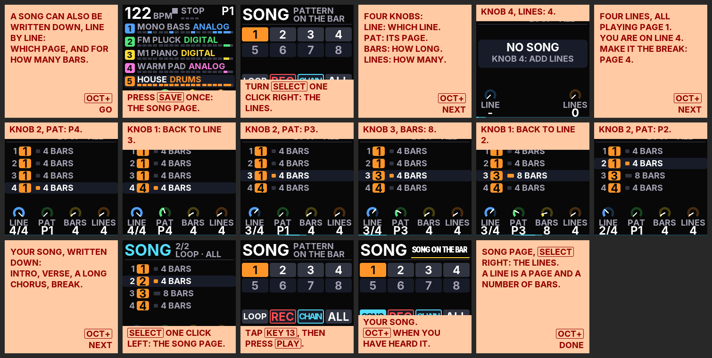

# Lesson 26: Write it line by line

- **Part:** 4, make a song
- **The idea:** a song can be written down and edited, a line at a time.
- **The learner does:** opens the song's lines, adds four, and sets which page each one plays and for how long.
- **Got it when:** they change a line's page and its length without help.
- **Song:** HOUSE ONE's four sections on pages 1 to 4 (intro, verse, chorus, break), four bars each. The song
  itself starts empty.
- **Style in the end:** dance music
- **Tied to the song:** nothing but the four pages.

## Steps

1. **Setup:** song HOUSE ONE section A; patterns A B C D; track drums; page TRACKS
2. **Card:** A SONG CAN ALSO BE WRITTEN DOWN, LINE BY LINE: / WHICH PAGE, AND FOR HOW MANY BARS.
   - **OCT+:** GO
3. **Strip:** PRESS [SAVE] ONCE: THE SONG PAGE.
   - **Do:** press SAVE
   - **Until:** page is SONG
   - **Hint:** ONE TAP ONLY.
4. **Strip:** TURN [SELECT] ONE CLICK RIGHT: THE LINES.
   - **Do:** turn SELECT right 1
   - **Until:** page is SONG 2
5. **Card:** FOUR KNOBS: / LINE: WHICH LINE. / PAT: ITS PAGE. / BARS: HOW LONG. / LINES: HOW MANY.
   - **OCT+:** NEXT
6. **Strip top:** KNOB 4, LINES: 4.
   - **Do:** turn KNOB 4 right 1
   - **Until:** song has 4 lines or more
   - **Page:** SONG 2
7. **Card:** FOUR LINES, ALL PLAYING PAGE 1. / YOU ARE ON LINE 4. MAKE IT THE BREAK: PAGE 4.
   - **OCT+:** NEXT
8. **Strip top:** KNOB 2, PAT: P4.
   - **Do:** turn KNOB 2 right 1
   - **Until:** song line 4 is pattern 4
   - **Page:** SONG 2
   - **Hint:** LINE MUST SAY 4/4.
9. **Strip top:** KNOB 1: BACK TO LINE 3.
   - **Do:** turn KNOB 1 left 1
   - **Page:** SONG 2
10. **Strip top:** KNOB 2, PAT: P3.
    - **Do:** turn KNOB 2 right 1
    - **Until:** song line 3 is pattern 3
    - **Page:** SONG 2
    - **Hint:** LINE MUST SAY 3/4.
11. **Strip top:** KNOB 3, BARS: 8.
    - **Do:** turn KNOB 3 right 1
    - **Until:** song line 3 has 8 bars
    - **Page:** SONG 2
12. **Strip top:** KNOB 1: BACK TO LINE 2.
    - **Do:** turn KNOB 1 left 1
    - **Page:** SONG 2
13. **Strip top:** KNOB 2, PAT: P2.
    - **Do:** turn KNOB 2 right 1
    - **Until:** song line 2 is pattern 2
    - **Page:** SONG 2
    - **Hint:** LINE MUST SAY 2/4.
14. **Card:** YOUR SONG, WRITTEN DOWN: / INTRO, VERSE, A LONG CHORUS, BREAK.
    - **OCT+:** NEXT
15. **Strip:** [SELECT] ONE CLICK LEFT: THE SONG PAGE.
    - **Do:** turn SELECT left 1
    - **Until:** page is SONG
16. **Strip:** TAP [KEY 13], THEN PRESS [PLAY].
    - **Do:** tap box 13, press PLAY
    - **Until:** song playing and playing
    - **Page:** SONG
17. **Strip:** YOUR SONG. / [OCT+] WHEN YOU HAVE HEARD IT.
    - **OCT+:** DONE
18. **Setup:** stop; song mode off; page TRACKS
19. **Card:** SONG PAGE, [SELECT] RIGHT: THE LINES. / A LINE IS A PAGE AND A NUMBER OF BARS.
    - **OCT+:** DONE

## Screens

The lesson's cards and strips in order, from the robot's run on the simulated FM-1.

## Notes for Claude

- The strips are at the top and one line long, so the list of lines and the four dials stay in view.
- New lines start as page 1 for four bars. The cursor sits on the newest line, which is why the lesson works
  backwards from line 4.
- A song recorded live (lesson 25) shows up here as lines too, and can be corrected here.
- The lesson cannot read which line the cursor is on. The LINE dial is the truth; the hints point at it.

## Tester notes

