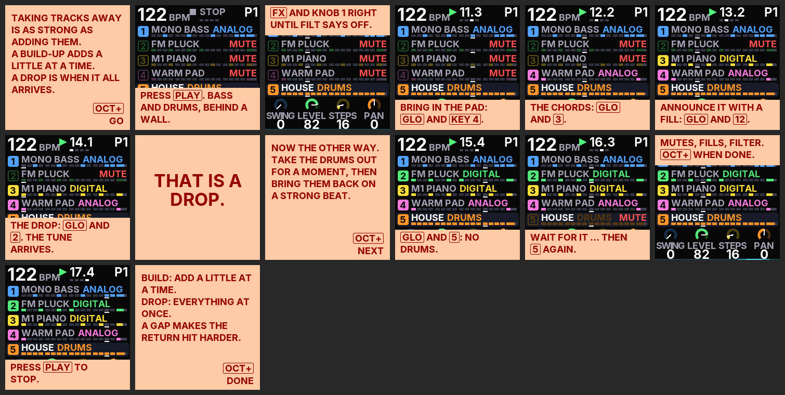

# Lesson 27: Build-ups and drops

- **Part:** 4, make a song
- **The idea:** taking tracks away is as strong as adding them.
- **The learner does:** starts with bass and drums behind a closed filter, opens the filter, brings the tracks in
  one by one, announces the drop with a fill, then tries a gap.
- **Got it when:** they can make the song grow and arrive, on purpose.
- **Song:** HOUSE ONE, section C, its first bar. Three tracks start muted and the filter starts closed. Four
  fill snares are hidden in the beat.
- **Style in the end:** dance music

## Steps

1. **Setup:** song HOUSE ONE section C, 1 bar; drums fill SNARE on 13 14 15 16; mute lead chords pad; master filter -70; track drums; page TRACKS
2. **Card:** TAKING TRACKS AWAY IS AS STRONG AS ADDING THEM. / A BUILD-UP ADDS A LITTLE AT A TIME. / A DROP IS WHEN IT ALL ARRIVES.
   - **OCT+:** GO
3. **Strip:** PRESS [PLAY]. BASS AND DRUMS, BEHIND A WALL.
   - **Do:** press PLAY
   - **Until:** playing
4. **Strip top:** [FX] AND KNOB 1 RIGHT UNTIL FILT SAYS OFF.
   - **Do:** hold FX, turn KNOB 1 right 3
   - **Until:** master filter is 0
   - **Hint:** HOLD [FX]. FILT IS THE FIRST DIAL BELOW.
5. **Strip:** BRING IN THE PAD: [GLO] AND [KEY 4].
   - **Do:** hold GLO, tap box 4
   - **Until:** pad is not muted
6. **Strip:** THE CHORDS: [GLO] AND [3].
   - **Do:** hold GLO, tap box 3
   - **Until:** chords is not muted
7. **Strip:** ANNOUNCE IT WITH A FILL: [GLO] AND [12].
   - **Do:** hold GLO, tap box 12
8. **Strip:** THE DROP: [GLO] AND [2]. THE TUNE ARRIVES.
   - **Do:** hold GLO, tap box 2
   - **Until:** lead is not muted
9. **Reply:** THAT IS A DROP.
10. **Card:** NOW THE OTHER WAY. / TAKE THE DRUMS OUT FOR A MOMENT, THEN BRING THEM BACK ON A STRONG BEAT.
    - **OCT+:** NEXT
11. **Strip:** [GLO] AND [5]: NO DRUMS.
    - **Do:** hold GLO, tap box 5
    - **Until:** drums is muted
12. **Strip:** WAIT FOR IT ... THEN [5] AGAIN.
    - **Do:** hold GLO, tap box 5
    - **Until:** nothing muted
13. **Strip top:** MUTES, FILLS, FILTER. / [OCT+] WHEN DONE.
    - **OCT+:** DONE
14. **Strip:** PRESS [PLAY] TO STOP.
    - **Do:** press PLAY
    - **Until:** stopped
15. **Card:** BUILD: ADD A LITTLE AT A TIME. / DROP: EVERYTHING AT ONCE. / A GAP MAKES THE RETURN HIT HARDER.
    - **OCT+:** DONE

## Screens

The lesson's cards and strips in order, from the robot's run on the simulated FM-1.

## Notes for Claude

- Timing is the whole lesson. The moves are ones the learner knows; what is new is when to make them. Suggest
  counting bars: a change every four or eight.
- If the learner rushes through, ask them to do the build again taking twice as long. The song still plays.
- In a written song (lesson 26) each line can carry its own mutes. That is set in SLOOP's web editor for now.

## Tester notes

