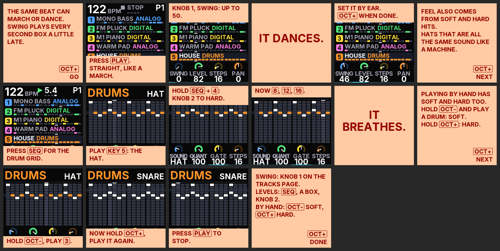

# Lesson 28: Swing and feel

- **Part:** 4, make a song
- **The idea:** the same beat can march or dance.
- **The learner does:** adds swing, makes some hats louder than others, and plays soft and hard drum hits by
  hand.
- **Got it when:** they can hear the difference between a straight beat and a swung one, and set either.
- **Song:** HOUSE ONE, section C, its first bar.
- **Style in the end:** hip-hop
- **Tied to the song:** the hats in boxes 4, 8, 12 and 16, which this beat plays softly.

## Steps

1. **Setup:** song HOUSE ONE section C, 1 bar; track drums; pick HAT; page TRACKS
2. **Card:** A straight beat marches. / With swing, it dances. // Swing plays every / second box a little late. // It's the bounce in / hip-hop and jazz.
   - **OCT+:** Go
3. **Strip:** Press [PLAY]. / Straight, like a march.
   - **Do:** press PLAY
   - **Until:** playing
4. **Strip top:** [KNOB1], SWING: to 50.
   - **Do:** turn KNOB 1 right 3
   - **Until:** swing above 45
   - **Page:** TRACKS
5. **Reply:** It dances.
6. **Strip top:** Set it by ear. / [OCT+] when done.
   - **OCT+:** Done
   - **Page:** TRACKS
7. **Card:** Soft and hard hits / make a beat groove. // A drummer never hits / twice the same way. // If every hit is the same, / it sounds like a robot.
   - **OCT+:** Next
8. **Strip:** Press [SEQ] for / the drum grid.
   - **Do:** press SEQ
   - **Until:** page is STEPS
9. **Card:** _Loud and soft / The hat is picked. / Its hits are all soft. // [KNOB2], STEP: walks / along the boxes. / [KNOB4], LEVEL: how / hard that hit is.
   - **OCT+:** Next
10. **Strip top:** [KNOB2] to STEP 4. / Then [KNOB4] to HARD.
    - **Do:** turn KNOB 2 right 3, turn KNOB 4 right 2
    - **Until:** drums has 1 hard notes or more
    - **Hint:** STEP is the 2nd dial / below, LEVEL the 4th.
    - **Page:** STEPS
11. **Strip top:** The same on steps / 8, 12 and 16.
    - **Do:** turn KNOB 2 right 4, turn KNOB 4 right 2, turn KNOB 2 right 4, turn KNOB 4 right 2, turn KNOB 2 right 4, turn KNOB 4 right 2
    - **Until:** drums has 4 hard notes or more
    - **Hint:** [KNOB2] to the step, / then [KNOB4] to HARD. / One step at a time.
    - **Page:** STEPS
12. **Reply:** It breathes.
13. **Setup:** page TRACKS
14. **Card:** Playing by hand has / soft and hard too. // Hold [OCT-] and play / a drum: soft. / Hold [OCT+]: hard.
    - **OCT+:** Next
15. **Strip:** Hold [OCT-], play [3].
    - **Do:** hold OCT-, tap box 3
16. **Strip:** Now hold [OCT+], / play it again.
    - **Do:** hold OCT+, tap box 3
17. **Strip:** Press [PLAY] to stop.
    - **Do:** press PLAY
    - **Until:** stopped
18. **Card:** _Swing and groove / Swing: [KNOB1] on / the TRACKS page. / Loud or soft box: / [KNOB2], then [KNOB4]. / Soft hit: hold [OCT-]. / Hard hit: hold [OCT+].
    - **OCT+:** Done

## Screens

The lesson's cards and strips in order, from the robot's run on the simulated FM-1.

## Notes for the AI assistant

- Swing is easiest to hear on the hats. At 50 the beat lilts; near 70 it limps. House barely swings, hip-hop
  swings a lot.
- The drum grid's four dials (SLOOP 3.4.2), named along the bottom once a knob is touched: SOUND ([KNOB1], the drum
  picked), STEP ([KNOB2], which box), HIT ([KNOB3], the hit in or out) and LEVEL ([KNOB4]: GHOST, SOFT, NORM, HARD).
  Nothing is held. The strips are at the top so the dials stay in view.
- LEVEL shows `--` on a step with no hit of the drum picked. In this beat the hats are on the even steps and all
  SOFT. If LEVEL shows `--` on step 4, another drum is picked: SOUND should say HAT.
- Steps are named as numbers here (`STEP 4`), not as framed keys: a tap on a white key empties that box. If a hat
  went that way, tap the key again to put it back, then [KNOB4].
- Soft and hard by hand ([OCT-] or [OCT+] held while a drum is played) work where the white keys play drums: on the
  tracks page, where step 13 puts the lesson. On the grid the white keys make no sound, and [OCT+] held opens the
  note's sheet (lesson 17).
- Soft and hard hits played by hand are written down as played when REC is on.

## Tester notes

2026-11-26, the move to SLOOP 3.4.2. Its goal is the same. It played through as it was, partly by accident: `Play
[5]: the hat.` on the grid now writes a box in silence, and the three-finger move ([SEQ] + a box + [KNOB2]) is no
longer the way. The swing half keeps its words. Shown whole ("Yes, all of it").

- **`Play [5]: the hat.` is gone:** the setup picks the hat.
- **Loud and soft with two knobs, nothing held** (steps 9 to 11). The card: `_Loud and soft / The hat is picked. / Its
  hits are all soft. // [KNOB2], STEP: walks / along the boxes. / [KNOB4], LEVEL: how / hard that hit is.` (was `_Three at
  once / Hold [SEQ], hold [4], / then turn [KNOB2]. // ...`). Then `[KNOB2] to STEP 4. / Then [KNOB4] to HARD.` (was `Hold
  [SEQ] + [4]: / [KNOB2] to HARD.`), hint `STEP is the 2nd dial / below, LEVEL the 4th.`; and `The same on steps / 8, 12
  and 16.` (was `Now [8], [12], [16].`), hint `[KNOB2] to the step, / then [KNOB4] to HARD. / One step at a time.`
  Looked at move by move in a picture: STEP 1 with no hit, STEP 4 SOFT, NORM, HARD.
- **Soft and hard by hand happen on the tracks page** (a setup before their card): on the grid the white keys are
  boxes. Their card and strips keep their words.
- **The last card:** `Loud or soft box: / [KNOB2], then [KNOB4].` (was `[SEQ] + a box, [KNOB2].`).
- Still 18 steps.
