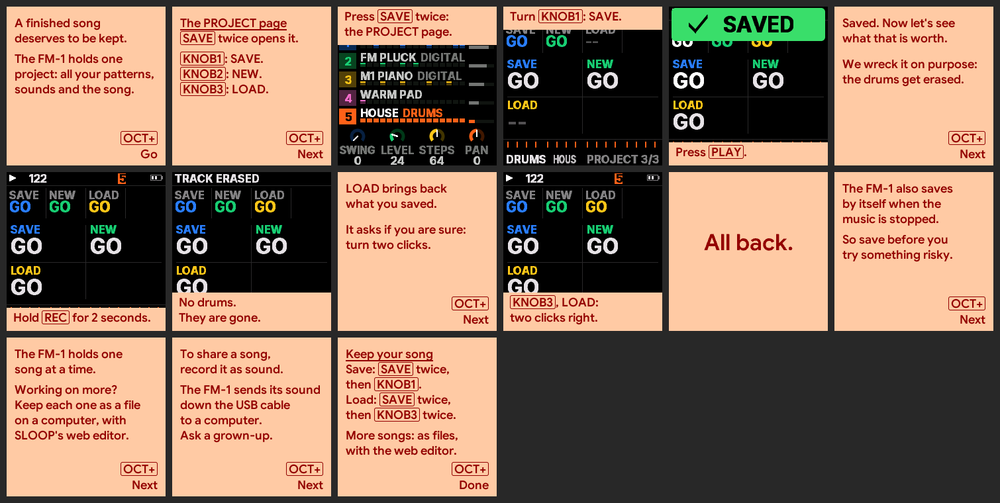

# Lesson 29: Keep it and share it

- **Part:** 4, make a song
- **The idea:** a finished song deserves to be kept.
- **The learner does:** saves the project, wrecks it on purpose, opens the saved one again, and hears how a song
  leaves the FM-1.
- **Got it when:** they save before trying something risky, without being told.
- **Song:** HOUSE ONE, section C, all four bars.
- **Style in the end:** the learner's own song, if they have one by now

## Steps

1. **Setup:** song HOUSE ONE section C; track drums; page TRACKS
2. **Card:** A finished song / deserves to be kept. // The FM-1 holds one / project: all your patterns, / sounds and the song.
   - **OCT+:** Go
3. **Card:** _The PROJECT page / [SAVE] twice opens it. // [KNOB1]: SAVE. / [KNOB2]: NEW. / [KNOB3]: LOAD.
   - **OCT+:** Next
4. **Strip top:** Press [SAVE] twice: / the PROJECT page.
   - **Do:** press SAVE twice
   - **Until:** page is PROJECT
   - **Hint:** Press [SAVE] until the / bottom corner says / PROJECT.
5. **Strip top:** Turn [KNOB1]: SAVE.
   - **Do:** turn KNOB 1 right 1
   - **Until:** says only PROJECT SAVED
   - **Hint:** One click to the right.
6. **Strip:** Press [PLAY].
   - **Do:** press PLAY
   - **Until:** playing
7. **Card:** Saved. Now let's see / what that is worth. // We wreck it on purpose: / the drums get erased.
   - **OCT+:** Next
8. **Strip:** Hold [REC] for 2 seconds.
   - **Do:** hold REC, wait 2.5
   - **Until:** drums is empty
9. **Strip:** No drums. / They are gone.
   - **Wait:** 2 bars
10. **Card:** LOAD brings back / what you saved. // It asks if you are sure: / turn two clicks.
    - **OCT+:** Next
11. **Strip:** [KNOB3], LOAD: / two clicks right.
    - **Do:** turn KNOB 3 right 2
    - **Until:** drums has 4 notes or more
    - **Hint:** Top says AGAIN? / One more click, quickly.
12. **Reply:** All back.
13. **Setup:** page TRACKS
14. **Card:** The FM-1 also saves / by itself when the / music is stopped. // So save before you / try something risky.
    - **OCT+:** Next
15. **Card:** The FM-1 holds one / song at a time. // Working on more? / Keep each one as a file / on a computer, with / SLOOP's web editor. *(connected only)*
    - **OCT+:** Next
16. **Card:** To share a song, / record it as sound. // The FM-1 sends its sound / down the USB cable / to a computer. / Ask a grown-up.
    - **OCT+:** Next
17. **Card:** _Keep your song / Save: [SAVE] twice, / then [KNOB1]. / Load: [SAVE] twice, / then [KNOB3] twice. // More songs: as files, / with the web editor.
    - **OCT+:** Done

## Screens

The lesson's cards and strips in order, from the robot's run on the simulated FM-1.

## Notes for the AI assistant

- The PROJECT page (SLOOP 3.4.2) is two presses of [SAVE] from the tracks page: the first opens the SONG page
  (`SONG 2/3`), the second `PROJECT 3/3`. Three knobs, each one click to the right: [KNOB1] SAVE, [KNOB2] NEW, [KNOB3]
  LOAD. LOAD shows `--` until something has been saved. A save shows a big green SAVED and says `PROJECT SAVED`.
- LOAD and NEW ask once more when something would be lost: `AGAIN: CHANGES LOST`, `AGAIN FOR A NEW ONE`. The second
  click has to come within a second and a half, or the question is asked again. Step 11's strip is at the bottom
  so that message, at the top, shows.
- NEW sits between SAVE and LOAD. Turned twice it empties the project; LOAD brings the saved one back. Do not teach
  it here: lesson 30 starts from a new project.
- The wreck in step 8 is done while the song plays, on purpose: SLOOP saves by itself only when the music is
  stopped (it then says `PROJECT SAVED (AUTO)`), so the saved project cannot be overwritten by the wrecked one. If
  the learner stops the music between the wreck and the LOAD, the autosave keeps the wrecked project, LOAD brings
  back no drums and step 11 cannot end: start the lesson again.
- The save step waits for exactly `PROJECT SAVED`, the word of the learner's own save; the autosave's message does
  not end it.
- Loading the saved project stops the music. That is SLOOP, not a fault.
- The old shortcuts still work ([HOME] held with key 1 OPEN, 3 NEW, 5 SAVE), but nothing on the screen names them
  any more, so the lesson leaves them out.
- Not built yet, and the reason steps 15 and 16 only tell: recording the FM-1's sound to a file from the lesson
  itself. For now a grown-up does it: SLOOP's web editor (LIVE, Record the set) or any recording program, with
  the FM-1 chosen as the sound input.

## Tester notes

- **2026-11-20, step 13:** the card said `IN ITS SEACHEST FOLDER`. The name was a leftover of the boat theme (the
  project was BOATSWAIN before it was Teachie). Changed the same day, on the tester's word ("Yes, BACKUPS"): the
  card says `IN ITS BACKUPS FOLDER`, and the folder is `tutorial/backups/` (`run.py`, `tutorial/.gitignore`, the
  two READMEs; the copies kept so far moved with it). The picture above still shows the old card.

2026-11-26, the move to SLOOP 3.4.2. Its goal is the same. It played through as it was, on the old shortcuts ([HOME]
held with keys 1 and 5), which nothing on the screen names any more. It now teaches SLOOP's PROJECT page (decision
6). Shown whole ("Yes, both": this lesson, and the exact save check below).

- **Step 3, the card:** `_The PROJECT page / [SAVE] twice opens it. // [KNOB1]: SAVE. / [KNOB2]: NEW. / [KNOB3]: LOAD.`
  (was `Hold [HOME]: / the PROJECT page. // [1]: OPEN. / [3]: NEW. / [5]: SAVE.`).
- **The save, two strips along the top,** lesson 6's: `Press [SAVE] twice: / the PROJECT page.` and `Turn [KNOB1]:
  SAVE.` (was `Hold [HOME], / tap [5]: SAVE.`).
- **LOAD, the page's word, for OPEN:** the card `LOAD brings back / what you saved. // It asks if you are sure: / turn
  two clicks.`; step 11 `[KNOB3], LOAD: / two clicks right.` (was `Hold [HOME]: [1], / then [1] again.`), hint `Top says
  AGAIN? / One more click, quickly.` This strip is at the bottom: after the first click the top says `AGAIN: CHANGES
  LOST`, which a strip at the top covers (a picture of both placings).
- **The last card:** `Save: [SAVE] twice, / then [KNOB1]. / Load: [SAVE] twice, / then [KNOB3] twice.` (was `Save: hold
  [HOME] + [5], / or [SAVE] twice. / Open: hold [HOME] + [1], / then [1] again.`).
- `project: all your patterns,` on the first card (was `pages,`). The setup goes to the tracks page before the last
  cards. 17 steps (were 15).
- **The save step waits for exactly PROJECT SAVED** (`Until: says only PROJECT SAVED`). Found while testing: the FM-1
  saves by itself when the music is stopped and untouched for about two and a half seconds, and says `PROJECT SAVED
  (AUTO)`; a step waiting for `says PROJECT SAVED` took that for the learner's save. Played on the simulated FM-1 with
  lesson 23 as it was: a learner who changed the beat and then only waited at `Turn [KNOB1]: SAVE.` was moved on,
  both ways. The same line is changed in lessons 6, 7, 15 and 23.
