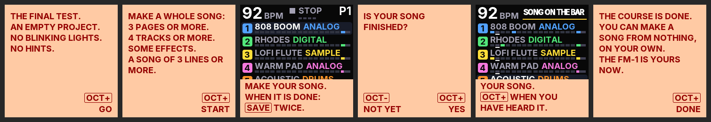

# Lesson 30: The final test

- **Part:** 4, make a song (the piece of the learner's own, and the end of the course)
- **The idea:** a whole song from nothing, with no lights and no hints.
- **The learner does:** starts from an empty project and makes a song: three pages or more, four tracks or more,
  some effects, a song of three lines or more. Then saves it.
- **Got it when:** the song exists, it is saved, and they made it alone. The learner is the judge: the lesson names
  the goal and does not hold anyone back.
- **Song:** none. An empty project with SLOOP's own starting sounds.
- **Style in the end:** the learner picks

## Steps

1. **Setup:** new project; page TRACKS
2. **Card:** _The final test / An empty project. / No blinking lights. / No hints.
   - **OCT+:** Go
3. **Card:** Make a whole song: / 3 pages or more. / 4 tracks or more. / Some effects. / A song that plays / 3 pages in a row.
   - **OCT-:** Cheat sheet → go to 4
   - **OCT+:** Next → go to 8
4. **Card:** _Your first beat / Play, stop: [PLAY]. / Pick a drum: play its key. / Boxes: [SEQ] + a key. / Tempo: [SELECT]. / Undo: [EDIT] + [OCT-]. / Mute: [GLO] + [1] to [5].
   - **OCT-:** Back → go to 3
   - **OCT+:** Next
5. **Card:** _Notes and chords / Track: [ALGORITHM]. / Sound: [PRESETS]. / Record live: [REC]. / Key and chords: [SEL]. / Piano roll: [SEQ] twice. / Level: [KNOB2].
   - **OCT-:** Back → go to 4
   - **OCT+:** Next
6. **Card:** _Effects and sound / Effects: hold [FX] + a key. / Filter: [FX] + [KNOB1]. / Echo, reverb: [FX]. / Fill: [GLO] + [12]. / Wobble: [LFO]. / Arpeggio: [ARP].
   - **OCT-:** Back → go to 5
   - **OCT+:** Next
7. **Card:** _Make a song / Page: [SAVE] + a key. / Copy: [SAVE], hold a key. / SONG page: [SAVE]. / Chain: [15]. / Record a song: [14]. / Play the song: [13].
   - **OCT-:** Back → go to 6
   - **OCT+:** Next
8. **Card:** When your song is done, / press [SAVE] twice. // The corner of the / screen reminds you: / [SAVE] x2
   - **OCT+:** Start
9. **Strip corner:** [SAVE] x2
   - **Until:** pressed SAVE twice
   - **Robot:** press SEQ, tap A3, hold SEQ, tap box 1 5, let go, turn ALGORITHM right 1, tap A4, hold SEQ, tap box 3, let go, turn ALGORITHM right 1, tap C5, hold SEQ, tap box 1, let go, turn ALGORITHM right 2, tap box 1, hold SEQ, tap box 1 5 9 13, let go, press HOME, hold SAVE, long box 2, let go, wait 2, hold SAVE, long box 3, let go, wait 2, press SAVE, wait 0.8, turn SELECT right 1, turn KNOB 4 right 3, wait 0.3, press HOME, wait 0.6, press SAVE twice, wait 1.5
10. **Card:** Is your song finished? // The goal: 3 pages, / 4 tracks, some effects, / and 3 pages in a row. // You decide.
    - **OCT-:** Not yet → go to 3
    - **OCT+:** Yes
11. **Setup:** song mode on; play
12. **Strip:** Your song. / [OCT+] when it's done.
    - **OCT+:** Done
13. **Setup:** stop
14. **Card:** The course is done. // Now you can make / a song from nothing, / on your own. // The FM-1 is yours now.
    - **OCT+:** Done

## Screens

The lesson's cards and strips in order, from the robot's run on the simulated FM-1.

## Notes for Claude

- Help only when asked, and then with a question back before an answer.
- Step 5 ends on the learner's own two quick taps of SAVE. Copying a page also saves, and that does not end it.
- The lesson checks nothing. The question card names the goal (three pages, four tracks, a song of three lines)
  and the learner says whether the song is finished. A YES is taken as it is, and the course's last card
  congratulates either way. Claude can listen in step 8 and say one true thing about the song.
- The empty project has SLOOP's own starting sounds and a tempo of 92. Choosing sounds and a tempo is part of the
  test.
- With an empty project, REC pressed while stopped starts SLOOP's free take, which sets the tempo from what is
  played. A fine way to begin, if the learner finds it.
- If the learner is not ready for this, the three "your own" lessons (7, 15 and 23) are the practice.

## Tester notes

- **2026-11-20, the strip while the song is made:** "for the final lesson I think we should try to minimize the
  real estate we are taking up maybe just the top left corner [save]x2". The strip was three lines over the dials
  for the whole of the song-making. Changed the same day: step 5 is a **Strip corner**, a small tag `[SAVE] X2` in
  the top left corner, and a new card before it (step 4) says what the tag means. The tag hides the tempo, or the
  page's name on STEPS, SONG, KEY and SOUNDS. Whether it should sit top right instead (it would hide `P1` or the
  small print) is the tester's call: `tutorial/lesson-30-corner-tag.png` shows both. The new card's words are a
  first draft.
- **2026-11-20, the copy again:** in the middle of the song-making the tester asked "how do I copy a part from 1
  to 2?" It is the second time (see lesson 23's note): the move from lesson 16, hold SAVE and hold a white key
  until the top says COPY, does not stick. Lesson 30 gives no hints on purpose, so the place to fix it is before:
  the copy as a step of its own in lesson 23, and perhaps once more in part 4 (lessons 25 to 27).
- **2026-11-20, erasing a track:** also asked while making the song: "how do I delete a whole track?" The move
  (REC held for two seconds) is only met in lesson 29, as the way to wreck the drums, never as a tool. A card or
  a step for it earlier (lesson 10, next to undo) would put it in the learner's hands.
- **2026-11-20, shut in on the question card:** after SAVE twice the card `IS YOUR SONG FINISHED?` came up, the
  song had no chain yet, and neither answer worked: "I can't get back to sloop. It just keeps telling me that my
  song isn't finished. I need to chain my pages but its blocking me from seeing the UI", "when I press Oct-
  nothing happens". The log shows 20 rounds of the card and its `STILL NEEDED` hint.
  - The fault: an `Until` on a card holds back both answers, `NOT YET → go to 5` included. The lesson program had
    to be stopped to get out. Nothing was lost: the song stayed on the FM-1.
  - The tester on the ending: "I also don't think we want to end like this. We can tell them what the goal was
    but we need to give them the option to finish and then we want to congratulate them even if they didn't
    finish the song."
  - Changed the same day: the card names the goal and holds nobody back (`IS YOUR SONG FINISHED? / THE GOAL WAS
    3 PAGES, 4 TRACKS AND A SONG OF 3 LINES. / YOU DECIDE.`, NOT YET goes back to the song, YES goes on). The
    song then plays (with no chain, the page that is up loops) and the last card congratulates as before.
    `tutorial/check.py` now refuses an `Until` on a card with two answers.
- **2026-11-20, "a song of 3 lines":** "when it says a song of 3 lines what does that mean?" The word LINES comes
  from lesson 26 (a line is a page and a number of bars) and did not stick; the tester's own word for it was "chain
  my pages". Proposed for the two cards: `A SONG: 3 PAGES IN A ROW, OR MORE.` in place of `A SONG OF 3 LINES OR
  MORE.` Not changed yet.
- **2026-11-20, the new ending on the real FM-1:** played the same day with the tester's own song (3 pages, 5
  tracks, a song of 3 lines; the lesson was started once without its new project so the song stayed). SAVE twice,
  the question card, YES, the song played, `THE COURSE IS DONE`, `LESSON 30 DONE`: no fault. With the firmware of
  before this day the corner tag showed as a one-line strip along the bottom. With this the tester has played
  all thirty lessons on the real FM-1.

2026-11-20, the round from the notes ("go back and make adjustment based on all of the notes").

- The goal reads `A SONG: 3 PAGES IN A ROW, OR MORE.` (and on the question card `A SONG OF 3 PAGES IN A ROW`).
- The tag stays in the top left corner, as built: the question of the corner was not answered.
- Copying a page is its own step in lesson 23 now, and erasing a track is taught in lesson 10.
